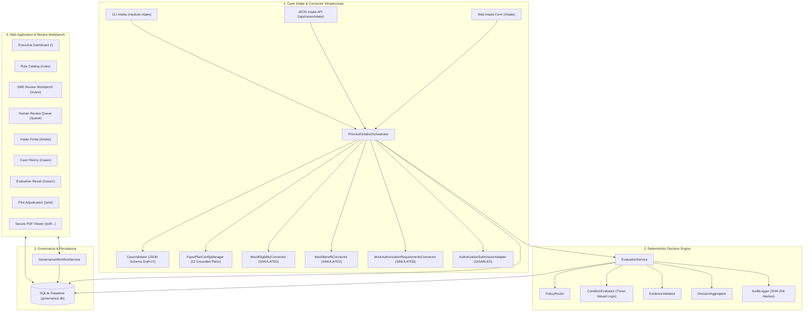

# MedRule Deterministic Decision Engine, Governance Workflow & Integrated Prior-Authorization Application — Phase 3F Release Candidate (v1.0.0-rc1)

The **MedRule Decision Engine** is a deterministic, policy-based prior authorization decision support system. It evaluates structured patient clinical requests against audited, machine-readable clinical guidelines across nine medical domains without calling large language models (LLMs), generative AI, probabilistic inference, or trained neural weights.

> [!IMPORTANT]
> **PHASE 3F RELEASE CANDIDATE — LOCAL EVALUATION & NON-BINDING ONLY**  
> All 372 extracted clinical policy rules remain in `DRAFT` (322 rules) or `NEEDS_HUMAN_REVIEW` (50 rules) status. Exactly **zero rules (0 / 372)** are marked `APPROVED`. All evaluations across all domains and pilot cases strictly enforce `is_binding: false`. All external payer integrations operate in simulated (`MOCK`) mode, and outbound prior-authorization transmission is permanently disabled (`DISABLED`).

---

## 1. System Architecture

The MedRule system unites a deterministic decision engine with an intake pipeline, simulated payer connectors, and an append-only, role-governed clinical review workbench:



### Module Responsibilities
- [`integrations/intake_service.py`](file:///c:/Users/KumarShiva/Downloads/PreAuth/medrule_engine/integrations/intake_service.py): Coordinates the 10-stage prior-auth intake workflow from schema validation to simulated connectors, deterministic evaluation handoff, and SQLite persistence.
- [`integrations/plan_configuration.py`](file:///c:/Users/KumarShiva/Downloads/PreAuth/medrule_engine/integrations/plan_configuration.py): Grounded payer and plan configuration manager indexing 22 plan configurations.
- [`integrations/submission.py`](file:///c:/Users/KumarShiva/Downloads/PreAuth/medrule_engine/integrations/submission.py): Permanently disabled outbound authorization submission adapter.
- [`evaluation_service.py`](file:///c:/Users/KumarShiva/Downloads/PreAuth/medrule_engine/evaluation_service.py): Single-case and high-throughput batch evaluation orchestrator.
- [`condition_evaluator.py`](file:///c:/Users/KumarShiva/Downloads/PreAuth/medrule_engine/condition_evaluator.py): 7-state recursive three-valued logic engine (`TRUE`, `FALSE`, `UNKNOWN`).
- [`policy_router.py`](file:///c:/Users/KumarShiva/Downloads/PreAuth/medrule_engine/policy_router.py): Policy router enforcing line of business, plan dependencies, and cross-domain boundaries.
- [`rule_registry.py`](file:///c:/Users/KumarShiva/Downloads/PreAuth/medrule_engine/rule_registry.py): In-memory index of all 372 rules; enforces zero-approved governance gate.
- [`governance/database.py`](file:///c:/Users/KumarShiva/Downloads/PreAuth/medrule_engine/governance/database.py): Persistent SQLite datastore with schema migrations, foreign keys, transactions, case intake records, connector audit logs, and cryptographic SHA-256 event chaining.
- [`governance/workflow_service.py`](file:///c:/Users/KumarShiva/Downloads/PreAuth/medrule_engine/governance/workflow_service.py): Coordinates review submissions, side-by-side diffing, provenance re-validation, and prerequisite verification.
- [`web/app.py`](file:///c:/Users/KumarShiva/Downloads/PreAuth/medrule_engine/web/app.py): Local Flask web application providing the interactive dashboard, rule catalog, individual review workbench, intake portal, case history, case evaluation viewer, pilot workbench, and secure PDF viewer.
- [`cli.py`](file:///c:/Users/KumarShiva/Downloads/PreAuth/medrule_engine/cli.py): Unified CLI exposing structured subcommands: `evaluate`, `intake`, `serve`, `health`, and `pilot`.

---

## 2. Role-Based Access Control (RBAC) & Governance

The governance system defines four distinct clinical personas:

| Reviewer Role | Description | Allowed Controlled Actions |
|---|---|---|
| **`VIEWER`** | Quality auditor, read-only observer | Inspect rules, metadata, source quotes, diffs, and audit logs. Cannot modify records. |
| **`CLINICAL_SME_REVIEWER`** | Board-certified physician, radiologist, clinical specialist | `START_REVIEW`, `CONFIRM_INTERPRETATION`, `REQUEST_CORRECTION`, `NEEDS_ADDITIONAL_EVIDENCE`, `ESCALATE_TO_MEDICAL_DIRECTOR`, `FLAG_POLICY_CONFLICT`, `MARK_NOT_APPLICABLE_WITH_RATIONALE`, `RETURN_TO_DRAFT`. Cannot approve rules. |
| **`MEDICAL_DIRECTOR`** | Chief Medical Officer, Authorized Approver | All SME actions + **`APPROVE_RULE`** (strictly subject to all 8 approval prerequisites). |
| **`ADMINISTRATOR`** | Compliance & System Administrator | User management, configuration, workflow reset (`RETURN_TO_DRAFT`). Cannot approve rules without Medical Director credentials. |

---

## 3. Rule Review Lifecycle & The 8 Approval Prerequisites

### The 8 Mandatory Approval Prerequisites
A rule cannot be transitioned to `APPROVED` until **every** prerequisite passes:
1. **Source Version Verified**: Governing policy version status must be `current_2026_verified`.
2. **Structured Conditions Present**: Machine-readable condition criteria must exist and be populated.
3. **Interpretation Resolved**: Rule workflow status must be `READY_FOR_MEDICAL_DIRECTOR`.
4. **Dependencies Addressed**: All cross-document and plan-specific dependencies must be resolved without blockers.
5. **Schema Validation Passed**: Rule record must pass canonical Draft-07 JSON Schema validation.
6. **Prior Clinical SME Review Recorded**: At least one formal SME sign-off action must be recorded in history.
7. **Approver Authority**: Actor must have the `MEDICAL_DIRECTOR` role.
8. **Clinical Credentials Verified**: Approver must possess verified, active clinical credentials.

---

## 4. Local Web Application Startup & Usage

Start the integrated web application locally:

```bash
python -m medrule_engine.cli serve --host 127.0.0.1 --port 5000
```

The web server starts at `http://127.0.0.1:5000`:
- **Dashboard** (`/`): Real-time metrics across all 372 rules, 9 domains, intake cases, pilot adjudications, connector events, and safety invariants.
- **Case Intake** (`/intake`): Prior-authorization intake form pre-loaded with synthetic presets across all 9 domains and failure modes.
- **Case History** (`/cases`): Searchable, filterable history table of all submitted intake cases.
- **Case Evaluation View** (`/cases/<case_id>`): Criterion-level evaluation findings, simulated connector badges, source citations, and direct links to governing rules in the SME Workbench.
- **Rule Catalog** (`/rules`): Search and filter rules by domain, extraction status, and human-review flags.
- **Rule Review Workbench** (`/rules/<rule_id>`): Side-by-side verbatim source text, structured conditions, PDF viewer, proposed corrections diffing, and append-only audit trail.
- **Human Review Queue** (`/queue`): Prioritized queue of rules flagged for mandatory clinical review.
- **Proposed Corrections Queue** (`/corrections`): Pending rule correction proposals.
- **Pilot Adjudication** (`/pilot`): Adjudication dashboard and side-by-side comparison with clinical SME judgments.
- **Health & Invariant Audit** (`/health`): JSON health status reporting all safety invariants.

### Testing Review Personas in Development
The navigation bar includes an interactive **Reviewer Persona Switcher** tagged with `<span class="dev-badge">DEV ONLY</span>`:
- `Quality Auditor (Viewer)`: Read-only permissions and forbidden operation testing.
- `Dr. Sarah Chen, MD (Clinical SME)`: Imaging criteria reviews and proposed corrections.
- `Dr. James Wilson, MD (Clinical SME)`: Cardiology criteria reviews.
- `Dr. Eleanor Vance, MD (Medical Director)`: Prerequisite auditing and sign-off controls.
- `Governance Administrator`: Administrative workflow resets.

---

## 5. Security Hardening

1. **Path Traversal Sandboxing**: The `/pdf/<path:pdf_path>` route sanitizes incoming paths, rejecting `..`, encoded tokens (`%2e`), null bytes (`\x00`), and any path outside `REPO_ROOT`.
2. **Non-PDF Rejection**: Only files ending with `.pdf` can be served; requests for `.py`, `.json`, `.db`, or `.env` are rejected with HTTP 400.
3. **Security Headers**: All HTTP responses include `X-Content-Type-Options: nosniff`, `X-Frame-Options: SAMEORIGIN`, and a strict `Content-Security-Policy`.
4. **Input Schema Validation**: All case payloads submitted via web form, JSON API, or CLI are validated against `case_schema.json` using JSON Schema Draft-07.
5. **Connector Badging**: All simulated connectors are visually badged with amber `MOCK` labels, and the submission adapter is tagged `DISABLED`.

---

## 6. Unified CLI Usage

```bash
# Start local server
python -m medrule_engine.cli serve --port 5000

# Perform prior-auth intake
python -m medrule_engine.cli intake --case medrule_engine/examples/case_01_cardiology.json

# Evaluate structured case
python -m medrule_engine.cli evaluate --case medrule_engine/examples/case_01_cardiology.json

# Run health check and safety invariant audit
python -m medrule_engine.cli health

# Run pilot benchmark adjudication
python -m medrule_engine.cli pilot
```

---

## 7. Running the Test Suites

Run the dedicated Phase 3F End-to-End Integration Suite (25 tests):
```bash
python -m pytest medrule_engine/tests/test_phase3f_end_to_end.py -v
```

Run the Phase 3E intake and connector test suite (25 tests):
```bash
python -m pytest medrule_engine/tests/test_phase3e_intake_connectors.py -v
```

Run the Phase 3D pilot adjudication test suite (16 tests):
```bash
python -m pytest medrule_engine/tests/test_phase3d_pilot.py -v
```

Run the cumulative test suite across the entire MedRule repository (**246 passing tests, 10 skipped, 0 failures across 17 test suites**):
```bash
python -m pytest rulebook_collection/ medrule_engine/ -v
```

---

## 8. Release Candidate Documentation

For the complete release specification, performance benchmarks, and invariant audit report, see:
- [`RELEASE_CANDIDATE.md`](file:///c:/Users/KumarShiva/Downloads/PreAuth/medrule_engine/RELEASE_CANDIDATE.md)
- [`phase_3f_completion_report.md`](file:///c:/Users/KumarShiva/Downloads/PreAuth/rulebook_collection/manifests/phase_3f_completion_report.md)
