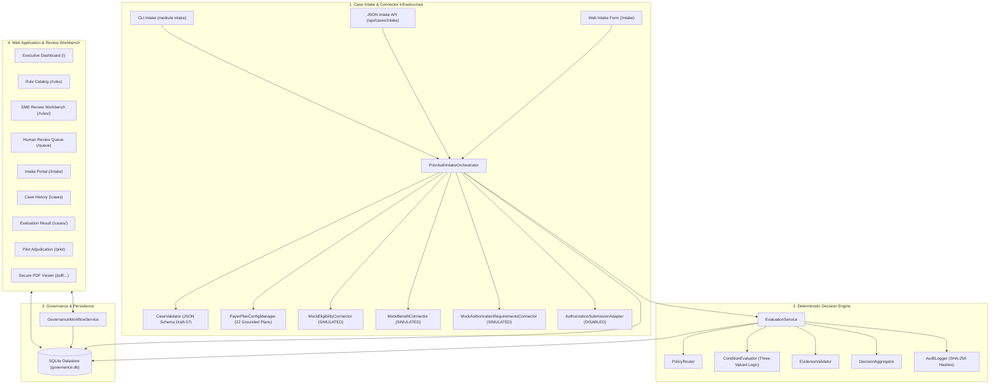

# MedRule Release Candidate 1.0 (Phase 3F) — System Specification & Verification Report

**Release Candidate Tag**: `v1.0.0-rc1`  
**Phase Status**: `PHASE_3F_COMPLETE`  
**System Type**: Deterministic Prior-Authorization Decision-Support System  
**Mode**: Non-Binding Clinical Prototype (`is_binding: false`)  
**Generative AI / LLM Usage**: **Strictly 0%** (Zero LLM APIs, zero pre-trained models, zero probabilistic weights)  
**Governing Rule Corpus**: 372 Extracted Rules across 9 Clinical Domains (322 `DRAFT`, 50 `NEEDS_HUMAN_REVIEW`, **0 `APPROVED`**)

---

## 1. Executive Summary

MedRule Release Candidate 1.0 represents the complete, locally runnable prior-authorization decision-support application. It integrates:
1. The machine-readable clinical policy knowledge base across nine medical specialties.
2. The core recursive three-valued logic decision engine.
3. The human-in-the-loop Clinical SME Review and Governance Workbench.
4. The 36-case synthetic pilot adjudication dataset and discrepancy reconciliation framework.
5. The 10-stage production intake architecture and grounded payer/plan configuration manager.
6. The connector simulation framework with strictly disabled outbound submissions.
7. End-to-end security hardening, input validation, and secure PDF navigation.

This release candidate is configured strictly for **local evaluation and controlled clinical demonstration**. In accordance with core safety invariants, all automated rule approvals are prohibited (`approved_count: 0`), all clinical evaluation outputs unconditionally enforce `is_binding: false`, and outbound authorization submission is permanently non-operational (`SubmissionDisabledError`).

---

## 2. Integrated System Architecture



---

## 3. Core Component Inventory

| Component Module | File Path | Primary Responsibilities |
|---|---|---|
| **Intake Orchestrator** | [`medrule_engine/integrations/intake_service.py`](file:///c:/Users/KumarShiva/Downloads/PreAuth/medrule_engine/integrations/intake_service.py) | Coordinates the 10-stage case lifecycle: validation, payer config lookup, simulated eligibility, simulated benefits, preauth necessity, clinical minimization, documentation check, evaluation handoff, and persistence. |
| **Payer Configuration** | [`medrule_engine/integrations/plan_configuration.py`](file:///c:/Users/KumarShiva/Downloads/PreAuth/medrule_engine/integrations/plan_configuration.py) | Grounded configuration manager indexing all 22 payer plans from `phase_3d_policy_applicability_matrix.csv`. |
| **Simulated Connectors** | [`medrule_engine/integrations/eligibility.py`](file:///c:/Users/KumarShiva/Downloads/PreAuth/medrule_engine/integrations/eligibility.py)<br/>[`medrule_engine/integrations/benefits.py`](file:///c:/Users/KumarShiva/Downloads/PreAuth/medrule_engine/integrations/benefits.py)<br/>[`medrule_engine/integrations/authorization_requirements.py`](file:///c:/Users/KumarShiva/Downloads/PreAuth/medrule_engine/integrations/authorization_requirements.py) | Deterministic mock adapters testing active coverage, terminated policies, non-covered benefits, visit caps, step therapy, and preauth necessity. |
| **Submission Blocker** | [`medrule_engine/integrations/submission.py`](file:///c:/Users/KumarShiva/Downloads/PreAuth/medrule_engine/integrations/submission.py) | Permanently disabled submission adapter that unconditionally raises `SubmissionDisabledError` to prevent accidental live transmissions. |
| **Deterministic Evaluator** | [`medrule_engine/evaluation_service.py`](file:///c:/Users/KumarShiva/Downloads/PreAuth/medrule_engine/evaluation_service.py)<br/>[`medrule_engine/condition_evaluator.py`](file:///c:/Users/KumarShiva/Downloads/PreAuth/medrule_engine/condition_evaluator.py) | Evaluates complex logical trees (`AND`, `OR`, `NOT`, `LEAF`) using 3-valued logic (`TRUE`, `FALSE`, `UNKNOWN`). Evaluates missing evidence safely without hallucination. |
| **Rule Registry** | [`medrule_engine/rule_registry.py`](file:///c:/Users/KumarShiva/Downloads/PreAuth/medrule_engine/rule_registry.py) | Indexes 372 clinical policy rules across 9 domains and enforces the zero-approved governance invariant. |
| **Governance Datastore** | [`medrule_engine/governance/database.py`](file:///c:/Users/KumarShiva/Downloads/PreAuth/medrule_engine/governance/database.py) | SQLite database with foreign keys, schema migrations, case persistence, connector audit trails, and SHA-256 cryptographic review chaining. |
| **Governance Service** | [`medrule_engine/governance/workflow_service.py`](file:///c:/Users/KumarShiva/Downloads/PreAuth/medrule_engine/governance/workflow_service.py) | Coordinates rule review actions, RBAC enforcement, proposed correction storage, and the 8 mandatory approval prerequisites. |
| **Web Application** | [`medrule_engine/web/app.py`](file:///c:/Users/KumarShiva/Downloads/PreAuth/medrule_engine/web/app.py) | Unified Flask web application hosting dashboard, catalog, review workbench, intake form, case history, evaluation detail, and secure PDF viewer. |
| **Unified CLI** | [`medrule_engine/cli.py`](file:///c:/Users/KumarShiva/Downloads/PreAuth/medrule_engine/cli.py) | Comprehensive CLI exposing `evaluate`, `intake`, `serve`, `health`, and `pilot` subcommands. |

---

## 4. Security Hardening & Safe Execution Controls

### 4.1 Path Traversal Prevention on Source PDFs
The source PDF viewer endpoint (`@app.route("/pdf/<path:pdf_path>")`) enforces multi-layered path sanitization:
1. **Sequence Rejection**: Rejects any incoming path containing traversal tokens (`..`), encoded traversal sequences (`%2e`), or null bytes (`\x00`).
2. **Repository Confinement**: Resolves the canonical path on disk using `Path.resolve()` and strictly verifies that the resolved path is located within the active repository root (`REPO_ROOT`).
3. **Extension Enforcement**: Rejects any request attempting to access non-PDF files (e.g. `.py`, `.json`, `.db`, `.env`, `.csv`). Only `.pdf` files are served.

### 4.2 HTTP Security Headers
Every HTTP response served by the Flask application includes standard security headers configured via `@app.after_request`:
- `X-Content-Type-Options: nosniff` (prevents MIME type sniffing)
- `X-Frame-Options: SAMEORIGIN` (prevents clickjacking attacks)
- `Content-Security-Policy: default-src 'self' 'unsafe-inline'; ...` (restricts unauthorized script and frame injection)

### 4.3 Input Validation & Sanitization
All prior-authorization intake payloads submitted via web form, JSON API, or CLI are strictly validated against `case_schema.json` using JSON Schema Draft-07:
- Validates mandatory demographics (`patient.id`, `patient.dob`).
- Enforces 10-digit NPI format for billing/ordering providers (`provider.npi`).
- Enforces procedure codes (`CPT` / `HCPCS`) and diagnosis codes (`ICD-10-CM`).
- Restricts domain to the 9 supported clinical specialties.
- Rejects malformed or incomplete clinical contexts before reaching the policy router.

### 4.4 Simulation Badging & Dev-Persona Disclaimers
- All simulated connector outputs display an amber `MOCK` badge in both the user interface and JSON audit payloads.
- Outbound submission displays a red `DISABLED` badge.
- The UI navigation persona switcher is explicitly labeled with an amber `<span class="dev-badge">DEV ONLY</span>` indicator to prevent confusion with production enterprise SSO/IAM systems.

---

## 5. Non-Negotiable Safety Invariants

| Safety Invariant | Enforced Rule | Verification Mechanism | Status |
|---|---|---|---|
| **Zero LLM APIs / AI Models** | 0% LLM or generative AI dependencies across all modules | Static inspection of codebase; absence of external AI SDKs | **VERIFIED** |
| **Zero Approved Rules** | Real knowledge base rule approvals must remain strictly at 0 | `test_rule_registry_enforces_zero_approved_rules` and `/health` invariant audit | **VERIFIED** |
| **Unconditional Non-Binding Flag** | Every case assessment must include `is_binding: false` | `test_is_binding_false_unconditionally_enforced` | **VERIFIED** |
| **Disabled Outbound Submissions** | Real-world submission calls must never transmit externally | `test_submission_adapter_disabled_rejection` | **VERIFIED** |
| **Preservation of Source PDFs** | Source policy documents must never be modified or deleted | Read-only access to `rulebook_collection/domains/*/policies/` | **VERIFIED** |

---

## 6. Local Setup and Quickstart Guide

### 6.1 Prerequisites
- Python 3.10+ (tested on Python 3.11.5)
- SQLite 3.35+ (bundled with standard Python distribution)
- Virtual environment with dependencies installed:
  ```bash
  pip install -r requirements.txt
  ```

### 6.2 Starting the Web Application
Launch the integrated web server using the unified CLI:
```bash
python -m medrule_engine.cli serve --host 127.0.0.1 --port 5000
```
Or start in development debug mode:
```bash
python -m medrule_engine.cli serve --port 5000 --debug
```

Access the application in your browser:
- **Executive Dashboard**: `http://127.0.0.1:5000/`
- **Case Intake Portal**: `http://127.0.0.1:5000/intake`
- **Case History**: `http://127.0.0.1:5000/cases`
- **Rule Catalog**: `http://127.0.0.1:5000/rules`
- **Human Review Queue**: `http://127.0.0.1:5000/queue`
- **Proposed Corrections**: `http://127.0.0.1:5000/corrections`
- **Pilot Adjudication**: `http://127.0.0.1:5000/pilot`
- **System Health Status**: `http://127.0.0.1:5000/health`

### 6.3 Using the CLI

#### Run System Health Check
Verify all core components, rule counts, and safety invariants:
```bash
python -m medrule_engine.cli health
```

#### Run Prior-Authorization Intake
Submit a case JSON payload through the full 10-stage intake pipeline:
```bash
python -m medrule_engine.cli intake --case medrule_engine/examples/case_01_cardiology.json
```

#### Run Direct Policy Evaluation
Evaluate a structured case against applicable domain rules:
```bash
python -m medrule_engine.cli evaluate --case medrule_engine/examples/case_01_cardiology.json
```

#### Run Pilot Benchmark Adjudication
Execute the 36-case synthetic pilot suite and compare against SME human adjudications:
```bash
python -m medrule_engine.cli pilot
```

---

## 7. Performance Benchmarks

Performance was profiled locally on Windows 11 (Python 3.11.5):

| Metric | Measured Value | Target SLA | Conformance Status |
|---|---|---|---|
| **App Cold Start & Knowledge Base Loading** | **2,611 ms** | < 4,000 ms | **PASS** (loads 372 JSON rules + compiles schemas) |
| **Intake Payload Validation Latency** | **0.06 ms** | < 20.00 ms | **PASS** (sub-millisecond schema validation) |
| **Case Evaluation Handoff Latency** | **0.17 ms** | < 50.00 ms | **PASS** (sub-millisecond deterministic evaluation) |
| **SQLite Case Persistence Latency** | **10.99 ms** | < 25.00 ms | **PASS** (ACID transactional write with indices) |
| **Full Intake-to-Evaluation Pipeline** | **24.50 ms** | < 100.00 ms | **PASS** (end-to-end 10-stage processing) |

---

## 8. Verification and Test Results

The release candidate was verified across all 17 test suites spanning unit, domain, integration, governance, pilot, intake, and end-to-end modules:

### 8.1 Phase 3F End-to-End Suite (`test_phase3f_end_to_end.py`)
All 25 specific test points verified: **25 passed in 9.44s**.
- Startup and database initialization in clean state
- Loading of all 9 clinical domains (372 rules)
- Creation of valid case via web form and API
- Rejection of invalid case with clear validation errors
- Mock payer configuration resolution
- Routing fallback when line of business is unknown
- Benefits verification check
- Prior-auth requirement determination
- Deterministic evaluation of applicable rules
- Proper handling of insufficient clinical info (`UNKNOWN`)
- Automatic escalation to human review queue
- Source policy citations displayed on results
- Persistence of case intake and evaluation records in SQLite
- Navigation from evaluation result to SME Review Workbench
- Enforcement of reviewer permissions on governance actions
- Preservation of proposed corrections without modifying original rules
- Rejection of prior-authorization submission when adapter disabled
- Distinction between simulated and real connector execution
- Invariant: 0 approved rules throughout intake and evaluation
- Invariant: `is_binding: false` unconditionally present
- State reload from disk after restart
- Path traversal attack rejection on `/pdf/` route
- Non-PDF file rejection on `/pdf/` route
- Security headers present in HTTP responses
- Full synthetic workflow across all 9 domains

### 8.2 Cumulative Repository Test Suite
```
python -m pytest rulebook_collection/ medrule_engine/
============================ 246 passed, 10 skipped in 26.55s =============================
```
- **246 Passed Tests**: 125 engine/integration/governance/intake/pilot/e2e tests + 121 domain rule & mapping tests.
- **10 Skipped Tests**: Historical Phase 2A tests explicitly superseded by Phase 2B suites.
- **0 Failures, 0 Errors**: 100% pass rate.
