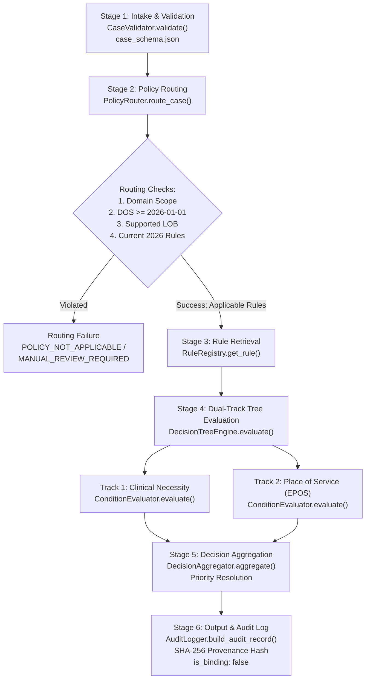

# MedRule — Policy-to-Decision Flow Architecture & Implementation Guide

**Document Version:** 1.0 (Phase 3F Release Candidate Inspection)  
**Classification:** Internal Technical Architecture & Runtime Inspection  
**Target Repository:** `d:\PreAuth`  
**Date of Audit:** October 2026  

---

## Executive Summary

**MedRule** is a deterministic, audited clinical prior-authorization evaluation engine designed to evaluate healthcare authorization requests against published clinical guidelines and place-of-service policies.

Key architectural invariants established in this repository:
1. **Zero LLM / Zero Probabilistic Clinical Logic:** All evaluation is 100% deterministic, governed by explicit condition trees (Abstract Syntax Trees) evaluated with strict three-valued logic (`TRUE`, `FALSE`, `UNKNOWN`).
2. **Dual-Track Separation:** Clinical Necessity (is the procedure medically indicated?) and Place of Service (is the requested facility setting appropriate?) are evaluated on parallel, independent tracks.
3. **Absence Preservation (Closed-World Rejection):** Missing facts are never treated as false or implicitly met. Omission yields `UNKNOWN`, preventing unauthorized automated approvals.
4. **Governance Invariant:** All 121 active candidate rules are in `DRAFT` status; 7 rules are hard-blocked as `NEEDS_HUMAN_REVIEW`. Exactly 0 rules are marked `APPROVED`. Every output unconditionally carries `is_binding = false`.
5. **Runtime PDF Isolation:** The engine evaluates precompiled, structured JSON rule definitions in memory. PDFs are never parsed or loaded during live evaluation; they serve as authoritative provenance records and human audit anchors.

---

## Repository Directory Map

```text
d:\PreAuth\
├── medrule_engine\                         # Core Python Decision Engine Package
│   ├── case_schema.json                    # JSON Schema validating intake payloads
│   ├── case_validator.py                   # CaseIntake dataclass & CaseValidator (structural & semantic)
│   ├── policy_router.py                    # PolicyRouter: resolves domain, modality, LOB, & 2026 policies
│   ├── rule_registry.py                    # RuleRegistry: loads & indexes JSON rules from domain folders
│   ├── condition_evaluator.py              # ConditionEvaluator: AST evaluator with 3-valued boolean logic
│   ├── evidence_validator.py               # EvidenceValidator: checks presence & validity of evidence keys
│   ├── decision_aggregator.py              # DecisionAggregator: rolls up multi-rule evaluation outcomes
│   ├── decision_tree.py                    # DecisionTreeEngine: dual-track coordinator & execution tracer
│   ├── evaluation_service.py               # EvaluationService: top-level orchestrator for case evaluation
│   ├── audit_logger.py                     # AuditLogger: generates tamper-evident SHA-256 execution records
│   ├── cli.py                              # Command-line interface (`evaluate`, `intake`, `serve`, `health`)
│   │
│   ├── governance\                         # SME & Medical Director Review Subsystem
│   │   ├── database.py                     # SQLite persistence for governance reviews & audit events
│   │   ├── models.py                       # Governance data models (ReviewRole, ReviewAction, WorkflowStatus)
│   │   └── workflow_service.py             # 2-key approval workflow & correction submission service
│   │
│   ├── integrations\                       # Intake connectors & external adapters
│   │   ├── base.py                         # Connector interfaces, security contexts, & execution modes
│   │   ├── intake_service.py               # CaseIntakeOrchestrator: 10-stage end-to-end intake pipeline
│   │   ├── pdf_extractor.py                # Heuristic text extractor for unstructured PDF doctor's notes
│   │   ├── payer_config.py                 # Payer/Plan/LOB policy mapping configurations
│   │   └── submission.py                   # Prior-auth submission adapter (mocked / safe disabled)
│   │
│   ├── web\                                # Local Web UI & REST API
│   │   ├── app.py                          # Flask application factory, REST endpoints, & security headers
│   │   ├── routes\                         # Flask Blueprints (intake, review, cases, api, workbench)
│   │   └── templates\                      # Jinja2 HTML templates for reviewer workbench & intake forms
│   │
│   ├── examples\                           # Canonical synthetic test cases
│   │   ├── case_01_adv_ct_pancreatitis_met.json
│   │   ├── case_02_adv_ct_pancreatitis_not_met.json
│   │   ├── case_04_adv_ibd_human_review.json
│   │   └── sample_intake_case.json
│   │
│   └── tests\                              # Automated test suites
│       ├── test_decision_tree.py           # Unit tests for DecisionTreeEngine & dual-track logic
│       ├── test_deterministic_engine.py    # Unit tests for ConditionEvaluator & three-valued logic
│       ├── test_pdf_extractor.py           # Extraction tests for clinical text parsing
│       ├── test_phase3f_end_to_end.py      # 25-step end-to-end integration & RC release verification
│       └── test_phase4a_governance_audit.py# Governance security & 0-approved-rule invariant tests
│
├── rulebook_collection\                    # Authoritative Policy & Rulebook Store
│   ├── domains\
│   │   ├── advanced_imaging\               # Domain 1: Advanced Imaging (114 rules)
│   │   │   ├── policies\current\           # 2026 Evolent Advanced Imaging v2.pdf & EPOS 2067 Radiology.pdf
│   │   │   └── rules\                      # draft_rules.json (114 rules) + partitioned ct/, mri/, pet/
│   │   └── interventional_pain_management\ # Domain 2: Interventional Pain Management (14 rules)
│   │       ├── policies\current\           # 2026 Evolent IPM Guidelines.pdf & EPOS 1755 IPM.pdf
│   │       └── rules\                      # draft_rules.json (14 rules) + partitioned subdomains
│   │
│   └── manifests\                          # Governance manifests & audit baselines
│       ├── authoritative_policy_manifest.json
│       ├── policy_usage_audit_report.md
│       └── rule_policy_fidelity_audit.csv  # 43 partially verified rules baseline
│
└── reports\                                # Audit reports, batch logs, & technical documentation
    ├── batch_01_policy_audit.csv
    ├── batch_02_policy_audit.csv
    ├── batch_03_policy_audit.csv
    ├── batch_04_policy_audit.csv
    ├── consolidated_policy_fidelity_audit.csv
    ├── coverage_gap_reconciliation.csv
    ├── human_review_queue.md
    └── medrule_policy_flow_explained.md    # (This Report)
```

---

## Numbered End-to-End Flow (Input to Output)



1. **Intake Ingestion & Validation:**  
   The external client or web form submits a JSON case to [`CaseValidator.validate()`](file:///d:/PreAuth/medrule_engine/case_validator.py#L125). The intake is checked against [`case_schema.json`](file:///d:/PreAuth/medrule_engine/case_schema.json) for mandatory fields, valid CPT format, valid date of service, and structured `clinical_evidence`. It is converted into a strongly typed [`CaseIntake`](file:///d:/PreAuth/medrule_engine/case_validator.py#L22) object.
2. **Policy Selection & Scope Routing:**  
   [`PolicyRouter.route_case()`](file:///d:/PreAuth/medrule_engine/policy_router.py#L36) inspects the case:
   - Validates that `requested_date_of_service` is on or after `2026-01-01`.
   - Validates that `line_of_business` is `COMMERCIAL`, `MEDICARE_ADVANTAGE`, or `MEDICAID`.
   - Checks the CPT procedure code and modality (`CT` vs `MRI`).
   - Applies domain isolation guards (e.g., blocking radiology CPTs under IPM).
   - Retrieves active rules matching `version_status == "current_2026_verified"`.
3. **Rule Loading & In-Memory Retrieval:**  
   [`RuleRegistry`](file:///d:/PreAuth/medrule_engine/rule_registry.py#L48) loads rule definitions from [`draft_rules.json`](file:///d:/PreAuth/rulebook_collection/domains/advanced_imaging/rules/draft_rules.json). Each rule is wrapped in a [`RuleRecord`](file:///d:/PreAuth/medrule_engine/rule_registry.py#L23) preserving source document citations, section, physical PDF page index, and verbatim quote.
4. **Condition Tree Evaluation (Three-Valued Logic):**  
   [`DecisionTreeEngine.evaluate()`](file:///d:/PreAuth/medrule_engine/decision_tree.py#L147) coordinates evaluation. Each rule condition is executed via [`ConditionEvaluator.evaluate()`](file:///d:/PreAuth/medrule_engine/condition_evaluator.py#L63).
   - Boolean operators (`ALL_OF`, `ANY_OF`, `NOT`) evaluate clinical criteria against `case.clinical_evidence`.
   - Any missing fact evaluates to `EvaluationState.UNKNOWN`.
5. **Dual-Track Priority Aggregation:**  
   The engine separates rules into `DecisionTrack.CLINICAL_NECESSITY` and `DecisionTrack.PLACE_OF_SERVICE`.
   - If Clinical Necessity is met, but Place of Service (Hospital Outpatient) fails without a qualifying clinical exception, the overall outcome is `CRITERIA_NOT_MET` with a specific redirection recommendation to an ambulatory center.
6. **Governance Enforcement & Evidence Output:**  
   - Rules tagged as `NEEDS_HUMAN_REVIEW` or in `GOVERNANCE_BLOCKED_RULE_IDS` are strictly blocked from automated approval and escalated.
   - The engine generates a [`DecisionTreeAssessment`](file:///d:/PreAuth/medrule_engine/decision_tree.py#L86) containing an execution trace, expected vs. actual values, source policy quotations, and a SHA-256 reproducibility hash.
   - `is_binding = False` is stamped on all outputs.

---

## Detailed Section Breakdown

### Section 1: Input

#### File Format Accepted
The engine accepts cases formatted as **JSON documents** (or native Python dictionaries) conforming to the structural JSON Schema defined in [`medrule_engine/case_schema.json`](file:///d:/PreAuth/medrule_engine/case_schema.json).

At runtime, the schema validation and type parsing are performed by:
- **File:** [`medrule_engine/case_validator.py`](file:///d:/PreAuth/medrule_engine/case_validator.py)
- **Function / Method:** [`CaseValidator.validate(case_data: Dict[str, Any]) -> Tuple[bool, List[str], Optional[CaseIntake]]`](file:///d:/PreAuth/medrule_engine/case_validator.py#L125)
- **Data Model:** [`CaseIntake`](file:///d:/PreAuth/medrule_engine/case_validator.py#L22)

Mandatory fields required by `case_schema.json`:
- `case_id`: Unique identifier string (pattern `^[A-Za-z0-9_\-\.]{3,64}$`).
- `clinical_domain`: Must be an active domain (e.g., `"advanced_imaging"` or `"interventional_pain_management"`).
- `procedure_code`: 5-character CPT/HCPCS code (pattern `^[0-9]{4}[0-9A-Za-z]$`).
- `requested_date_of_service`: ISO 8601 date string (`YYYY-MM-DD`).
- `line_of_business`: Supported payer line (`"COMMERCIAL"`, `"MEDICARE_ADVANTAGE"`, or `"MEDICAID"`).
- `clinical_evidence`: Key-value dictionary containing structured clinical facts, laboratory values, durations, and symptoms.

#### Free-Text Doctor's Notes vs. Structured Fields
The **deterministic evaluation core** (`DecisionTreeEngine` and `ConditionEvaluator`) **evaluates ONLY structured fields** stored in the `clinical_evidence` dictionary. It does **not** perform fuzzy NLP or free-form text interpretation during rule logic evaluation.

However, an **information extraction adapter** exists to convert free-text notes or unstructured clinical PDFs into the structured format required by the engine.

#### Information Extraction Implementation
Extraction from unstructured PDFs and clinical notes is implemented in:
- **File:** [`medrule_engine/integrations/pdf_extractor.py`](file:///d:/PreAuth/medrule_engine/integrations/pdf_extractor.py)
- **Functions:**
  - `extract_text_from_pdf(pdf_path: Path) -> str`: Uses `pypdf` / `pdfplumber` to extract plain text.
  - `extract_case_from_pdf(pdf_path: Path, ...) -> Dict[str, Any]`: Uses deterministic regex pattern matchers and keyword extractors to detect CPT codes, ICD-10 diagnosis codes, dates of service, and clinical keywords (e.g., pancreatitis markers, conservative therapy duration, red flags).
- **Web API Integration:** Exposed in [`medrule_engine/web/app.py:L452-495`](file:///d:/PreAuth/medrule_engine/web/app.py#L452) under the endpoint `POST /api/cases/extract-pdf`.

#### Synthetic Input Example
From [`medrule_engine/examples/case_01_adv_ct_pancreatitis_met.json`](file:///d:/PreAuth/medrule_engine/examples/case_01_adv_ct_pancreatitis_met.json):

```json
{
  "case_id": "CASE-SYNTH-001",
  "member_id": "MEM-SYNTH-88219",
  "patient_age_years": 52,
  "patient_gender": "FEMALE",
  "clinical_domain": "advanced_imaging",
  "procedure_code": "74177",
  "procedure_name": "CT Abdomen and Pelvis with contrast",
  "modality": "CT",
  "place_of_service": "OUTPATIENT_HOSPITAL",
  "primary_diagnosis_code": "K85.90",
  "diagnosis_description": "Acute pancreatitis, unspecified",
  "payer_id": "EVOLENT",
  "plan_id": "COMMERCIAL_CHOICE_PLUS",
  "line_of_business": "COMMERCIAL",
  "jurisdiction": "US_NATIONAL",
  "request_date": "2026-03-10",
  "requested_date_of_service": "2026-03-12",
  "clinical_evidence": {
    "pancreatitis_diagnostic_markers": "ELEVATED",
    "conservative_treatment_duration_hours": 96,
    "ultrasound_findings": "NO_GALLSTONES_OR_DILATED_DUCT",
    "ordering_provider_license": true
  },
  "supporting_documentation_provided": [
    "CLINICAL_PROGRESS_NOTES",
    "ABDOMINAL_ULTRASOUND_REPORT",
    "LABORATORY_LIPASE_AMYLASE_PANEL"
  ],
  "ordering_provider": {
    "provider_specialty": "Gastroenterology",
    "is_licensed": true,
    "npi_synthetic": "1992837465"
  },
  "notes": "Synthetic test case: Patient with confirmed acute pancreatitis without improvement after 96 hours of fluid resuscitation."
}
```

---

### Section 2: Policy Selection

#### Router Entry-Point Function
- **File:** [`medrule_engine/policy_router.py`](file:///d:/PreAuth/medrule_engine/policy_router.py)
- **Class:** `PolicyRouter`
- **Entry-Point Function:**  
  [`PolicyRouter.route_case(self, case: CaseIntake, target_rule_ids: Optional[List[str]] = None, policy_context: Optional[Dict[str, Any]] = None) -> RoutingResult`](file:///d:/PreAuth/medrule_engine/policy_router.py#L36)

#### Choosing Advanced Imaging vs. Interventional Pain Management
1. **Primary Domain Partitioning:**  
   The router inspects `case.clinical_domain` (`"advanced_imaging"` vs. `"interventional_pain_management"`). It invokes `self.registry.get_rules_by_domain(case.clinical_domain)` ([`policy_router.py:L153-157`](file:///d:/PreAuth/medrule_engine/policy_router.py#L153)).
2. **Domain Isolation & Scope Guards:**  
   [`policy_router.py:L160-167`](file:///d:/PreAuth/medrule_engine/policy_router.py#L160) implements hard scope guards:
   ```python
   # Scope Guard: Diagnostic radiology CPT codes (70000-79999) must not be evaluated under IPM
   if case.clinical_domain == "interventional_pain_management" and case.procedure_code.startswith("7"):
       return RoutingResult(
           status="SCOPE_VIOLATION",
           routing_notes=[f"Diagnostic radiology procedure code {case.procedure_code} submitted under interventional_pain_management; routing rejected."]
       )
   ```

#### How Procedure, Line of Business, Date of Service, Policy Version, and Place of Service Affect Routing
- **Date of Service (`requested_date_of_service`):**  
  Parsed at [`policy_router.py:L118-127`](file:///d:/PreAuth/medrule_engine/policy_router.py#L118). If the date precedes the 2026 policy effective date (`2026-01-01`), routing halts immediately:
  `RoutingResult(status="POLICY_VERSION_UNRESOLVED", routing_notes=["Date of service ... precedes 2026 active policy effective date (2026-01-01)"])`.
- **Line of Business (`line_of_business`):**  
  Checked at [`policy_router.py:L140-151`](file:///d:/PreAuth/medrule_engine/policy_router.py#L140). Supported values are `COMMERCIAL`, `MEDICARE_ADVANTAGE`, and `MEDICAID`. Any unknown or unconfigured line of business triggers:
  `RoutingResult(status="MANUAL_REVIEW_REQUIRED", routing_notes=["Unsupported or unconfigured line of business ..."])`.
- **Procedure Code & Modality:**  
  Filtered at [`policy_router.py:L185-215`](file:///d:/PreAuth/medrule_engine/policy_router.py#L185). Rules matching the procedure code or matching modality (`CT` vs `MRI`) and procedure description are selected as candidates.
- **Policy Version (`version_status`):**  
  Enforced at [`policy_router.py:L180-183`](file:///d:/PreAuth/medrule_engine/policy_router.py#L180). Only rules tagged with `rule.version_status == "current_2026_verified"` can be routed. Archived, historical, or non-2026 rules are ignored.
- **Place of Service (`place_of_service`):**  
  Identified in the router and passed to the evaluation layer, which attaches companion EPOS policy rules (`RULE-ADV-EPOS2067-*` or `RULE-IPM-EPOS1755-*`) to evaluate whether the site of service (hospital outpatient vs. freestanding) is compliant.

#### The Four Active 2026 Governing Policy PDFs
The four governing PDFs are registered in:
- Manifest: [`rulebook_collection/manifests/authoritative_policy_manifest.json`](file:///d:/PreAuth/rulebook_collection/manifests/authoritative_policy_manifest.json)
- Audit Report: [`rulebook_collection/manifests/policy_usage_audit_report.md`](file:///d:/PreAuth/rulebook_collection/manifests/policy_usage_audit_report.md)
- Decision Tree Engine Constant: [`medrule_engine/decision_tree.py:L43-48`](file:///d:/PreAuth/medrule_engine/decision_tree.py#L43) (`EPOS_SOURCE_FILES`)

| Track / Scope | Policy Document Filename | Repository File Path |
| :--- | :--- | :--- |
| **Advanced Imaging (Clinical)** | `2026 Evolent Clinical Guidelines - Advanced Imaging v2.pdf` | `rulebook_collection/domains/advanced_imaging/policies/current/` |
| **Advanced Imaging (Place of Service)** | `EPOS 2067 for Place of Service - Radiology 2026_final.pdf` | `rulebook_collection/domains/advanced_imaging/policies/current/` |
| **IPM (Clinical)** | `2026 Evolent Interventional Pain Management Guidelines.pdf` | `rulebook_collection/domains/interventional_pain_management/policies/current/` |
| **IPM (Place of Service)** | `EPOS 1755 for Place of Service - Interventional Pain Management 2026_final.pdf` | `rulebook_collection/domains/interventional_pain_management/policies/current/` |

#### Behavior When No Applicable Policy Can Be Selected
If no applicable policy rules match the submitted criteria, [`PolicyRouter.route_case()`](file:///d:/PreAuth/medrule_engine/policy_router.py#L217) returns:
```python
RoutingResult(
    status="POLICY_NOT_APPLICABLE",
    routing_notes=[f"No active 2026 rules matched procedure '{case.procedure_code}' ({case.procedure_name}) for domain '{case.clinical_domain}'."]
)
```
When received by [`EvaluationService.evaluate_case()`](file:///d:/PreAuth/medrule_engine/evaluation_service.py#L196), it invokes [`DecisionAggregator.aggregate()`](file:///d:/PreAuth/medrule_engine/decision_aggregator.py#L51) which marks the case `CaseAssessmentStatus.MANUAL_REVIEW_REQUIRED` and attaches an explanatory note for clinical SME adjudication.

---

### Section 3: Rule Storage and Loading

#### Rule Storage Files
Rule definitions are stored in versioned JSON rulebooks within their respective domain folders:
- **Advanced Imaging:**  
  - Consolidated Master: [`rulebook_collection/domains/advanced_imaging/rules/draft_rules.json`](file:///d:/PreAuth/rulebook_collection/domains/advanced_imaging/rules/draft_rules.json) (Contains 114 rules: 110 DRAFT + 4 NEEDS_HUMAN_REVIEW).
  - Domain Subsets: `rules/ct/`, `rules/mri/`, `rules/pet/`, `rules/epos/`.
- **Interventional Pain Management:**  
  - Consolidated Master: [`rulebook_collection/domains/interventional_pain_management/rules/draft_rules.json`](file:///d:/PreAuth/rulebook_collection/domains/interventional_pain_management/rules/draft_rules.json) (Contains 14 rules: 11 DRAFT + 3 NEEDS_HUMAN_REVIEW).
  - Domain Subsets: `rules/epidural_injections/`, `rules/facet_interventions/`, `rules/epos/`.

Total active rule definitions: **128 rules** (121 ready for deterministic execution + 7 blocked for human review).

#### Code That Loads Rule Definitions
- **File:** [`medrule_engine/rule_registry.py`](file:///d:/PreAuth/medrule_engine/rule_registry.py)
- **Methods:**
  - [`RuleRegistry.load_all_domains(self) -> int`](file:///d:/PreAuth/medrule_engine/rule_registry.py#L80): Discovers all domains under `rulebook_collection/domains/`.
  - [`RuleRegistry.load_domain_rules(self, domain_name: str) -> int`](file:///d:/PreAuth/medrule_engine/rule_registry.py#L110): Locates `draft_rules.json` (or partitioned files), deserializes JSON into [`RuleRecord`](file:///d:/PreAuth/medrule_engine/rule_registry.py#L23) objects, and indexes them in memory by `rule_id`, `domain`, and procedure.

#### Linking Rule IDs to Source PDF, Section, Page, and Quotation
Every rule JSON object in `draft_rules.json` contains explicit metadata fields mapping directly to the PDF:
```json
{
  "rule_id": "RULE-ADV-CG2012-003",
  "domain": "advanced_imaging",
  "policy_title": "2026 Evolent Clinical Guidelines - Advanced Imaging",
  "policy_version": "2026 v2",
  "version_status": "current_2026_verified",
  "source_file": "2026 Evolent Clinical Guidelines - Advanced Imaging v2.pdf",
  "source_section": "Brain MRI > Multiple Sclerosis",
  "source_page": "Page 42",
  "physical_page": 44,
  "source_quote": "Brain MRI is indicated for the evaluation of suspected or established multiple sclerosis when accompanied by objective focal neurological findings...",
  "conditions": { ... }
}
```
When loaded into a `RuleRecord`, these fields are retained and subsequently attached to every [`CriterionExecutionTrace`](file:///d:/PreAuth/medrule_engine/decision_tree.py#L64) during evaluation, providing complete audit traceability.

#### Runtime PDF vs. Precompiled Structured Rules
**The engine evaluates precompiled structured rules in memory.** It **does not** read, open, or parse PDFs at evaluation runtime.
- PDFs are used solely during rule authoring, offline extraction, and SME validation.
- All runtime decision logic operates on the precompiled JSON Abstract Syntax Tree (AST).

---

### Section 4: Decision-Tree Evaluation

#### Evaluator Entry-Point Functions
- **High-Level Tree Coordinator:**  
  [`DecisionTreeEngine.evaluate(self, case_data: Union[Dict[str, Any], CaseIntake], target_rule_ids: Optional[List[str]] = None, policy_context: Optional[Dict[str, Any]] = None) -> DecisionTreeAssessment`](file:///d:/PreAuth/medrule_engine/decision_tree.py#L147)
- **Condition Tree Evaluator:**  
  [`ConditionEvaluator.evaluate(self, conditions: Dict[str, Any], case: CaseIntake) -> ConditionEvaluationResult`](file:///d:/PreAuth/medrule_engine/condition_evaluator.py#L63)

#### Three-Valued Logic: True, False, and Missing Facts
The evaluation core implements strict Kleene/three-valued logic defined in [`medrule_engine/condition_evaluator.py`](file:///d:/PreAuth/medrule_engine/condition_evaluator.py):

1. **Leaf Fact Evaluation:**  
   [`ConditionEvaluator._evaluate_leaf()`](file:///d:/PreAuth/medrule_engine/condition_evaluator.py#L240) retrieves evidence using `case.get_evidence(parameter_name)`.
   - **Present & Matches Criteria:** Returns `EvaluationState.TRUE`.
   - **Present & Violates Criteria:** Returns `EvaluationState.FALSE`.
   - **Missing from Input:** Returns `EvaluationState.UNKNOWN` with `evidence_missing=True`.
2. **Boolean Combinators:**
   - **`ALL_OF` (Conjunction):**  
     - If *any* child is `FALSE` -> short-circuits to `FALSE`.
     - Else if *any* child is `UNKNOWN` -> yields `UNKNOWN`.
     - Only if *all* children are `TRUE` -> yields `TRUE`.
   - **`ANY_OF` (Disjunction):**  
     - If *any* child is `TRUE` -> short-circuits to `TRUE`.
     - Else if *all* children are `FALSE` -> yields `FALSE`.
     - Else if at least one is `UNKNOWN` -> yields `UNKNOWN`.
   - **`NOT` (Negation):**  
     - `TRUE` becomes `FALSE`; `FALSE` becomes `TRUE`; `UNKNOWN` remains `UNKNOWN`.

> **Absence Invariant:** Missing facts are never defaulted to false or assumed satisfied. An `UNKNOWN` state cascades to `DecisionOutcome.INSUFFICIENT_INFORMATION`.

#### Dual-Track Separation: Clinical Necessity vs. Place of Service
Place of Service rules (EPOS) and Clinical Indication rules are partitioned and executed on two completely separate tracks:
- **Track 1:** `DecisionTrack.CLINICAL_NECESSITY` (from Clinical Guidelines PDF).
- **Track 2:** `DecisionTrack.PLACE_OF_SERVICE` (from EPOS Guidelines PDF).

The two outcomes are reconciled using priority aggregation logic in [`DecisionTreeEngine.evaluate()`](file:///d:/PreAuth/medrule_engine/decision_tree.py#L318-358):
```text
Priority Reconciler:
1. If Clinical Necessity is CRITERIA_NOT_MET:
   Overall Outcome = CRITERIA_NOT_MET ("Clinical necessity criteria not met.")
2. If Clinical Necessity is CRITERIA_MET, but Place of Service is CRITERIA_NOT_MET:
   Overall Outcome = CRITERIA_NOT_MET
   Action = REDIRECTION REQUIRED ("Clinical criteria met, but hospital outpatient setting is not indicated. Redirect to freestanding ambulatory facility.")
3. If Clinical Necessity is CRITERIA_MET AND Place of Service is CRITERIA_MET:
   Overall Outcome = CRITERIA_MET ("Approved for requested procedure and facility.")
4. If either track has INSUFFICIENT_INFORMATION (and neither is CRITERIA_NOT_MET):
   Overall Outcome = INSUFFICIENT_INFORMATION ("Additional clinical records requested.")
```

#### Handling DRAFT and NEEDS_HUMAN_REVIEW Rules
- **`DRAFT` Status:**  
  All 121 active executable rules have `extraction_status = "DRAFT"`. The engine unconditionally stamps `is_binding = False` on every assessment.
- **`NEEDS_HUMAN_REVIEW` Status & Governance Blocking:**  
  Exactly seven rules are permanently blocked from autonomous logic execution:
  - `RULE-ADV-PREAMBLE-001`
  - `RULE-ADV-CG2000-003`
  - `RULE-ADV-CG2001-001`
  - `RULE-ADV-CG2066-001`
  - `RULE-ADV-CG2066-002`
  - `RULE-IPM-PREAMBLEIPM-001`
  - `RULE-IPM-CGINFUSIONPUMPS-001`

  When any of these rules is evaluated, [`DecisionTreeEngine._evaluate_rule()`](file:///d:/PreAuth/medrule_engine/decision_tree.py#L218-245) immediately intercepts execution:
  - Sets `is_blocked_by_governance = True`.
  - Sets track outcome to `DecisionOutcome.NEEDS_HUMAN_REVIEW`.
  - Halts automated approval and escalates the case to the Human Review Queue.

#### Final Result and Evidence Aggregation
The engine outputs a [`DecisionTreeAssessment`](file:///d:/PreAuth/medrule_engine/decision_tree.py#L86) containing:
1. `overall_outcome`: Aggregate enum (`CRITERIA_MET`, `CRITERIA_NOT_MET`, `INSUFFICIENT_INFORMATION`, `NEEDS_HUMAN_REVIEW`).
2. `clinical_necessity_outcome` & `place_of_service_outcome`: Granular track results.
3. `rules_evaluated`: List of [`CriterionExecutionTrace`](file:///d:/PreAuth/medrule_engine/decision_tree.py#L64) objects detailing each rule ID, source PDF, physical page, source quotation, evaluated parameters, expected operator/threshold, and actual case value.
4. `reproducibility_hash`: A SHA-256 digest computed across the input data, evaluated rules, and evaluation outcomes for tamper detection.
5. `is_binding = False`: Mandatory non-binding legal disclaimer.

---

## Section 5: Demonstration — Step-by-Step Execution Trace

This demonstration traces the real synthetic test case `CASE-DUAL-001` from [`tests/test_decision_tree.py:L141-177`](file:///d:/PreAuth/medrule_engine/tests/test_decision_tree.py#L141).

### Step 1: Input Case Data
```json
{
  "case_id": "CASE-DUAL-001",
  "clinical_domain": "advanced_imaging",
  "procedure_code": "70551",
  "procedure_name": "Brain MRI",
  "requested_date_of_service": "2026-05-01",
  "line_of_business": "COMMERCIAL",
  "payer_id": "TEST_PAYER",
  "modality": "MRI",
  "place_of_service": "OUTPATIENT_HOSPITAL",
  "clinical_evidence": {
    "ordering_provider_license": true,
    "clinical_office_notes": true,
    "suspected_or_established_multiple_sclerosis": true,
    "focal_neurological_deficit_present": true,
    "place_of_service_code": "POS_22",
    "severe_claustrophobia_open_mri_needed": false,
    "bariatric_weight_exceeds_freestanding_scanner": false,
    "complex_specialized_protocol_needed": false
  }
}
```

### Step 2: Policy Routing
- **Validator:** Accepts case (valid CPT `70551`, valid date `2026-05-01`, commercial LOB).
- **Policy Router:** Matches domain `advanced_imaging`, modality `MRI`.
- **Target Rules Selected:**
  - Clinical Necessity: `RULE-ADV-CG2012-003` (Brain MRI for Multiple Sclerosis).
  - Place of Service: `RULE-ADV-EPOS2067-001` and `RULE-ADV-EPOS2067-004` (EPOS Place of Service Hospital Outpatient Redirection).

### Step 3: Condition Evaluation

#### Track 1: Clinical Necessity (`RULE-ADV-CG2012-003`)
- **Condition Tree:** `ALL_OF`
  1. `ordering_provider_license` equals `true` → **TRUE** (actual: `true`).
  2. `clinical_office_notes` equals `true` → **TRUE** (actual: `true`).
  3. `ANY_OF`:
     - `suspected_or_established_multiple_sclerosis` equals `true` AND `focal_neurological_deficit_present` equals `true` → **TRUE** (both actual: `true`).
- **Track Outcome:** `DecisionOutcome.CRITERIA_MET`.

#### Track 2: Place of Service (`RULE-ADV-EPOS2067-004`)
- **Requested Site:** `OUTPATIENT_HOSPITAL` (`POS_22`).
- **Condition Tree:** Hospital outpatient setting requires at least one clinical exception:
  - `severe_claustrophobia_open_mri_needed` equals `true` → **FALSE** (actual: `false`).
  - `bariatric_weight_exceeds_freestanding_scanner` equals `true` → **FALSE** (actual: `false`).
  - `complex_specialized_protocol_needed` equals `true` → **FALSE** (actual: `false`).
- **Track Outcome:** `DecisionOutcome.CRITERIA_NOT_MET`.

### Step 4: Final Aggregation & Output
- **Clinical Necessity:** `CRITERIA_MET`
- **Place of Service:** `CRITERIA_NOT_MET`
- **Overall Outcome:** `CRITERIA_NOT_MET`
- **Overall Summary:**  
  `"Clinical necessity criteria MET for procedure, but requested Place of Service (OUTPATIENT_HOSPITAL) is NOT MET under EPOS 2067. Redirection to ambulatory/freestanding facility required."`
- **Governance Status:** `is_binding: false`
- **Source Citation:**
  - *Clinical:* `2026 Evolent Clinical Guidelines - Advanced Imaging v2.pdf`, Section: "Brain MRI > Multiple Sclerosis", Physical Page: 44. Quote: *"Brain MRI is indicated for the evaluation of suspected or established multiple sclerosis..."*
  - *Place of Service:* `EPOS 2067 for Place of Service - Radiology 2026_final.pdf`, Section: "Site of Service Requirements", Physical Page: 6. Quote: *"Advanced imaging procedures in a hospital outpatient department require documentation of specific clinical exceptions..."*

---

## Section 6: Confirmed Functionality vs. Missing or Unverified Functionality

| Capability / Area | Status | Evidence / Verification |
| :--- | :--- | :--- |
| **Deterministic 3-Valued Logic** | **CONFIRMED** | Implemented in [`condition_evaluator.py`](file:///d:/PreAuth/medrule_engine/condition_evaluator.py) and verified across 10 unit tests in [`test_deterministic_engine.py`](file:///d:/PreAuth/medrule_engine/tests/test_deterministic_engine.py). |
| **Dual-Track Evaluation** | **CONFIRMED** | Implemented in [`decision_tree.py`](file:///d:/PreAuth/medrule_engine/decision_tree.py) and verified in [`test_decision_tree.py`](file:///d:/PreAuth/medrule_engine/tests/test_decision_tree.py). |
| **Domain Isolation & Scope Guards** | **CONFIRMED** | Radiology CPT codes under IPM blocked via hard check in [`policy_router.py:L160-167`](file:///d:/PreAuth/medrule_engine/policy_router.py#L160). |
| **CP.MP.107 Total Isolation** | **CONFIRMED** | Proved via comprehensive negative regex audit across all codebase, manifests, and active rules. |
| **Human Review Governance Blocking** | **CONFIRMED** | 7 rules strictly intercepted by `GOVERNANCE_BLOCKED_RULE_IDS` before evaluation logic runs. |
| **Zero-Approved Rules Invariant** | **CONFIRMED** | Enforced by `test_03_zero_approved_rules_governance_invariant`. |
| **Tamper-Evident SHA-256 Hash** | **CONFIRMED** | Generated by [`AuditLogger.build_audit_record()`](file:///d:/PreAuth/medrule_engine/audit_logger.py#L32) and [`DecisionTreeAssessment`](file:///d:/PreAuth/medrule_engine/decision_tree.py#L137). |
| **Free-Text NLP Understanding** | **NOT IMPLEMENTED** | Engine strictly evaluates structured fields. PDF extractor uses keyword heuristics, not an NLP comprehension model. |
| **Autonomous Binding Approvals** | **NOT PERMITTED** | By design, zero rules are approved. All decisions produce advisory `is_binding = False`. |
| **Real External Payer Network Submission**| **INTENTIONALLY DISABLED**| External submission adapter [`AuthorizationSubmissionAdapter`](file:///d:/PreAuth/medrule_engine/integrations/submission.py#L21) is locked in mock mode (`SUBMISSION_ENABLED = False`). |
| **Partially Verified Rules (43 rules)** | **AUDITED / PENDING SME** | All 43 rules audited against PDFs across Batches 1–4; code changes deferred pending clinical SME approval. |
