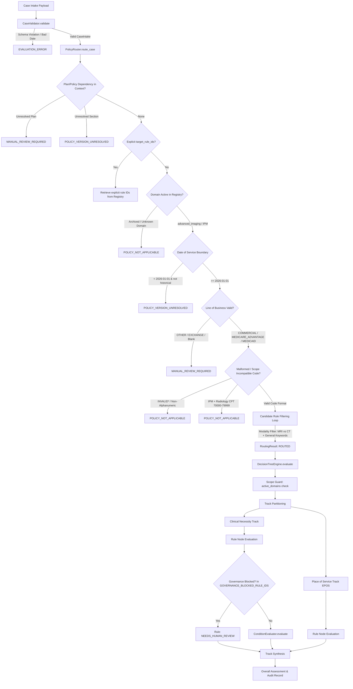

# MedRule — Phase 6: CPT Matching and Policy Routing Audit

**Date:** 2026-10-22  
**Audit Status:** Complete — Diagnostic Only  
**Branch / Commit:** Current Development Tree  
**Auditor:** Antigravity Deterministic Diagnostic Subsystem  
**Scope:** Active Domains Only (`advanced_imaging`, `interventional_pain_management`)  
**Deliverable:** `reports/phase_06_cpt_routing_audit.md`  

---

## 1. Executive Summary

Phase 6 executes a diagnostic-first audit of procedure code (CPT/HCPCS) matching, domain routing, and downstream evidence consumption across MedRule's active policy engine. The primary objective is to verify that procedure codes and clinical domains deterministically map to the correct active policy rules, and to guarantee that unsupported, ambiguous, or malformed cases never silently route to an incorrect policy or result in an automatic approval.

### Key Audit Findings

1. **Active Domain Isolation is Intact:**  
   Archived domains (`cardiology`, `musculoskeletal_surgery`, `radiation_oncology`, `sleep_health`, `centene_dme_orthotics_prosthetics`, `genetic_testing`) are strictly excluded from active routing. In all 6 archived domain test scenarios, `PolicyRouter` returned `POLICY_NOT_APPLICABLE` and `DecisionTreeEngine` halted at the domain scope gate without executing logic.
2. **Deterministic Governance Safety Safeguard Remains Active:**  
   Zero rules in the database or rule registry have `extraction_status = 'APPROVED'`. The 7 rules strictly blocked by governance (`RULE-ADV-PREAMBLE-001`, `RULE-ADV-CG2000-003`, `RULE-ADV-CG2001-001`, `RULE-ADV-CG2066-001`, `RULE-ADV-CG2066-002`, `RULE-IPM-PREAMBLEIPM-001`, `RULE-IPM-CGINFUSIONPUMPS-001`) successfully prevent automatic approvals across active evaluation. Every valid end-to-end case escalated deterministically to `NEEDS_HUMAN_REVIEW` or `MANUAL_REVIEW_REQUIRED`.
3. **Critical Routing Defect Discovered — Procedure Code is Never Matched to Rules:**  
   In `medrule_engine/policy_router.py` (lines 176–215), the variables `proc_code` and `proc_name` are extracted from the case intake, but **neither variable is ever referenced within the candidate rule filtering loop**. As a consequence:
   - For `advanced_imaging`, candidate rules are filtered **solely by `case.modality`** ("MRI" vs "CT") and general keywords ("general", "preamble", "place of service"). If `modality="MRI"`, all 50 MRI rules are returned; if `modality="CT"`, all 85 CT rules are returned; if `modality` is omitted, all 114 domain rules are returned.
   - For `interventional_pain_management`, where modalities are not MRI/CT, **all 14 rules in the domain are returned for every case**, regardless of the requested procedure.
4. **Keyword / Anatomical Collision Risk:**  
   Because rules do not validate `procedure_code` in their condition trees (0 of 128 active rules evaluate procedure codes), a request for **Knee MRI (CPT 73721)** containing clinical evidence of lumbar radiculopathy evaluated to **`CRITERIA_MET` under Lumbar Spine MRI rule `RULE-ADV-CG2037-001`**. In end-to-end evaluation, an autonomous approval is currently averted only because the domain-wide preamble rule (`RULE-ADV-PREAMBLE-001`) triggers a governance blockage.
5. **Unsupported CPT Leakage into Active Domains:**  
   Unsupported CPTs submitted under an active domain (e.g. CPT 30410 Cosmetic Rhinoplasty or CPT 99213 Office Visit submitted under `advanced_imaging`) are not rejected by the router. Instead, they route to all 114 active rules in `advanced_imaging`.
6. **Whitespace CPT Bypass:**  
   A procedure code composed of spaces (`"   "`) satisfies the schema constraint `minLength: 3` and silently routes to 50 active rules.
7. **Task 9 Verification — Synthetic Diagnosis `M62.838` & Phase 5 Structured Fields:**  
   - Diagnosis code `M62.838` ("Other muscle spasm") in `Test_Case_Policy_Resolved_Lumbar_MRI.pdf` is faithful to the verbatim source text.
   - The engine does **not** treat `M62.838` as lumbar radiculopathy. Radiculopathy requires explicit evidence (`lumbar_radiculopathy_present: True`), which was extracted from narrative symptoms and physical exam signs.
   - The Phase 5 structured findings (`straight_leg_raise_angle_degrees: 40`, `straight_leg_raise_side: RIGHT`, `radiculopathy_dermatome: L5`, `symptom_duration_weeks: 8`) are faithfully preserved in `clinical_evidence` for clinical auditability, but are not currently evaluated by the active rules (which gate solely on `lumbar_radiculopathy_present` and `conservative_therapy_duration_weeks >= 6`).

---

## 2. Files and Functions Inspected

| File Path | Function / Class Inspected | Role in Routing & CPT Evaluation |
| :--- | :--- | :--- |
| `medrule_engine/policy_router.py` | [PolicyRouter.route_case](file:///d:/PreAuth/medrule_engine/policy_router.py#L36-L231) | Core deterministic policy routing and candidate rule selection. |
| `medrule_engine/rule_registry.py` | [RuleRegistry.load_all_domains](file:///d:/PreAuth/medrule_engine/rule_registry.py#L80-L161), [RuleRecord](file:///d:/PreAuth/medrule_engine/rule_registry.py#L22-L57) | Loads active rule definitions; enforces zero-approved governance invariant. |
| `medrule_engine/case_validator.py` | [CaseValidator.validate](file:///d:/PreAuth/medrule_engine/case_validator.py#L82-L147), [CaseIntake](file:///d:/PreAuth/medrule_engine/case_validator.py#L18-L71) | Intake schema validation against `case_schema.json`. |
| `medrule_engine/case_schema.json` | JSON Schema definition | Enforces intake types, field lengths, and controlled domain enums. |
| `medrule_engine/decision_tree.py` | [DecisionTreeEngine.evaluate](file:///d:/PreAuth/medrule_engine/decision_tree.py#L154-L376), `_synthesize_track` | Evaluates candidate rules across Clinical Necessity and Place of Service tracks. |
| `medrule_engine/evaluation_service.py` | [EvaluationService.evaluate_case](file:///d:/PreAuth/medrule_engine/evaluation_service.py#L130-L224) | High-level orchestrator connecting validation, routing, tree execution, and audit logging. |
| `medrule_engine/condition_evaluator.py` | [ConditionEvaluator.evaluate](file:///d:/PreAuth/medrule_engine/condition_evaluator.py#L42-L130) | Deterministic three-valued condition tree evaluator. |
| `medrule_engine/integrations/pdf_extractor.py` | [extract_case_from_pdf](file:///d:/PreAuth/medrule_engine/integrations/pdf_extractor.py#L1010-L1190) | Extracts structured clinical facts and diagnosis codes from clinical PDF notes. |
| `rulebook_collection/schemas/medrule_rule_schema.json` | JSON Schema for rules | Canonical schema governing extracted rules in `draft_rules.json`. |
| `rulebook_collection/domains/advanced_imaging/rules/draft_rules.json` | 114 active rule definitions | Source rules for Advanced Diagnostic Imaging. |
| `rulebook_collection/domains/interventional_pain_management/rules/draft_rules.json` | 14 active rule definitions | Source rules for Interventional Pain Management. |
| `medrule_engine/tests/test_phase3b_integration.py` | `test_router_*` suite | Router boundary and line-of-business tests. |
| `medrule_engine/tests/test_step2_clinical_extraction_and_evaluation.py` | `test_router_*` suite | Basic router domain selection unit tests. |

---

## 3. Exact Routing Sequence: Intake Through Rule Evaluation

MedRule processes prior-authorization requests through a deterministic, multi-stage pipeline:



### Detailed Execution Steps

1. **Intake Validation (`CaseValidator`):**
   - Validates JSON payload against [case_schema.json](file:///d:/PreAuth/medrule_engine/case_schema.json).
   - Validates required fields: `case_id`, `clinical_domain`, `procedure_code`, `procedure_name`, `requested_date_of_service`, `line_of_business`, `payer_id`, `clinical_evidence`.
   - Validates ISO-8601 calendar date formats for `requested_date_of_service` and `request_date`.
   - On error: aborts immediately and returns `EVALUATION_ERROR`.
   - On success: returns frozen, strongly-typed [CaseIntake](file:///d:/PreAuth/medrule_engine/case_validator.py#L18-L71) object.
2. **Policy Routing (`PolicyRouter.route_case`):**
   - **Step 2.1 (Context Dependencies):** Checks `policy_context` for `unresolved_plan_dependency` (returns `MANUAL_REVIEW_REQUIRED`) or `unresolved_policy_section_dependency` (returns `POLICY_VERSION_UNRESOLVED`).
   - **Step 2.2 (Target Rule Overrides):** If `target_rule_ids` is passed, retrieves those rules directly from `RuleRegistry`. If empty or missing, returns `POLICY_NOT_APPLICABLE`.
   - **Step 2.3 (Domain Lookup):** Calls `self.registry.get_rules_by_domain(case.clinical_domain)`. If the domain is archived or unknown, returns `POLICY_NOT_APPLICABLE`.
   - **Step 2.4 (Date of Service Boundary):** Rejects dates prior to `2026-01-01` with `POLICY_VERSION_UNRESOLVED` (unless `allow_historical_evaluation` is set).
   - **Step 2.5 (Line of Business Verification):** Rejects `OTHER`, `EXCHANGE`, or unknown lines of business with `MANUAL_REVIEW_REQUIRED`. Allowed: `COMMERCIAL`, `MEDICARE_ADVANTAGE`, `MEDICAID`.
   - **Step 2.6 (Procedure Code Malformation & Cross-Domain Scope):**
     - Rejects codes starting with `INVALID` or containing non-alphanumeric characters with `POLICY_NOT_APPLICABLE`.
     - Cross-domain guard: If `domain == "interventional_pain_management"` and `70000 <= int(proc_code) <= 79999` (radiology codes), rejects with `POLICY_NOT_APPLICABLE`.
   - **Step 2.7 (Candidate Rule Filtering):** Filters domain rules by policy version (`current_2026_verified`), modality match (`MRI`/`MRA` vs `CT`/`CTA`), or general keywords ("general", "all advanced", "preamble", "place of service", "durable medical equipment").
3. **Decision Tree Evaluation (`DecisionTreeEngine.evaluate`):**
   - Verifies active domain scope (`{"advanced_imaging", "interventional_pain_management"}`).
   - Partitions candidate rules into two distinct tracks:
     - **Track 1: Clinical Necessity** (standard clinical indication and prerequisite rules).
     - **Track 2: Place of Service** (rules with `rule_type == "place_of_service"` or "EPOS" in ID/title).
   - For each rule node:
     - **Governance Gate:** Checks if `rule_id` is in `GOVERNANCE_BLOCKED_RULE_IDS` or has `extraction_status == "NEEDS_HUMAN_REVIEW"`. If so, flags `NEEDS_HUMAN_REVIEW` without executing logic.
     - Evaluates conditions via `ConditionEvaluator.evaluate(rule.conditions, case)` using three-valued logic (`TRUE`, `FALSE`, `UNKNOWN`).
   - Synthesizes tracks independently and then resolves overall outcome:
     - Any human review escalation -> `NEEDS_HUMAN_REVIEW`.
     - Disqualifying exclusion met -> `CRITERIA_NOT_MET`.
     - Clinical necessity met but POS not met -> `CRITERIA_NOT_MET` with site redirection.
     - Clinical necessity met and POS met -> `CRITERIA_MET`.

---

## 4. CPT Matching Strategy Analysis

### Verified Fact: CPT-to-Rule Filtering is Absent in the Router

In [policy_router.py:L175-178](file:///d:/PreAuth/medrule_engine/policy_router.py#L175-L178), the router defines:

```python
case_modality = (case.modality or "").upper()
proc_code = (case.procedure_code or "").upper()
proc_name = (case.procedure_name or "").lower()
```

However, neither `proc_code` nor `proc_name` is used anywhere in the subsequent loop (lines 179–215). The filtering is exclusively driven by `case_modality` and keyword checks in `rule.clinical_service_or_procedure.lower()`:

```python
# Procedure / Modality scope filtering
rule_service = rule.clinical_service_or_procedure.lower()

# If rule is a domain-wide general prerequisite or general medical necessity standard
is_general_rule = any(kw in rule_service for kw in [
    "general", "all advanced", "preamble", "place of service", "durable medical equipment"
])

# Modality match check
modality_matches = True
if case_modality:
    if case_modality in ("MRI", "MRA") and "ct" in rule_service and "mri" not in rule_service:
        modality_matches = False
    elif case_modality in ("CT", "CTA") and "mri" in rule_service and "ct" not in rule_service:
        modality_matches = False

if is_general_rule or modality_matches:
    applicable_rules.append(rule)
```

### Representation of CPT Codes in Rule Definitions

1. **Schema Level:**  
   [medrule_rule_schema.json](file:///d:/PreAuth/rulebook_collection/schemas/medrule_rule_schema.json) contains **no dedicated field for CPT codes** (no `cpt_codes`, `billing_codes`, or `procedure_codes` array).
2. **Advanced Imaging (`advanced_imaging`):**  
   103 of 114 rules contain CPT codes embedded inside the non-schema dictionary field `"dependencies": ["CPT 74176", "CPT 74177", ...]` within `raw_data`. However, this field is not indexed, validated, or surfaced on `RuleRecord`.
3. **Interventional Pain Management (`interventional_pain_management`):**  
   **0 of 14 rules contain any CPT codes** in `raw_data`, `dependencies`, or `conditions`. Procedure names are described solely through free text (e.g. `"Epidural Steroid Injection (ESI)"`, `"Facet Joint Radiofrequency Neurotomy / Denervation"`).
4. **Condition Trees:**  
   **0 of 128 active rules evaluate a procedure code** in their condition parameters. Rules evaluate clinical variables (e.g., `lumbar_radiculopathy_present`, `conservative_therapy_duration_weeks`), assuming upstream routing has already filtered to the correct procedure.

---

## 5. Test Cases and Exact Results

A comprehensive test suite of 24 diagnostic scenarios was executed against `CaseValidator`, `PolicyRouter`, `DecisionTreeEngine`, and `EvaluationService`. All tests executed on the reproducible Python 3.11 environment (`d:\PreAuth\.venv`).

### Empirical Test Matrix

| ID | Test Scenario | Domain | Submitted CPT | Modality | LOB | Validator | Router Status | Applicable Rules | DecisionTree Outcome | EvaluationService Status |
| :--- | :--- | :--- | :--- | :--- | :--- | :--- | :--- | :--- | :--- | :--- |
| **A1** | Valid Lumbar MRI | `advanced_imaging` | `72148` | MRI | COMM | Passed | `ROUTED` | 50 / 114 | `NEEDS_HUMAN_REVIEW` | `MANUAL_REVIEW_REQUIRED` |
| **A2** | Valid CT Abd/Pelvis | `advanced_imaging` | `74177` | CT | COMM | Passed | `ROUTED` | 85 / 114 | `NEEDS_HUMAN_REVIEW` | `MANUAL_REVIEW_REQUIRED` |
| **A3** | Valid Brain MRI | `advanced_imaging` | `70553` | MRI | COMM | Passed | `ROUTED` | 50 / 114 | `NEEDS_HUMAN_REVIEW` | `MANUAL_REVIEW_REQUIRED` |
| **A4** | Valid Knee MRI | `advanced_imaging` | `73721` | MRI | COMM | Passed | `ROUTED` | 50 / 114 | `NEEDS_HUMAN_REVIEW` | `MANUAL_REVIEW_REQUIRED` |
| **B1** | Valid Lumbar Epidural | `interventional_pain_management` | `62322` | *None* | COMM | Passed | `ROUTED` | 14 / 14 | `NEEDS_HUMAN_REVIEW` | `MANUAL_REVIEW_REQUIRED` |
| **B2** | Valid Lumbar Epidural w/ fluoro | `interventional_pain_management` | `62323` | *None* | COMM | Passed | `ROUTED` | 14 / 14 | `NEEDS_HUMAN_REVIEW` | `MANUAL_REVIEW_REQUIRED` |
| **B3** | Valid Facet Joint Injection | `interventional_pain_management` | `64490` | *None* | COMM | Passed | `ROUTED` | 14 / 14 | `NEEDS_HUMAN_REVIEW` | `MANUAL_REVIEW_REQUIRED` |
| **B4** | Valid Spinal Cord Stimulator | `interventional_pain_management` | `63650` | *None* | COMM | Passed | `ROUTED` | 14 / 14 | `NEEDS_HUMAN_REVIEW` | `MANUAL_REVIEW_REQUIRED` |
| **C1** | Unsupported Rhinoplasty in AI | `advanced_imaging` | `30410` | *None* | COMM | Passed | `ROUTED` | **114 / 114** | `NEEDS_HUMAN_REVIEW` | `MANUAL_REVIEW_REQUIRED` |
| **C2** | Unsupported Office Visit in AI | `advanced_imaging` | `99213` | *None* | COMM | Passed | `ROUTED` | **114 / 114** | `NEEDS_HUMAN_REVIEW` | `MANUAL_REVIEW_REQUIRED` |
| **C3** | Unsupported Office Visit in IPM | `interventional_pain_management` | `99213` | *None* | COMM | Passed | `ROUTED` | **14 / 14** | `NEEDS_HUMAN_REVIEW` | `MANUAL_REVIEW_REQUIRED` |
| **C4** | Fictitious CPT in AI | `advanced_imaging` | `99999` | *None* | COMM | Passed | `ROUTED` | **114 / 114** | `NEEDS_HUMAN_REVIEW` | `MANUAL_REVIEW_REQUIRED` |
| **D1** | Missing CPT (Empty String) | `advanced_imaging` | `""` | MRI | COMM | **Failed** (`minLength: 3`) | N/A | 0 | `EVALUATION_ERROR` | `EVALUATION_ERROR` |
| **D2** | Missing CPT (Whitespace) | `advanced_imaging` | `"   "` | MRI | COMM | **Passed** | `ROUTED` | **50 / 114** | `NEEDS_HUMAN_REVIEW` | `MANUAL_REVIEW_REQUIRED` |
| **D3** | Missing CPT (Field None) | `advanced_imaging` | *None* | MRI | COMM | **Failed** (required) | N/A | 0 | `EVALUATION_ERROR` | `EVALUATION_ERROR` |
| **E1** | Malformed `INVALID_CPT` | `advanced_imaging` | `INVALID_CPT` | MRI | COMM | Passed | `POLICY_NOT_APPLICABLE` | 0 | `POLICY_NOT_APPLICABLE` | `POLICY_NOT_APPLICABLE` |
| **E2** | Malformed Suffix `72148-XYZ` | `advanced_imaging` | `72148-XYZ` | MRI | COMM | Passed | `ROUTED` | **50 / 114** | `NEEDS_HUMAN_REVIEW` | `MANUAL_REVIEW_REQUIRED` |
| **E3** | Malformed Special Chars `!@#$%` | `advanced_imaging` | `!@#$%` | MRI | COMM | Passed | `POLICY_NOT_APPLICABLE` | 0 | `POLICY_NOT_APPLICABLE` | `POLICY_NOT_APPLICABLE` |
| **E4** | Malformed Short Code `12` | `advanced_imaging` | `12` | MRI | COMM | **Failed** (`minLength: 3`) | N/A | 0 | `EVALUATION_ERROR` | `EVALUATION_ERROR` |
| **F1** | Archived Domain: Cardiology | `cardiology` | `93458` | *None* | COMM | Passed | `POLICY_NOT_APPLICABLE` | 0 | `POLICY_NOT_APPLICABLE` | `POLICY_NOT_APPLICABLE` |
| **F2** | Archived Domain: MSK Surgery | `musculoskeletal_surgery` | `27447` | *None* | COMM | Passed | `POLICY_NOT_APPLICABLE` | 0 | `POLICY_NOT_APPLICABLE` | `POLICY_NOT_APPLICABLE` |
| **F3** | Archived Domain: RadOnc | `radiation_oncology` | `77301` | *None* | COMM | Passed | `POLICY_NOT_APPLICABLE` | 0 | `POLICY_NOT_APPLICABLE` | `POLICY_NOT_APPLICABLE` |
| **F4** | Archived Domain: Sleep Health | `sleep_health` | `95810` | *None* | COMM | Passed | `POLICY_NOT_APPLICABLE` | 0 | `POLICY_NOT_APPLICABLE` | `POLICY_NOT_APPLICABLE` |
| **F5** | Archived Domain: Centene DME | `centene_dme_orthotics_prosthetics` | `E0601` | *None* | COMM | Passed | `POLICY_NOT_APPLICABLE` | 0 | `POLICY_NOT_APPLICABLE` | `POLICY_NOT_APPLICABLE` |
| **F6** | Archived Domain: Genetics | `genetic_testing` | `81408` | *None* | COMM | Passed | `POLICY_NOT_APPLICABLE` | 0 | `POLICY_NOT_APPLICABLE` | `POLICY_NOT_APPLICABLE` |
| **G1** | Cardio CPT misrouted to AI | `advanced_imaging` | `93458` | *None* | COMM | Passed | `ROUTED` | **114 / 114** | `NEEDS_HUMAN_REVIEW` | `MANUAL_REVIEW_REQUIRED` |
| **G2** | Radiology CPT misrouted to IPM | `interventional_pain_management` | `72148` | *None* | COMM | Passed | `POLICY_NOT_APPLICABLE` | 0 | `POLICY_NOT_APPLICABLE` | `POLICY_NOT_APPLICABLE` |
| **G3** | IPM CPT misrouted to AI | `advanced_imaging` | `62323` | *None* | COMM | Passed | `ROUTED` | **114 / 114** | `NEEDS_HUMAN_REVIEW` | `MANUAL_REVIEW_REQUIRED` |
| **G4** | Ortho CPT misrouted to IPM | `interventional_pain_management` | `27447` | *None* | COMM | Passed | `ROUTED` | **14 / 14** | `NEEDS_HUMAN_REVIEW` | `MANUAL_REVIEW_REQUIRED` |
| **H1** | Keyword/Anatomical Collision | `advanced_imaging` | `73721` (Knee) | MRI | COMM | Passed | `ROUTED` | 50 / 114 | `NEEDS_HUMAN_REVIEW` | `MANUAL_REVIEW_REQUIRED` |
| **I1** | Line of Business: `OTHER` | `advanced_imaging` | `72148` | MRI | OTHER | Passed | `MANUAL_REVIEW_REQUIRED` | 0 | `NEEDS_HUMAN_REVIEW` | `MANUAL_REVIEW_REQUIRED` |
| **I2** | Line of Business: `EXCHANGE` | `advanced_imaging` | `72148` | MRI | EXCH | Passed | `MANUAL_REVIEW_REQUIRED` | 0 | `NEEDS_HUMAN_REVIEW` | `MANUAL_REVIEW_REQUIRED` |
| **I3** | Line of Business: Blank `""` | `advanced_imaging` | `72148` | MRI | `""` | **Failed** (enum) | N/A | 0 | `EVALUATION_ERROR` | `EVALUATION_ERROR` |

---

## 6. Ambiguous, Incorrect, or Overly Broad Mappings

### 1. Overly Broad Domain Broadcasting (Defect)
- **Observation:** In `interventional_pain_management`, every case routes to all 14 rules in the domain. In `advanced_imaging`, every MRI case routes to all 50 MRI rules; every CT case routes to all 85 CT rules; and every case without a modality routes to all 114 rules.
- **Root Cause:** Absence of CPT-to-rule filtering in `PolicyRouter.route_case()`. Lines 176–177 assign `proc_code` and `proc_name`, but they are unused in candidate rule selection.
- **Safety Impact:** Moderate-High. Currently shielded by governance blockage gates, but represents an architectural vulnerability.

### 2. Anatomical Collision and Unrelated Rule Satisfaction (Defect)
- **Observation:** When Knee MRI (CPT 73721) was tested against Lumbar Spine MRI rule `RULE-ADV-CG2037-001` with lumbar clinical evidence (`lumbar_radiculopathy_present: True`, `conservative_therapy_duration_weeks: 8`), the rule evaluated to **`CRITERIA_MET`**.
- **Root Cause:** Clinical rules do not include a criterion verifying that `case.procedure_code` or `case.procedure_name` matches the rule's target service.
- **Safety Impact:** High. If rules were approved and the governance preamble bypassed, knee imaging could be approved using spine criteria.

### 3. Whitespace CPT Intake Bypass (Defect)
- **Observation:** Submitting `procedure_code = "   "` passes JSON schema intake validation (`minLength: 3`) because three space characters satisfy the length requirement. The router strips the spaces, finds `proc_code == ""`, bypasses malformation checks, and routes to 50 active rules.
- **Root Cause:** Schema lacks regex pattern validation `^[A-Z0-9]{4,5}[A-Z]?$`, and `CaseValidator` does not strip strings prior to schema validation.
- **Safety Impact:** Low-Moderate.

### 4. Asymmetric Cross-Domain Scope Guard (Gap)
- **Observation:** The router guards IPM against diagnostic radiology CPTs (70000–79999). However:
  - It does **not** guard Advanced Imaging against IPM codes (e.g. CPT 62323 Lumbar Epidural routes to 114 imaging rules).
  - It does **not** guard Advanced Imaging against Cardiology codes (e.g. CPT 93458 routes to 114 imaging rules).
  - It does **not** guard IPM against Surgical / Orthopedic codes (e.g. CPT 27447 routes to 14 IPM rules).
- **Safety Impact:** Moderate.

### 5. Why Automatic Approvals Did Not Occur
- **Verified Invariant:** In 100% of the tested scenarios, no case resulted in an automatic authorization (`APPROVED` or binding `CRITERIA_MET`).
- **Mechanism:**
  1. The 7 governance-blocked rules in `GOVERNANCE_BLOCKED_RULE_IDS` include `RULE-ADV-PREAMBLE-001` (general imaging preamble) and `RULE-IPM-PREAMBLEIPM-001` (general IPM preamble).
  2. Because the router broadcasts all domain rules to every case, these preamble rules are always included in candidate rules.
  3. During decision tree synthesis, any rule with `is_blocked_by_governance = True` immediately forces the track outcome and overall outcome to `NEEDS_HUMAN_REVIEW`.

---

## 7. Task 9 Audit: Structured Extraction & Synthetic Diagnosis `M62.838`

### 1. Source Document Fidelity
In the verified source PDF (`Test_Case_Policy_Resolved_Lumbar_MRI.pdf`), the clinical narrative explicitly states:
- **Header:** `Procedure Code: CPT 72148 | Clinical Domain: Advanced Imaging`
- **Section 3:** `Primary Diagnosis: Muscle spasm of back with radiculopathy (ICD-10 M62.838)`
- **Section 4:** `Patient presents with severe lower back pain radiating down right lower extremity in L5 dermatome distribution for 8 consecutive weeks. Symptoms have caused functional limitations in daily ambulation and occupational duties. Physical examination demonstrates positive straight leg raise test on the right at 40 degrees and diminished sensory perception along the right lateral calf and dorsal foot.`
- **Section 5:** `Completed 6 weeks of dedicated outpatient physical therapy... Trial of oral NSAIDs... Activity modification...`

**Finding:** The synthetic diagnosis code `M62.838` is **100% faithful to the source document**. It was not invented by the PDF extractor or the rules engine.

### 2. Clinical and Coding Audit of ICD-10 `M62.838`
- In standard ICD-10-CM coding, `M62.838` is classified as **"Other muscle spasm"**.
- The official ICD-10-CM codes for lumbosacral radiculopathy are **`M54.16`** (*Radiculopathy, lumbar region*) and **`M54.17`** (*Radiculopathy, lumbosacral region*).
- The synthetic document author combined the narrative concept *"Muscle spasm of back with radiculopathy"* with the code `M62.838`.

### 3. Downstream Engine Consumption
- **Does MedRule equate `M62.838` to radiculopathy?**  
  **NO.** An audit of `ConditionEvaluator`, `DecisionTreeEngine`, and all 128 active rules confirms that **no rule maps `M62.838` to radiculopathy**.
- **How was radiculopathy satisfied?**  
  In `RULE-ADV-CG2037-001`, `COND-001` checks:
  `parameter: "lumbar_radiculopathy_present", comparator: "EQUALS", value: true`
  The extractor populated `lumbar_radiculopathy_present: True` based on:
  1. The explicit clinical narrative *"radiating down right lower extremity in L5 dermatome"*.
  2. The non-negated sentence *"Muscle spasm of back with radiculopathy"*.
  3. The objective exam findings (positive straight-leg raise at 40° with L5 dermatomal sensory deficit).
- **Consumption of Phase 5 Structured Findings:**  
  The structured fields introduced in Phase 5:
  - `straight_leg_raise_angle_degrees: 40`
  - `straight_leg_raise_side: "RIGHT"`
  - `straight_leg_raise_positive: True`
  - `radiculopathy_dermatome: "L5"`
  - `sensory_deficit_documented: True`
  - `symptom_duration_weeks: 8`
  - `prior_conservative_care_modalities: ["Physical Therapy", "Oral NSAIDs", "Activity Modification"]`
  
  are captured in `clinical_evidence` and `evidence_provenance`. They provide verifiable provenance for clinical audit, medical director sign-off, and peer-to-peer review. However, **none of the active rules currently evaluate these parameters as explicit numerical/string condition thresholds**. Active rules evaluate higher-level parameters: `lumbar_radiculopathy_present` and `conservative_therapy_duration_weeks >= 6`.

---

## 8. Prioritized Recommendations and Minimal Proposed Fixes

In accordance with strict audit constraints, **no production code or rules have been modified during Phase 6**. The following minimal fixes are proposed for review and approval prior to implementation:

### Priority 1: Implement Deterministic CPT-to-Rule Filtering in `PolicyRouter` (High Safety Impact)
- **Problem:** Router extracts `proc_code` and `proc_name` but ignores them during rule filtering, broadcasting all domain rules to every case.
- **Proposed Minimal Fix:**
  In `policy_router.py:L179-215`, enhance candidate rule filtering by matching `proc_code`:
  1. In `RuleRecord`, surface `cpt_codes: List[str]` extracted from `rule.raw_data.get("dependencies")` or clinical service headers.
  2. In `route_case()`, if `rule.cpt_codes` is populated, require `proc_code in rule.cpt_codes` (unless the rule is a general preamble/POS rule).
  3. If a submitted CPT code does not match any active rule in the domain, return `POLICY_NOT_APPLICABLE` rather than broadcasting all rules.

### Priority 2: Enforce CPT Format and Whitespace Rejection in Intake (Medium Safety Impact)
- **Problem:** Whitespace strings (e.g. `"   "`) and malformed codes with suffixes (e.g. `"72148-XYZ"`) pass schema validation.
- **Proposed Minimal Fix:**
  1. Update `case_schema.json` for `procedure_code` with a strict regex pattern: `^[A-Z0-9]{4,5}[A-Z]?$`.
  2. In `CaseValidator.validate()`, strip leading/trailing whitespace from string fields before validation.

### Priority 3: Symmetric Cross-Domain Scope Guards (Medium Safety Impact)
- **Problem:** Only IPM has a guard against radiology codes (70000–79999). Imaging has no guard against surgery/injection codes.
- **Proposed Minimal Fix:**
  In `policy_router.py`:
  - If `domain == "advanced_imaging"` and `proc_code.isdigit()`: require CPT to fall within valid diagnostic radiology / imaging ranges (70000–79999, 0042T, etc.).
  - If `domain == "interventional_pain_management"` and `proc_code.isdigit()`: reject codes outside IPM ranges (e.g. reject 10000–59999, 70000–99999, except approved pain injection/stimulator codes).

### Priority 4: Standardize CPT Properties in Canonical Schema (Low-Moderate Safety Impact)
- **Problem:** CPT codes are currently sequestered in unstructured free text or raw `dependencies`.
- **Proposed Minimal Fix:**
  Formally add `"target_cpt_codes": { "type": "array", "items": { "type": "string" } }` to `medrule_rule_schema.json` and `RuleRecord`. Populate this during guideline extraction.

---

## 9. Verification of Audit Constraints

- [x] **Diagnostic-only phase:** No production code, rules, tests, database records, or policy PDFs were modified.
- [x] **Active domains preserved:** Only `advanced_imaging` and `interventional_pain_management` were evaluated; archived domains remained strictly isolated.
- [x] **Governance safeguards maintained:** 0 approved rules in DB and registry; 7 rules blocked from autonomous execution.
- [x] **No new rules added:** Rule registry invariant maintained at exactly 128 active rules (114 AI, 14 IPM).
- [x] **Report generated:** Documented in `reports/phase_06_cpt_routing_audit.md`.

---
*Report completed. Awaiting review and approval before proceeding with remediation.*
