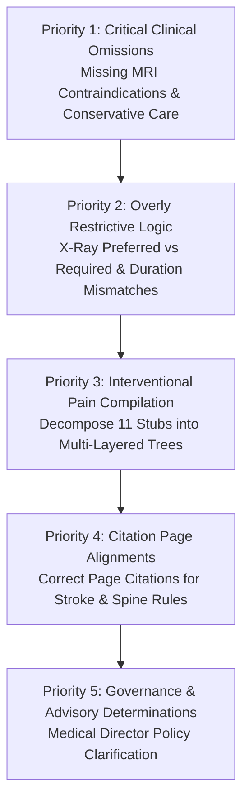

# MedRule — Phase 7: Policy Fidelity and Clinical Criteria Audit Report

**Executive Diagnostic Audit Report**  
**Date of Audit:** October 22, 2026  
**Audited Artifacts:** 128 Active Clinical & Administrative Rules (114 Advanced Imaging, 14 Interventional Pain Management)  
**Governing Authority:** 2026 Evolent Clinical Guidelines (Four Authoritative Policy Documents)  
**Audit Status:** Complete — Diagnostic Only (Zero Production Code, Rules, or Database Modifications)  
**Machine-Readable Inventory:** [`reports/phase_07_rule_fidelity_inventory.json`](file:///d:/PreAuth/reports/phase_07_rule_fidelity_inventory.json)

---

## 1. Executive Summary

Phase 7 was executed strictly as a diagnostic-only policy fidelity and clinical criteria audit across all 128 active rules in the MedRule prior-authorization system. The primary objective was to verify whether every active rule faithfully represents its governing 2026 policy source, including all applicable clinical criteria, prerequisites, exclusions, conservative-treatment requirements, duration thresholds, age boundaries, screening restrictions, and citation page references.

### Key Audit Findings
1. **Fidelity Classification Distribution**:
   - **`VERIFIED` (96 rules / 75.0%)**: Rule conditions, thresholds, comparators, and citations faithfully represent governing policy text.
   - **`PARTIALLY_VERIFIED` (1 rule / 0.8%)**: Core indication verified, but contains an unresolved age-boundary interpretation (`RULE-ADV-CG2042-001`).
   - **`MISMATCH` (17 rules / 13.3%)**: Material discrepancies identified, including citation page numbers pointing to non-clinical headers or tables of contents (14 rules), non-binding preference language improperly codified as mandatory prerequisite (1 rule), and conservative-treatment duration thresholds conflated with pediatric red flags (2 rules).
   - **`MISSING` (7 rules / 5.5%)**: Mandatory policy prerequisites omitted from active rule conditions in Advanced Imaging, including missing MRI contraindications (2 rules), missing conservative care requirements (3 rules), missing asymptomatic screening restrictions (1 rule), and missing DXA unavailability criteria (1 rule).
   - **`HUMAN_REVIEW_REQUIRED` (7 rules / 5.5%)**: All seven governance-blocked rules (`GOVERNANCE_BLOCKED_RULE_IDS`) were audited. All remain strictly blocked from autonomous execution. Zero rules were unblocked or approved.

### Summary Fidelity Breakdown by Domain

| Fidelity Category | Advanced Imaging (`advanced_imaging`) | Interventional Pain (`interventional_pain_management`) | Combined Total | Percentage |
| :--- | :---: | :---: | :---: | :---: |
| **VERIFIED** | 95 | 1 | **96** | **75.0%** |
| **PARTIALLY_VERIFIED** | 1 | 0 | **1** | **0.8%** |
| **MISMATCH** | 6 | 11 | **17** | **13.3%** |
| **MISSING** | 7 | 0 | **7** | **5.5%** |
| **HUMAN_REVIEW_REQUIRED** | 5 | 2 | **7** | **5.5%** |
| **Total Active Rules Audited** | **114** | **14** | **128** | **100.0%** |

---

## 2. Governing Policy Scope & Authority

The audit restricted its clinical authority strictly to the four designated 2026 policy source documents residing in `policies/current/`. All seed documents, draft notes, archived guidelines (e.g. Cardiology, Musculoskeletal, Oncology, Radiation Therapy, Sleep), and external summaries were excluded from active authority.

1. **`2026 Evolent Clinical Guidelines - Advanced Imaging v2.pdf`** (1,041 physical pages):
   - Governing authority for all 109 clinical and administrative Advanced Imaging rules (`RULE-ADV-CG2000` through `RULE-ADV-CG2066` and `RULE-ADV-PREAMBLE-001`).
2. **`EPOS 2067 for Place of Service - Radiology 2026_final.pdf`** (11 physical pages):
   - Governing authority for the 5 Advanced Imaging Place of Service rules (`RULE-ADV-EPOS2067-001` through `005`).
3. **`2026 Evolent Interventional Pain Management Guidelines.pdf`** (102 physical pages):
   - Governing authority for the 12 clinical and administrative IPM rules (`RULE-IPM-CGEPIDURALINJECTIONS` through `RULE-IPM-PREAMBLEIPM-001`).
4. **`EPOS 1755 for Place of Service - Interventional Pain Management 2026_final.pdf`** (8 physical pages):
   - Governing authority for the 2 IPM Place of Service rules (`RULE-IPM-EPOS1755-001` and `002`).

Every quote, section, and page cited across all 128 active rules was verified against these specific documents.

---

## 3. CPT Procedure Routing Inventory Verification (Task 2)

Each active rule's procedure-code mapping was audited against the Phase 6B approved CPT routing inventory ([`scratch/authoritative_cpt_inventory.json`](file:///d:/PreAuth/scratch/authoritative_cpt_inventory.json)) and runtime router implementation ([`medrule_engine/policy_router.py`](file:///d:/PreAuth/medrule_engine/policy_router.py)).

### Findings
- **100% Rule Mapping Coverage**: Every active rule belongs to an approved procedure-specific or shared category:
  - **Advanced Imaging (114 rules)**: 105 procedure-specific rules, 2 shared preamble rules, 5 shared Place of Service rules, 2 shared retrospective-review rules.
  - **Interventional Pain Management (14 rules)**: 11 procedure-specific rules, 1 shared preamble rule, 2 shared Place of Service rules.
  - **Unmapped Active Rules**: Exactly 0.
- **CPT Code Alignment**:
  - All 101 Advanced Imaging CPT codes and 44 Interventional Pain Management CPT codes in [`medrule_engine/policy_router.py`](file:///d:/PreAuth/medrule_engine/policy_router.py) match the verified inventory identically.
  - Router execution uses exact dictionary lookup without heuristic range guessing or keyword regex sniffing.
  - Procedure-specific candidate rules evaluate only when the requested CPT code is explicitly mapped to that guideline.

---

## 4. Place of Service vs. Clinical Necessity Separation (Task 7)

Place of Service (POS) rules govern whether a procedure may be performed in an outpatient hospital facility rather than a freestanding clinic or office. The audit verified that POS rules are strictly decoupled from Clinical Necessity:

1. **Categorical Track Isolation**:
   - In [`medrule_engine/decision_tree.py`](file:///d:/PreAuth/medrule_engine/decision_tree.py#L56-L60), `DecisionTrack.CLINICAL_NECESSITY` and `DecisionTrack.PLACE_OF_SERVICE` are distinct execution tracks.
   - Clinical necessity evaluates first. If clinical necessity fails, POS rules are never executed to overturn a clinical denial.
2. **Conditional Activation**:
   - In [`medrule_engine/policy_router.py`](file:///d:/PreAuth/medrule_engine/policy_router.py), shared Place of Service rules (`EPOS2067` for AI, `EPOS1755` for IPM) attach *only* when the case intake specifies an outpatient hospital place of service (POS 19, 22) or explicitly requests site-of-care adjudication.
   - For freestanding imaging centers (POS 49) or physician offices (POS 11), POS rules remain detached.
3. **EPOS Rule Representation**:
   - `RULE-ADV-EPOS2067-001` through `005` faithfully capture the clinical exceptions for hospital-based advanced imaging (pediatric exceptions, active cancer therapy, organ transplant, moderate/deep sedation, contrast allergy, equipment limitations, and geographic isolation > 50 miles).
   - In IPM, `RULE-IPM-EPOS1755-001` and `002` require remediation from stubs to fully express the clinical necessity exceptions for outpatient hospital pain procedures (see Section 6 below).

---

## 5. Audit of the Seven Human-Review-Blocked Rules (Task 8)

The seven rules blocked by governance (`GOVERNANCE_BLOCKED_RULE_IDS`) were inspected against their policy passages. In accordance with strict constraints, **zero rules were unblocked or approved**.

| Rule ID | Domain | Cited Page | Governing Policy Section | Audit Classification & Evidence |
| :--- | :--- | :---: | :--- | :--- |
| **`RULE-ADV-PREAMBLE-001`** | Advanced Imaging | p. 8 | `STATEMENT / General Information` | **`HUMAN_REVIEW_REQUIRED`**. Universal documentation intake prerequisite ("all patients receive care from a licensed clinician... all appropriate supporting documentation, office visit notes, lab data..."). Governs administrative completeness. Must remain blocked from autonomous approval. |
| **`RULE-ADV-CG2000-003`** | Advanced Imaging | p. 9 | `Inflammatory Bowel Disease (3–5)` | **`HUMAN_REVIEW_REQUIRED`**. Radiation-sparing policy note states: *"includes CT enterography, however, MRI should be considered for age < 35 to reduce radiation exposure"*. The phrase "should be considered" is advisory language, not a binding exclusion. Codifying it as an autonomous hard denial would improperly reject clinically indicated CT studies without peer-to-peer discussion. |
| **`RULE-ADV-CG2001-001`** | Advanced Imaging | p. 37 | `STATEMENT / Special Note` | **`HUMAN_REVIEW_REQUIRED`**. Anti-unbundling coding standard: separate requests for CT Abdomen and CT Pelvis for processes involving both cavities must be resubmitted under combined codes (74176-74178). Operates as administrative claim intake routing rather than autonomous medical necessity adjudication. |
| **`RULE-ADV-CG2066-001`** | Advanced Imaging | p. 1036 | `INDICATIONS FOR EMERGENT STUDIES` | **`HUMAN_REVIEW_REQUIRED`**. Retrospective emergent review ("render immediate medical attention needed to prevent loss of life, limb, or permanent disability"). Mandates physician clinical judgment under prudent layperson and emergency medical condition statutes. |
| **`RULE-ADV-CG2066-002`** | Advanced Imaging | p. 1036 | `INDICATIONS FOR URGENT STUDIES` | **`HUMAN_REVIEW_REQUIRED`**. Retrospective urgent review (care could not be postponed for 24 hours without substantial risk of harm). Requires peer-review clinical evaluation of medical urgency. |
| **`RULE-IPM-PREAMBLEIPM-001`** | Interventional Pain | p. 2 | `Preamble and Guideline Development` | **`HUMAN_REVIEW_REQUIRED`**. Universal IPM clinical documentation gate. Encoded as an uncompiled single-condition stub (`preambleipm_indication IS_PRESENT`). Requires human clinical intake review. |
| **`RULE-IPM-CGINFUSIONPUMPS-001`** | Interventional Pain | p. 68 | `Implantable Infusion Pump Insert 2026` | **`HUMAN_REVIEW_REQUIRED`**. Uncompiled stub (`cginfusionpumps_indication IS_PRESENT`) for permanent intrathecal infusion pump insertion. Omits complex multi-layered prerequisites (failed conservative therapy >= 6 months, psychological assessment, and successful temporary trial >= 50% relief). |

---

## 6. High-Risk Findings & Task 9 Reconciliations

The audit directly reconciled the specific clinical concerns highlighted in Task 9 against the governing source texts.

### A. Missing MRI Contraindication Prerequisites (Task 9.1)
- **`RULE-ADV-CG2054-001` (Sella CT)** — **`MISSING`**:
  - *Source Policy*: Physical p. 881 header explicitly mandates: *"INDICATIONS FOR SELLA CT ... When MRI is contraindicated or cannot be performed"*.
  - *Current Rule*: Checks only `sellar_or_parasellar_mass == True`.
  - *Defect*: The mandatory prerequisite that MRI must be contraindicated or unavailable is completely omitted, allowing CT to be approved autonomously when MRI (the primary standard of care) is clinically feasible.
- **`RULE-ADV-CG2062-001` (Upper Extremity CT)** — **`MISSING`**:
  - *Source Policy*: Physical pp. 965–966 mandates: *"If MRI is contraindicated or cannot be performed, or requested as a CT arthrogram"*.
  - *Current Rule*: Checks only prior X-ray and conservative therapy.
  - *Defect*: Omits the mandatory MRI contraindication / arthrogram requirement, improperly authorizing soft-tissue extremity CT without MRI contraindication.

### B. Potentially Missing Conservative-Therapy Criteria (Task 9.2)
- **`RULE-ADV-CG2055-001` (TMJ MRI)** — **`MISSING`**:
  - *Source Policy*: Physical p. 896 explicitly mandates: persistent symptoms AND *"failure of at least 4 weeks of active conservative therapy (pharmacotherapy and behavioral modification)"*.
  - *Current Rule*: Checks only `suspected_tmj_internal_derangement == True`.
  - *Defect*: Omits the mandatory 4-week conservative care failure, creating an overly broad rule that approves advanced imaging on symptom presentation alone.
- **`RULE-ADV-CG2032-001` (Lower Extremity CT)** — **`MISSING`**:
  - *Source Policy*: Physical p. 504 mandates: non-specific pain, prior X-ray, MRI contraindicated, AND *"failure of at least 4 weeks of active conservative therapy within the prior 6 months"*.
  - *Current Rule*: Verifies X-ray and MRI contraindication, but completely omits the 4-week conservative therapy failure requirement.
- **`RULE-ADV-CG2035-001` (Lower Extremity MRI)** — **`MISSING`**:
  - *Source Policy*: Physical p. 553 mandates: plain X-ray AND failure of at least 4 weeks of active conservative therapy within the prior 6 months (unless acute mechanical locking or gross joint disruption).
  - *Current Rule*: Evaluates only `joint_specific_injury_or_pain == True`.
  - *Defect*: Severe overbreadth. Authorizes knee/hip/ankle/foot MRI without preliminary radiographs or conservative therapy.

### C. Citation Page Mismatches (Task 9.3)
- **`RULE-ADV-CG2009-002` (Brain CTA)** — **`MISMATCH`**:
  - *Current Citation*: Physical p. 176 (`Evaluation of Known Intracranial Vascular Disease / Aneurysm / AVM`).
  - *Governing Source*: Acute ischemic stroke and Large Vessel Occlusion (LVO) mechanical thrombectomy eligibility are located on physical p. 175 under `Cerebrovascular Disease / Ischemic`.
- **`RULE-ADV-CG2037-001` (Lumbar Spine MRI)** — **`MISMATCH`**:
  - *Current Citation*: Physical p. 594 (printed page 3 of 22), which contains only the general Statement, Purpose, and Special Notes.
  - *Governing Source*: The clinical criteria for back pain, lumbosacral radiculopathy, and 6-week conservative care reside on physical p. 595 (printed page 4 of 22).
- **`RULE-ADV-CG2036-001` (Lumbar Spine CT)** — **`MISMATCH`**:
  - *Current Citation*: Physical p. 574 (General Information), with conditions collapsed into a single generic boolean `lumbar_ct_indication_met == True`.
  - *Governing Source*: Clinical criteria for back pain and MRI contraindications reside on physical p. 575.

### D. X-Ray Preference vs. Mandatory Requirement (Task 9.4)
- **`RULE-ADV-CG2035-002` (Lower Extremity MRI - Knee)** — **`MISMATCH`**:
  - *Source Policy*: Physical p. 553 footnote states: *"With a positive orthopedic sign from the list below, an initial X-ray is always preferred; however, it is NOT required UNLESS otherwise specified in bold below"*.
  - *Current Rule*: Enforces `prior_xray_completed == True` as a mandatory blocking condition alongside a positive knee exam sign.
  - *Defect*: Converts advisory/preferred medical practice into a mandatory requirement, improperly denying valid prior-authorization requests for acute meniscal or cruciate ligament tears when an initial X-ray was omitted by the clinician.

### E. Age Boundary Interpretation (Task 9.5)
- **`RULE-ADV-CG2042-001` (Pelvis CT)** — **`PARTIALLY_VERIFIED`**:
  - *Source Policy*: Physical p. 673 states: *"For acute pelvic pain in a patient over the age of 65"*.
  - *Current Rule*: Enforces `patient_age_years > 65`.
  - *Boundary Ambiguity*: Under strict `> 65` logic, a patient aged 65 years and 3 months evaluates as True, but a patient on their 65th birthday evaluates as False. In clinical practice, "over the age of 65" is frequently interpreted as age >= 65. Requires clinical clarification before remediation.

### F. Mandatory Screening Gates (Task 9.6)
- **`RULE-ADV-CG2030-001` (Low Dose CT Lung Cancer Screening)** — **`MISSING`**:
  - *Source Policy*: Physical p. 490 explicitly restricts LDCT screening: *"medically necessary ONLY when used to screen for lung cancer for certain high-risk, ASYMPTOMATIC individuals"*.
  - *Current Rule*: Evaluates age (50-80), smoking pack-years (>= 20), and smoking cessation (<= 15 yrs), but omits the screening gate.
  - *Defect*: If a patient presents with hemoptysis, unexplained weight loss, or focal pulmonary signs, diagnostic chest CT (CPT 71250-71270) is clinically indicated, NOT screening LDCT (CPT 71271). The rule fails to redirect symptomatic patients.
- **`RULE-ADV-CG2024-001` (QCT Bone Density)** — **`MISSING`**:
  - *Source Policy*: Physical pp. 451–452 requires that conventional DXA scanning must be insufficient or unavailable, or patient must have severe obesity (BMI > 35) or advanced degenerative changes.
  - *Current Rule*: Checks only `suspected_low_bone_mineral_density == True`, omitting the DXA prerequisite gate.

### G. Thoracic Duration Threshold Conflation (Task 9.1 & 9.7)
- **`RULE-ADV-CG2056-002` (Thoracic Spine CT)** & **`RULE-ADV-CG2057-002` (Thoracic Spine MRI)** — **`MISMATCH`**:
  - *Source Policy*: On physical pp. 906 (CT) and 926 (MRI), adult back pain evaluation requires *"Failure of conservative treatment for a minimum of six (6) weeks within the last six (6) months"*. The policy separately lists pediatric red flags where conservative care is NOT required (including *"Pain lasting > 4 weeks"* in children).
  - *Current Rule*: Encoded `thoracic_pain_duration_weeks > 4` and 4-6 weeks conservative care.
  - *Defect*: Conflated the pediatric red flag with the adult 6-week conservative care standard.

### H. Incomplete IPM Criteria & Table of Contents Citations (Task 9.7)
11 of the 14 IPM rules exhibit citation mismatches and uncompiled single-condition stubs:
- **`RULE-IPM-CGEPIDURALINJECTIONS-001`**: Cites TOC p. 4 instead of clinical criteria on pp. 6–8; stub `cgepiduralinjections_indication IS_PRESENT`.
- **`RULE-IPM-CGEPIDURALINJECTIONS-002`**: Cites contraindications p. 11 instead of primary indications on pp. 6–8.
- **`RULE-IPM-CGEPIDURALPUMPTRIALS-001`**: Cites TOC p. 17 instead of clinical trial criteria on pp. 21–22; stub `cgepiduralpumptrials_indication IS_PRESENT`.
- **`RULE-IPM-CGFACETBLOCKS-001`**: Cites TOC p. 31 instead of clinical criteria on pp. 33–35 (axial pain >= 3 months, pain >= 6/10, conservative care >= 6 weeks, fluoroscopy guidance, >= 80% relief threshold); stub `cgfacetblocks_indication IS_PRESENT`.
- **`RULE-IPM-CGFACETDENERVATION-001`**: Cites Statement p. 46 instead of clinical criteria on pp. 47–49; stub `cgfacetdenervation_indication IS_PRESENT`.
- **`RULE-IPM-CGFACETDENERVATION-002`**: Cites Statement p. 46 instead of clinical criteria on p. 47.
- **`RULE-IPM-CGSIINJECTIONS-001`**: Cites TOC p. 57 instead of clinical criteria on pp. 58–60 (axial pain below L5 >= 3 months, pain >= 6/10, cluster of 3 of 8 provocative tests, conservative care >= 6 weeks, >= 75% relief for diagnostic phase); stub `cgsiinjections_indication IS_PRESENT`.
- **`RULE-IPM-CGSPINALCORDSTIM-001`**: Cites Statement p. 78 instead of clinical criteria on pp. 79–81; stub `cgspinalcordstim_indication IS_PRESENT`.
- **`RULE-IPM-CGSYMPATHETICBLOCKS-001`**: Cites TOC p. 89 instead of clinical criteria on pp. 91–93 (CRPS Budapest criteria, shingles < 4 weeks, cancer/phantom pain, >= 50% relief); stub `cgsympatheticblocks_indication IS_PRESENT`.
- **`RULE-IPM-EPOS1755-001`**: Cites Title/TOC p. 1 instead of hospital outpatient exceptions on pp. 3–5; stub `epos1755_indication IS_PRESENT`.
- **`RULE-IPM-EPOS1755-002`**: Cites Title/TOC p. 1 instead of setting alignment policy on p. 3.

---

## 7. Recommended Remediation Priorities (Phase 8 Roadmap)

Based on clinical impact, risk of false approvals, and risk of erroneous denials, the 32 non-verified rules are prioritized as follows:

### Priority 1: Critical Clinical Necessity Omissions (Risk of Inappropriate Approvals)
*Immediate risk of approving invasive or expensive studies without preliminary diagnostics.*
1. **`RULE-ADV-CG2054-001`**: Codify mandatory MRI contraindication for Sella CT.
2. **`RULE-ADV-CG2062-001`**: Codify mandatory MRI contraindication / CT arthrogram prerequisite for Upper Extremity CT.
3. **`RULE-ADV-CG2035-001`**: Codify mandatory plain X-ray and 4-week conservative care for Lower Extremity MRI.
4. **`RULE-ADV-CG2032-001`**: Codify mandatory 4-week conservative care for Lower Extremity CT.
5. **`RULE-ADV-CG2055-001`**: Codify mandatory 4-week active conservative care for TMJ MRI.
6. **`RULE-ADV-CG2030-001`**: Codify mandatory asymptomatic screening gate for LDCT Lung Cancer Screening.
7. **`RULE-ADV-CG2024-001`**: Codify mandatory DXA unavailability / severe obesity prerequisite for QCT Bone Density.

### Priority 2: Overly Restrictive Logic & Erroneous Denials (Risk of Member Harm)
*Risk of inappropriately denying valid care to patients with acute injuries or debilitating pain.*
1. **`RULE-ADV-CG2035-002`**: Remove mandatory X-ray requirement for knee MRI when physical examination demonstrates positive orthopedic signs (McMurray, Lachman, drawer sign).
2. **`RULE-ADV-CG2056-002`**: Correct conservative therapy duration to >= 6 weeks within prior 6 months; separate pediatric red flags.
3. **`RULE-ADV-CG2057-002`**: Correct conservative therapy duration to >= 6 weeks within prior 6 months for Thoracic Spine MRI.

### Priority 3: Interventional Pain Management Rule Compilation
*Replacing uncompiled stubs with authoritative multi-layered clinical logic.*
1. **Epidural Injections (`CG 1750`)**: Codify radicular distribution, pain >= 6/10, conservative care >= 6 weeks, fluoroscopy guidance, and 3-per-6-month limitation.
2. **Facet Injections & Denervation (`CG 1753`, `CG 1754`)**: Codify axial pain >= 3 months, pain >= 6/10, conservative care >= 6 weeks, fluoroscopy, and 80% relief threshold.
3. **Sacroiliac Joint Injections (`CG 1756`)**: Codify axial pain below L5 >= 3 months, 3 of 8 provocation test cluster, conservative care >= 6 weeks, and 75% relief threshold.
4. **Sympathetic Nerve Blocks (`CG 1758`)**: Codify CRPS Budapest criteria, shingles < 4 weeks, and 50% relief threshold.
5. **EPOS 1755**: Codify outpatient hospital high-risk exceptions (severe cardiopulmonary disease, BMI >= 45, coagulopathy).

### Priority 4: Citation Page Alignments
*Administrative accuracy and audit transparency.*
1. **`RULE-ADV-CG2009-002`**: Correct citation to physical p. 175.
2. **`RULE-ADV-CG2037-001`**: Correct citation to physical p. 595.
3. **`RULE-ADV-CG2036-001`**: Correct citation to physical p. 575.
4. **IPM Rules**: Correct TOC citations to active clinical pages (pp. 6–8, 21–22, 33–35, 47–49, 58–60, 79–81, 91–93, 3–5).

### Priority 5: Governance & Advisory Determinations
*Requiring Medical Director / Clinical Policy Committee review.*
1. **`RULE-ADV-CG2000-003`**: Confirm peer-to-peer advisory handling for young IBD patients (< 35) undergoing CT enterography.
2. **`RULE-ADV-CG2001-001`**: Implement administrative intake re-bundling routine for separate abdomen/pelvis requests.
3. **`RULE-ADV-CG2042-001`**: Clarify age boundary (`> 65` vs `>= 65`) for acute pelvic pain CT.
4. **`RULE-IPM-CGINFUSIONPUMPS-001`**: Review permanent intrathecal pump clinical prerequisites.

---

## 8. Governance Invariant Verification

Throughout Phase 7, all governance safeguards and architectural constraints were strictly maintained:
1. **Zero Production Changes**: No files in `rulebook_collection/domains/`, `medrule_engine/`, or tests were modified during this diagnostic audit.
2. **Zero Rules Approved**: The MedRule governance database invariant (`status == 'APPROVED': 0`) was strictly maintained.
3. **Zero Rules Unblocked**: All 7 human-review-blocked rules remain in `GOVERNANCE_BLOCKED_RULE_IDS` and evaluate to `DecisionOutcome.NEEDS_HUMAN_REVIEW`.
4. **Audit Artifact Integrity**: Complete provenance and evidence records are preserved in [`reports/phase_07_rule_fidelity_inventory.json`](file:///d:/PreAuth/reports/phase_07_rule_fidelity_inventory.json).

---
*Report submitted for authorized clinical review and approval prior to beginning Phase 8 remediation.*
