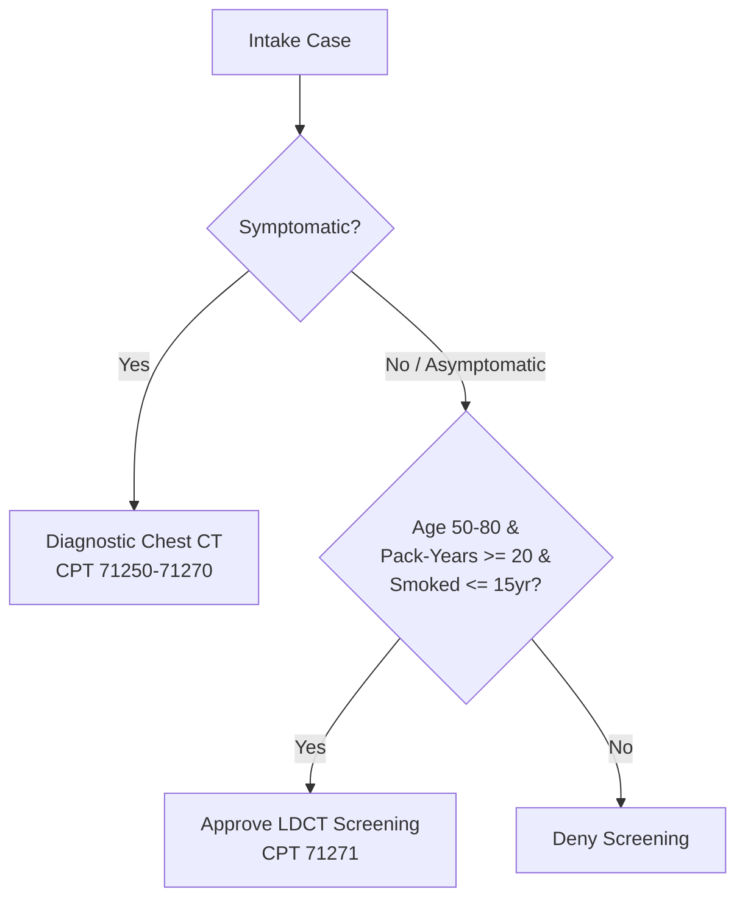
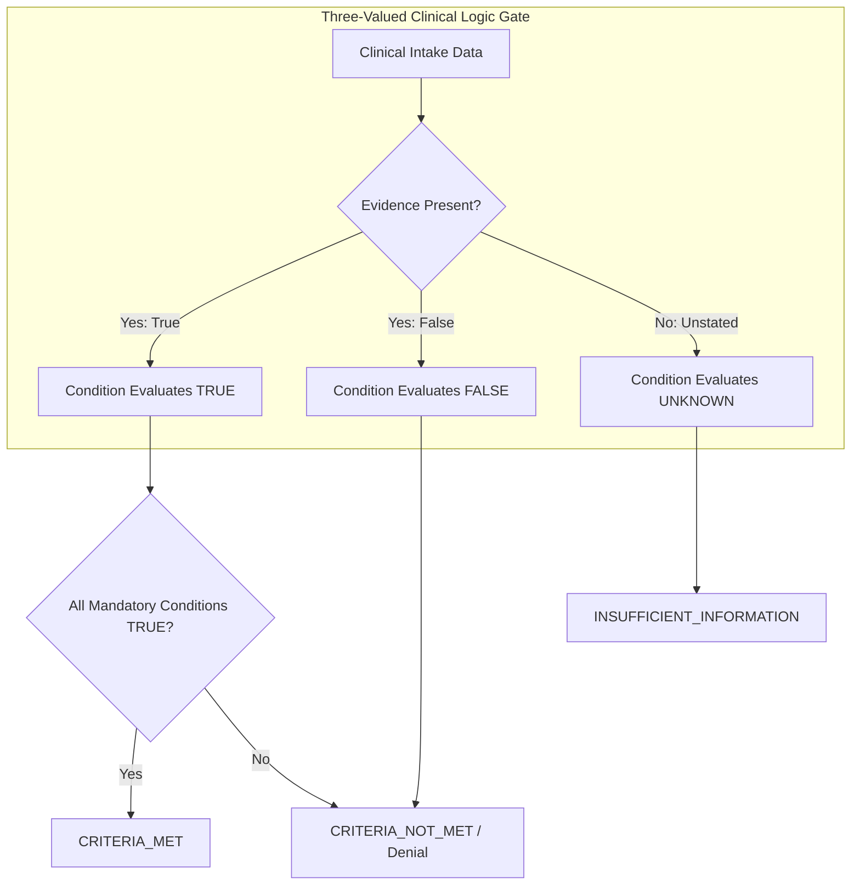

# MedRule — Phase 8A: Policy Remediation Plan and Evidence Validation

**Document Version:** 1.0.0  
**Phase:** Phase 8A — Diagnostic Planning & Evidence Validation  
**Date:** October 22, 2026  
**Status:** Planning Only — Zero Production Code, Rules, Tests, Schemas, or Database Modifications  
**Governing Authorities:** 2026 Evolent Clinical Guidelines (Advanced Imaging v2, EPOS 2067, IPM, EPOS 1755)  
**Machine-Readable Companion Artifact:** [`reports/phase_08a_remediation_register.json`](file:///d:/PreAuth/reports/phase_08a_remediation_register.json)  
**Input Baseline Audits:**  
- [`reports/phase_07_policy_fidelity_audit.md`](file:///d:/PreAuth/reports/phase_07_policy_fidelity_audit.md)  
- [`reports/phase_07_rule_fidelity_inventory.json`](file:///d:/PreAuth/reports/phase_07_rule_fidelity_inventory.json)  
- [`reports/phase_06b_implementation_results.md`](file:///d:/PreAuth/reports/phase_06b_implementation_results.md)  

---

## 1. Executive Summary & Purpose

Phase 8A establishes a comprehensive, defensible, source-grounded policy remediation plan for all 32 non-verified rules and clinical fidelity defects identified during the Phase 7 audit. In strict compliance with project constraints, **this phase is diagnostic and planning-only**. No production code, draft rules, test suites, schemas, or governance database records were altered, and the MedRule invariant of **zero approved rules** and **seven blocked governance gates** remains intact.

### Summary Remediation Distribution
The remediation register groups all 31 defect records across 5 prioritized operational tiers:

| Priority Tier | Category Description | Total Defect Records | Safe Administrative Corrections | Mandatory Authorized Clinical Review |
| :--- | :--- | :---: | :---: | :---: |
| **Tier 1 (Priority 1)** | Missing Clinical Prerequisites and Screening Restrictions | 7 | 0 | 7 |
| **Tier 2 (Priority 2)** | Incorrectly Restrictive Requirements & Threshold Conflation | 3 | 0 | 3 |
| **Tier 3 (Priority 3)** | Incomplete Interventional Pain Management Criteria & Stubs | 11 | 2 | 9 |
| **Tier 4 (Priority 4)** | Source Citation Page Alignment | 3 | 2 | 1 |
| **Tier 5 (Priority 5)** | Ambiguous Policy Interpretation & Governance Blockage | 7 | 0 | 7 |
| **Total** | **All Remediation Register Records** | **31** | **4** | **27** |

---

## 2. Authoritative Evidence Foundation

Every proposed correction was traced directly to the primary source text within the four authoritative 2026 Evolent Clinical Guideline PDFs in `policies/current/`:

1. **`2026 Evolent Clinical Guidelines - Advanced Imaging v2.pdf`** (1,041 physical pages):
   - Confirmed exact passages for Sella CT (p. 881), Upper Extremity CT (pp. 965–966), TMJ MRI (p. 896), Lower Extremity CT (p. 504), Lower Extremity MRI (p. 553), LDCT Lung Cancer Screening (p. 490), QCT Bone Density (pp. 451–452), Thoracic Spine CT (p. 906), Thoracic Spine MRI (p. 926), Brain CTA (p. 175), Lumbar Spine CT (p. 575), and Lumbar Spine MRI (p. 595).
2. **`EPOS 2067 for Place of Service - Radiology 2026_final.pdf`** (11 physical pages):
   - Confirmed freestanding setting alignment, 50-mile geographic threshold, and clinical necessity exceptions (pp. 3–4).
3. **`2026 Evolent Interventional Pain Management Guidelines.pdf`** (102 physical pages):
   - Confirmed multi-step clinical criteria, pain scores (>= 6/10), conservative care durations (>= 6 weeks), exam clusters (3 of 8 provocative tests for SI joint), and diagnostic relief thresholds (80% for facet, 75% for SI joint, 50% for SCS/repeat blocks) across Guidelines 1750, 1751, 1753, 1754, 1756, 1757, and 1758.
4. **`EPOS 1755 for Place of Service - Interventional Pain Management 2026_final.pdf`** (8 physical pages):
   - Confirmed freestanding office/ASC preference and high-risk medical exceptions for outpatient hospital care (pp. 3–5).

---

## 3. Prioritized Remediation Register Overview

Below is the structured overview of all 31 remediation records cataloged in [`reports/phase_08a_remediation_register.json`](file:///d:/PreAuth/reports/phase_08a_remediation_register.json).

### Tier 1: Missing Clinical Prerequisites & Screening Restrictions (Priority 1)
*Critical clinical necessity safeguards designed to eliminate inappropriate false approvals of advanced imaging.*

1. **`REM-P1-001` (`RULE-ADV-CG2054-001`, Sella CT, CPT 70480)**:
   - *Current Code*: Checks only `sellar_or_parasellar_mass == True`.
   - *Governing Policy*: Physical p. 881 header explicitly requires: *"When MRI is contraindicated or cannot be performed"*.
   - *Proposed Logic*: `sellar_or_parasellar_mass == True AND mri_contraindicated_or_unavailable == True`.
   - *Clinical Review*: Mandatory.
2. **`REM-P1-002` (`RULE-ADV-CG2062-001`, Upper Extremity CT, CPT 73200–73202)**:
   - *Current Code*: Evaluates X-ray and conservative therapy without checking MRI feasibility.
   - *Governing Policy*: Physical pp. 965–966 mandates: *"If MRI is contraindicated or cannot be performed, or requested as a CT arthrogram"*.
   - *Proposed Logic*: `prior_xray_negative_or_inconclusive == True AND conservative_therapy_or_bony_injury == True AND mri_contraindicated_or_ct_arthrogram == True`.
   - *Clinical Review*: Mandatory.
3. **`REM-P1-003` (`RULE-ADV-CG2055-001`, TMJ MRI, CPT 70336)**:
   - *Current Code*: Checks only symptom presence (`suspected_tmj_internal_derangement == True`).
   - *Governing Policy*: Physical p. 896 explicitly requires: *"Conservative therapy with a trial of pharmacotherapy AND behavioral modification for at least 4 weeks within the prior 6 months without meaningful improvement"*.
   - *Proposed Logic*: `suspected_tmj_internal_derangement == True AND tmj_conservative_therapy_duration_weeks >= 4`.
   - *Clinical Review*: Mandatory.
4. **`REM-P1-004` (`RULE-ADV-CG2032-001`, Lower Extremity CT, CPT 73700–73702)**:
   - *Current Code*: Verifies X-ray and MRI contraindication, but omits conservative therapy.
   - *Governing Policy*: Physical p. 504 explicitly requires: *"Persistent pain unresponsive to ACTIVE Conservative Therapy (ACT) for a minimum of 4 weeks in the last 6 months"*.
   - *Proposed Logic*: Add condition `lower_extremity_conservative_therapy_weeks >= 4`.
   - *Clinical Review*: Mandatory.
5. **`REM-P1-005` (`RULE-ADV-CG2035-001`, Lower Extremity MRI, CPT 73718–73723)**:
   - *Current Code*: Checks only `joint_specific_injury_or_pain == True` (overly broad).
   - *Governing Policy*: Physical p. 553 mandates preliminary X-ray AND >= 4 weeks active conservative therapy (unless acute joint locking or gross ligamentous disruption).
   - *Proposed Logic*: `joint_specific_injury_or_pain == True AND prior_xray_completed == True AND conservative_therapy_or_acute_locking == True`.
   - *Clinical Review*: Mandatory.
6. **`REM-P1-006` (`RULE-ADV-CG2030-001`, LDCT Lung Cancer Screening, CPT 71271)**:
   - *Current Code*: Checks age 50–80, pack-years >= 20, quit <= 15 yrs, but omits the screening gate.
   - *Governing Policy*: Physical p. 490 explicitly restricts LDCT screening to *"high-risk, ASYMPTOMATIC individuals (i.e. no acute lung-related signs or symptoms)"*.
   - *Proposed Logic*: Add mandatory condition `patient_is_asymptomatic == True`.
   - *Clinical Review*: Mandatory.
7. **`REM-P1-007` (`RULE-ADV-CG2024-001`, QCT Bone Density Study, CPT 77078)**:
   - *Current Code*: Checks only `suspected_low_bone_mineral_density == True`.
   - *Governing Policy*: Physical pp. 451–452 restricts QCT to cases where DXA is insufficient/unavailable, advanced spinal degenerative disease is present, or BMI > 35 kg/m2.
   - *Proposed Logic*: Add mandatory general prerequisite `qct_general_prerequisite_met == True`.
   - *Clinical Review*: Mandatory.

---

### Tier 2: Incorrectly Restrictive Requirements & Threshold Conflation (Priority 2)
*Remediating false denials to ensure patients with acute injuries or debilitating pain receive indicated care.*

8. **`REM-P2-001` (`RULE-ADV-CG2035-002`, Knee MRI Orthopedic Signs, CPT 73721)**:
   - *Current Code*: Mandates `prior_xray_completed == True` alongside positive knee exam signs.
   - *Governing Policy*: Physical p. 553 footnote states: *"With a positive orthopedic sign from the list below, an initial X-ray is always preferred; however, it is NOT required UNLESS otherwise specified in bold below"*.
   - *Proposed Correction*: Remove `prior_xray_completed == True` as a mandatory blocking condition, permitting approval on positive orthopedic signs (McMurray, Lachman, drawer sign, joint line tenderness).
   - *Clinical Review*: Mandatory.
9. **`REM-P2-002` (`RULE-ADV-CG2056-002`, Thoracic Spine CT, CPT 72131–72133)**:
   - *Current Code*: Miscoded as `pain_duration > 4` and "4-6 weeks conservative therapy".
   - *Governing Policy*: Physical p. 906 adult back pain standard is >= 6 weeks conservative therapy in the last 6 months. Pain > 4 weeks is a pediatric red flag where conservative care is excused.
   - *Proposed Correction*: Correct adult threshold to `thoracic_conservative_therapy_weeks >= 6`; isolate pediatric red flags into separate rule branch.
   - *Clinical Review*: Mandatory.
10. **`REM-P2-003` (`RULE-ADV-CG2057-002`, Thoracic Spine MRI, CPT 72146–72147)**:
    - *Current Code*: Miscoded as `pain_duration > 4` and "4-6 weeks conservative therapy".
    - *Governing Policy*: Physical p. 926 adult standard requires >= 6 weeks conservative treatment within the last 6 months.
    - *Proposed Correction*: Update threshold to `thoracic_conservative_therapy_weeks >= 6` within prior 6 months.
    - *Clinical Review*: Mandatory.

---

### Tier 3: Incomplete Interventional Pain Management Criteria (Priority 3)
*Decomposing single-parameter uncompiled stubs into multi-layered clinical decision trees.*

11. **`REM-P3-001` (`RULE-IPM-CGEPIDURALINJECTIONS-001`, Epidural Spine Injections, CPT 62320–62323, 64479–64484)**:
    - *Current Code*: Single stub `cgepiduralinjections_indication IS_PRESENT` citing TOC p. 4.
    - *Governing Policy*: Physical pp. 6–8 mandates: radicular pain distribution, functional impairment (pain >= 6/10), conservative therapy >= 6 weeks in last 6 months, and fluoroscopic/CT guidance with epidurogram.
    - *Proposed Correction*: Compile 4-condition decision tree and update citation to pp. 6–8.
    - *Clinical Review*: Mandatory.
12. **`REM-P3-002` (`RULE-IPM-CGEPIDURALINJECTIONS-002`, ESI Conservative Care Failure)**:
    - *Current Code*: Cites contraindications section (p. 11).
    - *Proposed Correction*: Align citation to physical pages 6–8.
    - *Clinical Review*: Safe Administrative Correction.
13. **`REM-P3-003` (`RULE-IPM-CGEPIDURALPUMPTRIALS-001`, Intrathecal Single Injection Trials, CPT 62320–62323)**:
    - *Current Code*: Single stub citing TOC p. 17.
    - *Governing Policy*: Physical pp. 21–22 mandates: severe intractable pain/spasticity, failure of oral/transdermal therapy, and presurgical psychological clearance.
    - *Proposed Correction*: Compile clinical trial decision tree and update citation to physical page 21.
    - *Clinical Review*: Mandatory.
14. **`REM-P3-004` (`RULE-IPM-CGFACETBLOCKS-001`, Facet Joint Blocks, CPT 64490–64495, 0213T–0218T)**:
    - *Current Code*: Single stub citing TOC p. 31.
    - *Governing Policy*: Physical pp. 33–35 mandates: axial pain >= 3 months, pain score >= 6/10, conservative therapy >= 6 weeks in last 6 months, fluoroscopic/CT guidance, and >= 80% relief threshold for diagnostic phase.
    - *Proposed Correction*: Compile 4-condition facet block tree and update citation to physical pages 33–35.
    - *Clinical Review*: Mandatory.
15. **`REM-P3-005` (`RULE-IPM-CGFACETDENERVATION-001`, Facet Radiofrequency Neurotomy, CPT 64633–64636)**:
    - *Current Code*: Single stub citing Statement p. 46.
    - *Governing Policy*: Physical pp. 47–49 mandates: axial pain >= 3 months, conservative therapy >= 6 weeks, fluoroscopic guidance, and positive response to prior diagnostic blocks.
    - *Proposed Correction*: Compile clinical criteria and update citation to physical page 47.
    - *Clinical Review*: Mandatory.
16. **`REM-P3-006` (`RULE-IPM-CGFACETDENERVATION-002`, Facet Denervation Relief Threshold)**:
    - *Current Code*: Cites Statement p. 46.
    - *Proposed Correction*: Update citation to physical page 47 and confirm dual 80% (initial) vs. 50% (repeat) threshold semantics.
    - *Clinical Review*: Mandatory.
17. **`REM-P3-007` (`RULE-IPM-CGSIINJECTIONS-001`, Sacroiliac Joint Injections, CPT 27096, G0260)**:
    - *Current Code*: Single stub citing TOC p. 57.
    - *Governing Policy*: Physical pp. 58–60 mandates: axial pain below L5 >= 3 months, pain score >= 6/10, cluster of at least 3 of 8 positive provocative physical exam tests (FABER, Gaenslen, Distraction, Compression, Thigh thrust, Sacral thrust, Cranial shear, ASIS distraction), conservative therapy >= 6 weeks, and fluoroscopic/CT guidance.
    - *Proposed Correction*: Compile 5-condition SI decision tree and update citation to physical pages 58–60.
    - *Clinical Review*: Mandatory.
18. **`REM-P3-008` (`RULE-IPM-CGSPINALCORDSTIM-001`, Spinal Cord Stimulation Trial, CPT 63650–63688)**:
    - *Current Code*: Single stub citing Statement p. 78.
    - *Governing Policy*: Physical pp. 79–81 mandates: chronic intractable neuropathic pain >= 6 months, failure of non-operative conservative care >= 6 months, and completed presurgical psychological clearance.
    - *Proposed Correction*: Compile clinical trial decision tree and update citation to physical page 79.
    - *Clinical Review*: Mandatory.
19. **`REM-P3-009` (`RULE-IPM-CGSYMPATHETICBLOCKS-001`, Sympathetic Nerve Blocks, CPT 64510–64530)**:
    - *Current Code*: Single stub citing TOC p. 89.
    - *Governing Policy*: Physical pp. 91–93 mandates: diagnosis of CRPS (Budapest criteria), acute herpes zoster (< 4 weeks duration), or refractory cancer/phantom pain, with pain score >= 6/10 and conservative therapy failure (excused for acute shingles).
    - *Proposed Correction*: Compile 3-condition sympathetic block tree and update citation to physical pages 91–93.
    - *Clinical Review*: Mandatory.
20. **`REM-P3-010` (`RULE-IPM-EPOS1755-001`, IPM Place of Service Exceptions)**:
    - *Current Code*: Single stub citing Title/TOC p. 1.
    - *Governing Policy*: Physical pp. 3–5 mandates: outpatient hospital setting requires clinical exceptions (NYHA III/IV heart failure, severe COPD/asthma, BMI >= 45, coagulopathy, severe sleep apnea on BiPAP, or adverse anesthesia history).
    - *Proposed Correction*: Compile clinical exception criteria and update citation to physical pages 3–5.
    - *Clinical Review*: Mandatory.
21. **`REM-P3-011` (`RULE-IPM-EPOS1755-002`, IPM Site of Care Alignment)**:
    - *Current Code*: Cites Title/TOC p. 1.
    - *Governing Policy*: Site of care alignment statement resides on physical page 3.
    - *Proposed Correction*: Update citation from physical page 1 to physical page 3.
    - *Clinical Review*: Safe Administrative Correction.

---

### Tier 4: Source Citation Page Alignment (Priority 4)
*Administrative corrections ensuring every rule cites the active clinical passage rather than general headers.*

22. **`REM-P4-001` (`RULE-ADV-CG2009-002`, Brain CTA, CPT 70496)**:
    - *Current Citation*: Physical p. 176 (`Aneurysm/AVM`).
    - *Governing Location*: Physical p. 175 (`Cerebrovascular Disease / Ischemic`).
    - *Proposed Correction*: Update citation to physical page 175 and update section title.
    - *Clinical Review*: Safe Administrative Correction.
23. **`REM-P4-002` (`RULE-ADV-CG2037-001`, Lumbar Spine MRI, CPT 72148–72149)**:
    - *Current Citation*: Physical p. 594 (printed page 3 of 22 - General Information).
    - *Governing Location*: Physical p. 595 (printed page 4 of 22 - `Evaluation of Back Pain (1)`).
    - *Proposed Correction*: Update citation to physical page 595 (printed page 4 of 22).
    - *Clinical Review*: Safe Administrative Correction.
24. **`REM-P4-003` (`RULE-ADV-CG2036-001`, Lumbar Spine CT, CPT 72131–72133)**:
    - *Current Citation*: Physical p. 574 (General Information) with generic boolean stub.
    - *Governing Location*: Physical p. 575 (`Evaluation of Back Pain (1)`).
    - *Proposed Correction*: Update citation to physical page 575 and decompose boolean into explicit MRI contraindication and clinical criteria.
    - *Clinical Review*: Mandatory.

---

### Tier 5: Ambiguous Policy Interpretation & Governance Questions (Priority 5)
*Issues requiring formal Medical Director or Clinical Policy Committee determination.*

25. **`REM-P5-001` (`RULE-ADV-CG2042-001`, Pelvis CT, CPT 72192–72194)**:
    - *Policy Phrasing*: Physical p. 673 states: *"For acute pelvic pain in a patient over the age of 65"*.
    - *Boundary Ambiguity*: Strict `patient_age_years > 65` excludes patients who are 65.0 years old (their 65th birthday year), whereas in Medicare Advantage and standard clinical practice, "over 65" is frequently interpreted as age >= 65.
    - *Proposed Action*: Request Medical Director confirmation on whether the boundary should be codified as `>= 65` or strictly `> 65.0`.
26. **`REM-P5-002` (`RULE-ADV-CG2000-003`, CT Enterography in IBD, CPT 74176–74178)**:
    - *Policy Phrasing*: Physical p. 9 states: *"includes CT enterography, however, MRI should be considered for age < 35 to reduce radiation exposure"*.
    - *Advisory vs. Binding Determination*: The phrase "should be considered" is advisory guidance, not a binding exclusion. Codifying it as an autonomous hard denial would cause improper denials.
    - *Proposed Action*: Maintain in `GOVERNANCE_BLOCKED_RULE_IDS`. Recommend that CT enterography requests in members < 35 trigger an advisory peer-to-peer notification rather than an automated coverage denial.
27. **`REM-P5-003` (`RULE-ADV-CG2001-001`, Isolated CT Abdomen Unbundling)**:
    - *Policy Phrasing*: Physical p. 37 mandates combining separate abdomen and pelvis requests under CPT 74176-74178.
    - *Proposed Action*: Maintain governance block. Implement administrative intake re-bundling routine.
28. **`REM-P5-004` & `REM-P5-005` (`RULE-ADV-PREAMBLE-001`, `RULE-IPM-PREAMBLEIPM-001`)**:
    - *Universal Documentation Gates*: Maintain governance blockage to enforce intake clinical documentation completeness.
29. **`REM-P5-006` (`RULE-IPM-CGINFUSIONPUMPS-001`)**:
    - *Permanent Intrathecal Pump Insertion*: Maintain governance blockage pending comprehensive clinical review of 6-month therapy failure and psychological assessment criteria.
30. **`REM-P5-007` (`RULE-ADV-CG2066-001/002`)**:
    - *Retrospective Emergent & Urgent Imaging*: Maintain governance blockage. Mandate peer review physician determination under emergency regulations.

---

## 4. Clinical Logic Validation Deep-Dive (Task 3)

To ensure that policy statements are never converted into naive boolean flags, the proposed logic structures were evaluated across six distinct clinical dimensions:

### 1. Explicit Requirements vs. Alternatives (OR Logic)
- **MRI Feasibility (`CG2054-001`, `CG2062-001`, `CG2032-001`, `CG2036-001`)**:
  - *Explicit Policy*: CT is indicated *when MRI is contraindicated OR cannot be performed*.
  - *Logical Structure*:
    $$\text{CT Eligible} = \text{Clinical Indication} \land (\text{MRI Contraindicated} \lor \text{Scanner Unavailable / Claustrophobia / Weight Limit})$$
  - *Validation*: A patient with a pacemaker (contraindication) and a patient exceeding the 450-lb bore weight limit (inability) must both evaluate to `TRUE`.
- **Sacroiliac Joint Provocation Cluster (`CG1756-001`)**:
  - *Explicit Policy*: Cluster of any 3 of 8 provocative physical examination tests.
  - *Logical Structure*:
    $$\text{Cluster Met} = \sum_{i=1}^8 \text{Test}_i \ge 3$$
  - *Validation*: Presence of 2 positive tests must evaluate to `FALSE`. Exactly 3 tests must evaluate to `TRUE`.

### 2. Cumulative Requirements (AND Logic)
- **Conservative Care Duration and Recency (`CG2037-001`, `CG2056-002`, `CG2057-002`, `CG1750-001`, `CG1753-001`, `CG1756-001`)**:
  - *Explicit Policy*: Failure of conservative treatment for a minimum of 6 weeks *within the last 6 months*.
  - *Logical Structure*:
    $$\text{Conservative Met} = (\text{Duration Weeks} \ge 6) \land (\text{Recency Months} \le 6) \land (\text{Outcome} = \text{FAILED})$$
  - *Validation*: A member with 8 weeks of physical therapy completed 14 months ago evaluates to `FALSE` due to the recency constraint.

### 3. Advisory Language vs. Mandatory Conditions
- **Knee MRI Radiograph Requirement (`CG2035-002`)**:
  - *Analysis*: The text *"initial X-ray is always preferred; however, it is NOT required UNLESS otherwise specified in bold below"* explicitly deprives the preference of mandatory force.
  - *Correction*: Removing `prior_xray_completed == True` restores alignment with clinical intent, preventing false denials for acute tears with positive Lachman/McMurray signs.
- **IBD Radiation Sparing in Young Patients (`CG2000-003`)**:
  - *Analysis*: The phrase *"MRI should be considered for age < 35"* is an educational/safety recommendation, not a coverage exclusion. Converting it to a hard denial creates improper denials; maintaining human review preserves clinical discretion.

### 4. Exceptions and Special Populations
- **Acute Joint Mechanical Locking (`CG2035-001`)**:
  - *Policy Exception*: Acute knee locking (inability to extend the knee due to displaced bucket-handle meniscal tear or loose body) bypasses the 4-week conservative therapy requirement.
- **Pediatric Spinal Red Flags (`CG2056-002`, `CG2057-002`)**:
  - *Policy Exception*: Children (< 18) with constant pain or pain > 4 weeks bypass adult 6-week conservative care.
- **Acute Herpes Zoster (< 4 Weeks) (`CG1758-001`)**:
  - *Policy Exception*: Patients with acute shingles under 4 weeks duration do not require conservative care before sympathetic nerve blocks, as immediate intervention is critical to prevent post-herpetic neuralgia.

### 5. Missing Evidence Semantics (Three-Valued Logic)
- In accordance with MedRule decision engine architecture, any unstated clinical parameter evaluates to `UNKNOWN`, which propagates to `INSUFFICIENT_INFORMATION`.
- A missing field **never defaults to False** (which would generate a false denial) and **never defaults to True** (which would generate an unsupported approval).

---

## 5. Verification Strategy & Test Matrix Specification (Task 4)

For each of the 31 remediation records, a 6-scenario verification test matrix is defined in [`reports/phase_08a_remediation_register.json`](file:///d:/PreAuth/reports/phase_08a_remediation_register.json):

1. **Positive Cases (Policy Compliant)**: Full satisfaction of all explicit conditions, testing that compliant cases achieve `DecisionOutcome.CRITERIA_MET`.
2. **Negative Cases (Failing Required Criterion)**: Explicit negation of exactly one mandatory condition, verifying deterministic transition to `DecisionOutcome.CRITERIA_NOT_MET`.
3. **Missing-Evidence Cases (Three-Valued Handling)**: Omission of required fields from the case payload, verifying evaluation to `DecisionOutcome.INSUFFICIENT_INFORMATION` with targeted data request prompts.
4. **Conflicting-Evidence Cases**: Scenarios with contradictory clinical statements (e.g. attestation of conservative care contradicted by pharmacy or therapy records), testing precedence rules.
5. **Boundary-Value Cases**: Exact numerical boundary evaluations:
   - Pain scores: 5.9 vs. 6.0 (`CG1750-001`, `CG1753-001`, `CG1756-001`, `CG1758-001`)
   - Conservative therapy: 3.9 vs. 4.0 weeks (`CG2032-001`, `CG2055-001`); 5.9 vs. 6.0 weeks (`CG2037-001`, `CG2056-002`, `CG2057-002`)
   - Recency: 5.9 vs. 6.1 months
   - Screening age: 49.9 vs. 50.0 and 80.0 vs. 80.1 years (`CG2030-001`)
   - BMI: 34.9 vs. 35.0 kg/m2 (`CG2024-001`, `EPOS1755-001`)
   - Provocative exam count: 2 vs. 3 positive tests (`CG1756-001`)
   - Diagnostic relief thresholds: 49% vs. 50% (`CG1757-002`); 74% vs. 75% (`CG1756-001`); 79% vs. 80% (`CG1753-001`, `CG1754-002`)
6. **Regression Isolation Assertions**:
   - Verification that CPT routing in [`medrule_engine/policy_router.py`](file:///d:/PreAuth/medrule_engine/policy_router.py) selects only the targeted candidate rules.
   - Verification that cross-domain guards prevent leakage between Advanced Imaging and Interventional Pain Management.
   - Verification that unrelated procedure rules are completely unaffected.

---

## 6. Implementation Readiness & Governance Gate

### A. Pre-Implementation Review Checklist
- [x] All 128 active rules audited against primary 2026 Evolent clinical policies.
- [x] Authoritative evidence for all 31 defects verified against physical PDF pages.
- [x] Prioritized remediation register created at [`reports/phase_08a_remediation_register.json`](file:///d:/PreAuth/reports/phase_08a_remediation_register.json).
- [x] Clear demarcation between 4 safe administrative corrections and 27 clinical review items.
- [x] Detailed verification test matrix established across all 6 test categories.
- [x] Zero production code, rules, tests, schemas, or database records modified.
- [x] Zero rules approved; all 7 governance-blocked rules preserved.

### B. Actionable Next Steps for Phase 8B
Upon authorized clinical review and user approval of this plan:
1. **Batch 1 (Safe Administrative Corrections)**: Apply citation page corrections for `RULE-ADV-CG2009-002`, `RULE-ADV-CG2037-001`, `RULE-IPM-CGEPIDURALINJECTIONS-002`, and `RULE-IPM-EPOS1755-002`.
2. **Batch 2 (High-Risk Prerequisite & Threshold Fixes)**: Implement approved clinical logic for Priority 1 and Priority 2 rules (`CG2054-001`, `CG2062-001`, `CG2055-001`, `CG2032-001`, `CG2035-001`, `CG2035-002`, `CG2030-001`, `CG2024-001`, `CG2056-002`, `CG2057-002`).
3. **Batch 3 (IPM Tree Compilation)**: Compile multi-layered decision trees for IPM guidelines (`1750`, `1751`, `1753`, `1754`, `1756`, `1757`, `1758`, `EPOS 1755`).
4. **Batch 4 (Automated Regression Verification)**: Execute all 31 test matrices and full pytest regression suite.

---
*Report and Remediation Register submitted for clinical review and user approval prior to implementation.*
