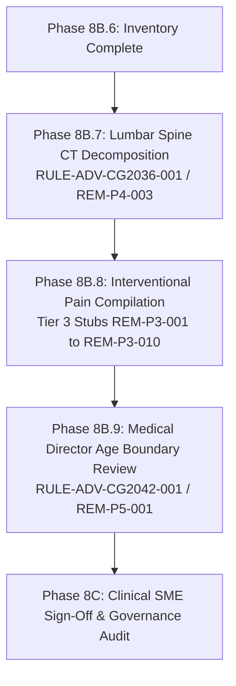

# MedRule — Phase 8B.6: Remaining Remediation Inventory and Gap Reconciliation Report

**Document ID:** `MEDRULE-REPORT-PHASE-08B6-INVENTORY`  
**Date:** 2026-10-22  
**Status:** Diagnostic Inventory & Reconciliation Complete  
**Governing Register Baseline:** [`reports/phase_08a_remediation_register.json`](file:///d:/PreAuth/reports/phase_08a_remediation_register.json) (31 records)  
**Machine-Readable Companion Artifact:** [`reports/phase_8b6_remaining_remediation_register.json`](file:///d:/PreAuth/reports/phase_8b6_remaining_remediation_register.json)  
**Prior Phase Reports Reconciled:**  
- Phase 8B.1 Citation Corrections: [`reports/phase_08b1_citation_corrections.md`](file:///d:/PreAuth/reports/phase_08b1_citation_corrections.md)  
- Phase 8B.2 Tier 1 Evidence Review: [`reports/phase_08b2_tier1_evidence_review.md`](file:///d:/PreAuth/reports/phase_08b2_tier1_evidence_review.md)  
- Phase 8B.3 Tier 1 Implementation: [`reports/phase_08b3_tier1_implementation.md`](file:///d:/PreAuth/reports/phase_08b3_tier1_implementation.md)  
- Phase 8B.3A Governance Reconciliation: [`reports/phase_08b3a_governance_reconciliation.md`](file:///d:/PreAuth/reports/phase_08b3a_governance_reconciliation.md)  
- Phase 8B.4 Tier 2 Evidence Review: [`reports/phase_08b4_tier2_evidence_review.md`](file:///d:/PreAuth/reports/phase_08b4_tier2_evidence_review.md)  
- Phase 8B.5 Tier 2 Implementation: [`reports/phase_8b5_tier2_implementation.md`](file:///d:/PreAuth/reports/phase_8b5_tier2_implementation.md)  

---

## 1. Executive Summary & Inventory Status Distribution

Phase 8B.6 establishes a comprehensive reconciliation between the 31 remediation records cataloged in `reports/phase_08a_remediation_register.json`, the original Phase 7 audit baseline (32 non-verified rules in `reports/phase_07_policy_fidelity_audit.md`), and the actual implemented codebase state following Phases 8B.1 through 8B.5.

### Summary Inventory Distribution across 31 Register Records:
```
Total Remediation Records: 31
├── 1. Implemented and Verified (Phases 8B.3 & 8B.5): 10 records (32.3%)
├── 2. Citation-Only Corrections Completed (Phase 8B.1): 4 records (12.9%)
├── 3. Still Outstanding Implementation: 10 records (32.3%)
│   ├── Advanced Imaging Criteria Decomposition: 1 record (REM-P4-003 / Lumbar CT)
│   └── Interventional Pain Management Stubs: 9 records (REM-P3-001, 003–010)
├── 4. Requires Clinical Interpretation / Sign-Off: 1 record (3.2%)
│   └── Pelvis CT Age Boundary Interpretation: REM-P5-001 (> 65 vs >= 65)
└── 5. Governance-Blocked Rules (Canonical Gates): 6 records / 7 rules (19.4%)
    └── REM-P5-002 through REM-P5-007 (Maintained strictly blocked)
```

| Current Status Classification | Record Count | Affected Rules | Primary Phase / Source |
| :--- | :---: | :--- | :--- |
| **Implemented and Verified** | **10** | `RULE-ADV-CG2054-001`, `RULE-ADV-CG2062-001`, `RULE-ADV-CG2055-001`, `RULE-ADV-CG2032-001`, `RULE-ADV-CG2035-001`, `RULE-ADV-CG2030-001`, `RULE-ADV-CG2024-001`, `RULE-ADV-CG2035-002`, `RULE-ADV-CG2056-002`, `RULE-ADV-CG2057-002` | Phase 8B.3 (Tier 1) & Phase 8B.5 (Tier 2) |
| **Citation Correction Completed** | **4** | `RULE-ADV-CG2009-002`, `RULE-ADV-CG2037-001`, `RULE-IPM-CGEPIDURALINJECTIONS-002`, `RULE-IPM-EPOS1755-002` | Phase 8B.1 |
| **Still Outstanding Implementation** | **10** | `RULE-ADV-CG2036-001` (Lumbar CT), plus 9 IPM stubs (`RULE-IPM-CGEPIDURALINJECTIONS-001`, `CGEPIDURALPUMPTRIALS-001`, `CGFACETBLOCKS-001`, `CGFACETDENERVATION-001`, `CGFACETDENERVATION-002`, `CGSIINJECTIONS-001`, `CGSPINALCORDSTIM-001`, `CGSYMPATHETICBLOCKS-001`, `EPOS1755-001`) | Tier 3 (IPM) & Tier 4 (`REM-P4-003`) |
| **Requires Clinical Interpretation** | **1** | `RULE-ADV-CG2042-001` (Pelvis CT age > 65 boundary ambiguity) | Tier 5 (`REM-P5-001`) |
| **Governance Blocked / Protected** | **6** | 7 canonical rules: `RULE-ADV-CG2000-003`, `RULE-ADV-CG2001-001`, `RULE-ADV-PREAMBLE-001`, `RULE-IPM-PREAMBLEIPM-001`, `RULE-IPM-CGINFUSIONPUMPS-001`, `RULE-ADV-CG2066-001`, `RULE-ADV-CG2066-002` | Tier 5 (`REM-P5-002` to `REM-P5-007`) |
| **Total** | **31** | **32 rules total** (Record `REM-P5-007` covers both `CG2066-001` and `002`) | Complete Active Register |

---

## 2. Phase 7 Baseline Reconciliation & Count Accounting

### 2.1 Reconciliation of the 31 Register Records vs. 32 Phase 7 Defects
The Phase 7 policy fidelity audit ([`reports/phase_07_policy_fidelity_audit.md`](file:///d:/PreAuth/reports/phase_07_policy_fidelity_audit.md)) audited all 128 active rules (114 Advanced Imaging, 14 IPM) and identified **32 non-verified rules**:
- **`PARTIALLY_VERIFIED` (1 rule)**: `RULE-ADV-CG2042-001` (Pelvis CT age boundary).
- **`MISMATCH` (17 rules)**: 6 Advanced Imaging rules (`CG2009-002`, `CG2035-002`, `CG2036-001`, `CG2037-001`, `CG2056-002`, `CG2057-002`) and 11 IPM rules (`CGEPIDURALINJECTIONS-001`, `002`, `CGEPIDURALPUMPTRIALS-001`, `CGFACETBLOCKS-001`, `CGFACETDENERVATION-001`, `002`, `CGSIINJECTIONS-001`, `CGSPINALCORDSTIM-001`, `CGSYMPATHETICBLOCKS-001`, `EPOS1755-001`, `002`).
- **`MISSING` (7 rules)**: 7 Advanced Imaging rules with missing prerequisites (`CG2024-001`, `CG2030-001`, `CG2032-001`, `CG2035-001`, `CG2054-001`, `CG2055-001`, `CG2062-001`).
- **`HUMAN_REVIEW_REQUIRED` (7 rules)**: All 7 canonical governance gates (`CG2000-003`, `CG2001-001`, `PREAMBLE-001`, `CG2066-001`, `CG2066-002`, `PREAMBLEIPM-001`, `CGINFUSIONPUMPS-001`).

$$\text{Phase 7 Non-Verified Rules} = 1 + 17 + 7 + 7 = 32 \text{ rules}$$

### Why Phase 8A Contains Exactly 31 Records:
In `reports/phase_08a_remediation_register.json`, record **`REM-P5-007`** was intentionally structured as a consolidated pair:
- **`REM-P5-007`** governs **both** `RULE-ADV-CG2066-001` (Retrospective Emergent Imaging) and `RULE-ADV-CG2066-002` (Retrospective Urgent Imaging) because they share the identical source page (physical page 1036) and statutory prudent-layperson emergency review rationale.
- Therefore:

$$\mathbf{31 \text{ register records}} + \mathbf{1 \text{ consolidated paired rule}} = \mathbf{32 \text{ audited non-verified rules}}$$

No defect was silently dropped, omitted, or lost in translation.

---

## 3. Comprehensive Itemized Status Inventory (All 31 Records)

### Category A: Implemented and Verified (10 Records / 10 Rules)
All 10 rules have been updated in `rulebook_collection/domains/advanced_imaging/rules/draft_rules.json`, validated against `schema.json` (0 schema errors), and verified through automated test suites.

| Record ID | Rule ID | Procedure / Modality | Implemented Logic Summary | Supporting Report & Test Suite |
| :--- | :--- | :--- | :--- | :--- |
| **`REM-P1-001`** | `RULE-ADV-CG2054-001` | Sella CT (70480) | Added mandatory cumulative prerequisite `mri_contraindicated_or_unavailable == True`. | `phase_08b3_tier1_implementation.md`<br>`test_phase8b3_tier1_rules.py` |
| **`REM-P1-002`** | `RULE-ADV-CG2062-001` | Upper Extremity CT (73200) | Added mandatory prerequisite `mri_contraindicated == True` OR `requested_as_ct_arthrogram == True`. | `phase_08b3_tier1_implementation.md`<br>`test_phase8b3_tier1_rules.py` |
| **`REM-P1-003`** | `RULE-ADV-CG2055-001` | TMJ MRI (70336) | Added mandatory condition `tmj_conservative_therapy_duration_weeks >= 4` within prior 6 months. | `phase_08b3_tier1_implementation.md`<br>`test_phase8b3_tier1_rules.py` |
| **`REM-P1-004`** | `RULE-ADV-CG2032-001` | Lower Extremity CT (73700) | Added conservative therapy requirement ($\ge 4$ weeks ACT in prior 6 months, worsening, or age $< 12$). | `phase_08b3_tier1_implementation.md`<br>`test_phase8b3_tier1_rules.py` |
| **`REM-P1-005`** | `RULE-ADV-CG2035-001` | Lower Extremity MRI (73721) | Enforced mandatory prior plain X-ray and conservative therapy ($\ge 4$ weeks ACT in prior 6m, worsening, or age $< 12$). | `phase_08b3_tier1_implementation.md`<br>`test_phase8b3_tier1_rules.py` |
| **`REM-P1-006`** | `RULE-ADV-CG2030-001` | LDCT Lung Screening (71271) | Added mandatory screening gate `patient_is_asymptomatic == True`. | `phase_08b3_tier1_implementation.md`<br>`test_phase8b3_tier1_rules.py` |
| **`REM-P1-007`** | `RULE-ADV-CG2024-001` | QCT Bone Density (77078) | Added mandatory general prerequisites (DXA unavailable, severe degenerative spine disease, or BMI $> 35$). | `phase_08b3_tier1_implementation.md`<br>`test_phase8b3_tier1_rules.py` |
| **`REM-P2-001`** | `RULE-ADV-CG2035-002` | Knee MRI Orthopedic Signs (73721) | Removed mandatory X-ray requirement for positive orthopedic exam signs; codified bold unexaminable ACL trauma pathway. | `phase_8b5_tier2_implementation.md`<br>`test_phase8b5_tier2_rules.py` |
| **`REM-P2-002`** | `RULE-ADV-CG2056-002` | Thoracic Spine CT (72128) | Updated adult conservative care to $\ge 6$ weeks in prior 6 months (with worsening/medical inability/EMG exceptions); codified 10 pediatric red flags. | `phase_8b5_tier2_implementation.md`<br>`test_phase8b5_tier2_rules.py` |
| **`REM-P2-003`** | `RULE-ADV-CG2057-002` | Thoracic Spine MRI (72146) | Updated adult conservative care to $\ge 6$ weeks in prior 6 months (with worsening/medical inability/EMG exceptions); codified 10 pediatric red flags. | `phase_8b5_tier2_implementation.md`<br>`test_phase8b5_tier2_rules.py` |

---

### Category B: Citation-Only Corrections Completed (4 Records / 4 Rules)
In Phase 8B.1, four rules were updated strictly on metadata citation fields (`source_page.physical_page`, `source_page.printed_page`, `source_section`, `source_quote`) to eliminate Table-of-Contents or general introductory citations. Zero condition criteria were altered.

| Record ID | Rule ID | Procedure / Modality | Citation Correction Applied | Supporting Implementation Report |
| :--- | :--- | :--- | :--- | :--- |
| **`REM-P4-001`** | `RULE-ADV-CG2009-002` | Brain CTA (70496) | Corrected citation from physical p. 176 (`Aneurysm/AVM`) to physical p. 175 (`Cerebrovascular Disease / Ischemic`). | [`reports/phase_08b1_citation_corrections.md`](file:///d:/PreAuth/reports/phase_08b1_citation_corrections.md) |
| **`REM-P4-002`** | `RULE-ADV-CG2037-001` | Lumbar Spine MRI (72148) | Corrected citation from physical p. 594 (General Info) to physical p. 595 (`Evaluation of Back Pain (1)`). | [`reports/phase_08b1_citation_corrections.md`](file:///d:/PreAuth/reports/phase_08b1_citation_corrections.md) |
| **`REM-P3-002`** | `RULE-IPM-CGEPIDURALINJECTIONS-002` | Epidural Steroid Injection (62320) | Corrected citation from physical p. 11 (Contraindications) to physical p. 7 (`Treatment Purposes / Conservative Treatment`). | [`reports/phase_08b1_citation_corrections.md`](file:///d:/PreAuth/reports/phase_08b1_citation_corrections.md) |
| **`REM-P3-011`** | `RULE-IPM-EPOS1755-002` | IPM Place of Service Alignment | Corrected citation from physical p. 1 (TOC) to physical p. 3 (`Policy Statement / Office/ASC Alignment`). | [`reports/phase_08b1_citation_corrections.md`](file:///d:/PreAuth/reports/phase_08b1_citation_corrections.md) |

---

### Category C: Still Outstanding Implementation (10 Records / 10 Rules)

#### C.1 Advanced Imaging Outstanding Item (1 Record):
- **`REM-P4-003` (`RULE-ADV-CG2036-001`, Lumbar Spine CT, CPT 72131–72133)**:
  - *Current Status:* **STILL OUTSTANDING**.
  - *Current Encoded Logic:* Cites physical page 574 (General Information) with condition collapsed into a single generic boolean: `lumbar_ct_indication_met == True`.
  - *Authoritative Source:* Physical page 575 (`Evaluation of Back Pain (1) / When Lumbar Spine MRI is Contraindicated`).
  - *Required Remediation:* Update citation to physical page 575; decompose single boolean into explicit dual-track clinical indications:
    1. Acute trauma, post-surgical hardware evaluation, or pseudoarthrosis.
    2. Lumbar back pain when MRI is contraindicated AND failure of conservative treatment $\ge 6$ weeks within last 6 months (or worsening or abnormal EMG radiculopathy).

#### C.2 Interventional Pain Management Outstanding Stubs (9 Records):
All 9 rules currently exist in `rulebook_collection/domains/interventional_pain_management/rules/draft_rules.json` as single-parameter uncompiled stubs of the form `<parameter> IS_PRESENT`:

| Record ID | Rule ID | Procedure / Service | Current Stub Parameter | Authoritative Source Passage & Required Decomposition |
| :--- | :--- | :--- | :--- | :--- |
| **`REM-P3-001`** | `RULE-IPM-CGEPIDURALINJECTIONS-001` | Epidural Spine Injections (62320–62323, 64479–64484) | `cgepiduralinjections_indication` | Physical pp. 6–8: Radicular pain matching dermatome, pain score $\ge 6/10$, conservative therapy $\ge 6$ weeks in last 6 months, and fluoroscopic/CT guidance. |
| **`REM-P3-003`** | `RULE-IPM-CGEPIDURALPUMPTRIALS-001` | Intrathecal Single Injection Trials (62320–62323) | `cgepiduralpumptrials_indication` | Physical pp. 21–22: Severe intractable cancer/neuropathic pain or spasticity, failure of oral therapies, and psychological clearance. |
| **`REM-P3-004`** | `RULE-IPM-CGFACETBLOCKS-001` | Facet Joint Blocks (64490–64495) | `cgfacetblocks_indication` | Physical pp. 33–35: Axial spinal pain $\ge 3$ months, pain score $\ge 6/10$, conservative care $\ge 6$ weeks, fluoroscopic/CT guidance, and $\ge 80\%$ diagnostic relief. |
| **`REM-P3-005`** | `RULE-IPM-CGFACETDENERVATION-001` | Facet Radiofrequency Neurotomy (64633–64636) | `cgfacetdenervation_indication` | Physical pp. 47–49: Axial pain $\ge 3$ months, conservative care $\ge 6$ weeks, and positive response to prior diagnostic medial branch blocks. |
| **`REM-P3-006`** | `RULE-IPM-CGFACETDENERVATION-002` | Facet Denervation Relief Threshold | `diagnostic_facet_block_relief >= 50%` | Physical p. 47: Align citation from p. 46 to p. 47 and confirm dual 80% (initial diagnostic block) vs. 50% (repeat neurotomy) relief threshold semantics. |
| **`REM-P3-007`** | `RULE-IPM-CGSIINJECTIONS-001` | Sacroiliac Joint Injections (27096, G0260) | `cgsiinjections_indication` | Physical pp. 58–60: Axial pain below L5 $\ge 3$ months, pain $\ge 6/10$, positive cluster of 3 of 8 provocative tests, conservative care $\ge 6$ weeks, and image guidance. |
| **`REM-P3-008`** | `RULE-IPM-CGSPINALCORDSTIM-001` | Spinal Cord Stimulation Trial (63650–63688) | `cgspinalcordstim_indication` | Physical pp. 79–81: Chronic intractable neuropathic pain $\ge 6$ months, failure of conservative care $\ge 6$ months, and formal psychological evaluation. |
| **`REM-P3-009`** | `RULE-IPM-CGSYMPATHETICBLOCKS-001` | Sympathetic Nerve Blocks (64510–64530) | `cgsympatheticblocks_indication` | Physical pp. 91–93: CRPS Budapest criteria, acute herpes zoster ($< 4$ weeks), or refractory cancer/phantom pain, with pain $\ge 6/10$ and conservative care. |
| **`REM-P3-010`** | `RULE-IPM-EPOS1755-001` | IPM Place of Service Clinical Exceptions | `epos1755_indication` | Physical pp. 3–5: Outpatient hospital setting exception criteria (severe cardiopulmonary disease, BMI $\ge 45$, coagulopathy, severe sleep apnea, or adverse anesthesia history). |

---

### Category D: Requires Clinical Interpretation or Authorized Sign-Off (1 Record / 1 Rule)

- **`REM-P5-001` (`RULE-ADV-CG2042-001`, Pelvis CT, CPT 72192–72194)**:
  - *Clinical Modality:* Pelvis Computed Tomography (CT).
  - *Current Logic:* Enforces `patient_age_years > 65`.
  - *Policy Phrasing:* Physical page 673 states: *"For acute pelvic pain in a patient over the age of 65"*.
  - *Clinical Ambiguity:* Under strict programmatic evaluation, `> 65` excludes patients on their 65th birthday or during their 65th year until they reach 65.01+. However, in Medicare Advantage benefit design and utilization review standards, "over 65" is universally applied as age $\ge 65$.
  - *Action Required:* Request formal determination from the Medical Director / Clinical Policy Committee before modifying comparator from `GREATER_THAN` to `GREATER_THAN_OR_EQUAL`.

---

### Category E: Governance-Blocked Rules (6 Records / 7 Rules)
These seven rules remain strictly quarantined in `medrule_engine/decision_tree.py` (`GOVERNANCE_BLOCKED_RULE_IDS`) and status `NEEDS_HUMAN_REVIEW`. They must remain blocked from autonomous adjudication:

| Record ID | Rule ID | Domain | Policy Citation | Governance Blockage Rationale |
| :--- | :--- | :--- | :--- | :--- |
| **`REM-P5-004`** | `RULE-ADV-PREAMBLE-001` | Advanced Imaging | Physical p. 8 | Universal clinical intake prerequisite ("all patients receive care from a licensed clinician... all appropriate supporting documentation, office visit notes, lab data..."). Governs administrative completeness; requires clinical intake validation. |
| **`REM-P5-002`** | `RULE-ADV-CG2000-003` | Advanced Imaging | Physical p. 9 | Radiation-sparing policy note states: *"includes CT enterography, however, MRI should be considered for age < 35 to reduce radiation exposure"*. The phrase "should be considered" is advisory guidance, not a binding exclusion. Codifying it as an autonomous hard denial would cause improper denials. Must remain an advisory peer-to-peer prompt. |
| **`REM-P5-003`** | `RULE-ADV-CG2001-001` | Advanced Imaging | Physical p. 37 | Anti-unbundling coding rule: separate requests for CT Abdomen and CT Pelvis for processes involving both cavities must be resubmitted under combined codes (74176-74178). Operates as an administrative claim intake routing gate rather than clinical medical necessity. |
| **`REM-P5-007`** | `RULE-ADV-CG2066-001` | Advanced Imaging | Physical p. 1036 | Retrospective Emergent Review ("render immediate medical attention needed to prevent loss of life, limb, or permanent disability"). Mandates physician peer-review determination under statutory prudent-layperson emergency regulations. |
| **`REM-P5-007`** | `RULE-ADV-CG2066-002` | Advanced Imaging | Physical p. 1036 | Retrospective Urgent Review (care could not be postponed for 24 hours without substantial risk of harm). Requires physician peer review under urgent medical necessity standards. |
| **`REM-P5-005`** | `RULE-IPM-PREAMBLEIPM-001` | Interventional Pain | Physical p. 2 | Universal IPM clinical documentation gate. Encoded as an uncompiled single-condition stub (`preambleipm_indication IS_PRESENT`). Requires human clinical intake review. |
| **`REM-P5-006`** | `RULE-IPM-CGINFUSIONPUMPS-001` | Interventional Pain | Physical p. 68 | Permanent Intrathecal Infusion Pump Insertion. Single stub (`cginfusionpumps_indication IS_PRESENT`). Involves irreversible surgical implantation requiring multidisciplinary clinical clearance, trial relief verification ($\ge 50\%$), and psychological evaluation. |

---

## 4. Deep-Dive on Remaining Advanced Imaging Issues & The Lumbar CT Decomposition

### 4.1 The Lumbar CT Criteria Decomposition Defect (`RULE-ADV-CG2036-001` / `REM-P4-003`)
In the active Advanced Imaging domain, `RULE-ADV-CG2036-001` is the **sole remaining procedure-specific clinical rule** that remains collapsed as a single uncompiled boolean:
```json
{
  "rule_id": "RULE-ADV-CG2036-001",
  "conditions": {
    "operator": "ALL_OF",
    "criteria": [
      {
        "condition_id": "COND-001",
        "description": "Evaluation of acute lumbar trauma, surgical fusion integrity/pseudoarthrosis, or lumbar pain when MRI is contraindicated",
        "parameter": "lumbar_ct_indication_met",
        "comparator": "EQUALS",
        "value": true
      }
    ]
  }
}
```

#### Policy Ground Truth (Physical Page 575, Printed `Page 4 of 20`):
Under `INDICATIONS FOR LUMBAR SPINE CT / Evaluation of Back Pain (1)`:
- Heading explicitly mandates: *"With any of the following when Lumbar Spine MRI is Contraindicated:"*
  1. Failure of conservative treatment for a minimum of six (6) weeks within the last six (6) months (or progression/worsening during care, or abnormal EMG radiculopathy).
  2. Bony architecture assessment: acute trauma, delayed union / pseudoarthrosis, or surgical fusion integrity.

#### Clinical Hazards of Current Collapsed Logic:
1. **False Approvals:** Any intake setting `lumbar_ct_indication_met = True` approves Lumbar CT for ordinary back pain without verifying whether lumbar MRI is contraindicated or whether conservative therapy was completed.
2. **False Denials / Intake Failure:** Upstream intake systems extracting granular EHR parameters (e.g., `conservative_therapy_duration_weeks`, `mri_contraindicated`) cannot map to the single coarse parameter `lumbar_ct_indication_met`, causing cases to pend or fail.

#### Required Remediation Structure:
Decompose `RULE-ADV-CG2036-001` into a dual-track indication matching `RULE-ADV-CG2056-002`:
- **Top-Level Operator:** `ANY_OF`
  - **Track 1 (Bony Architecture & Trauma):** Acute trauma, fracture evaluation, hardware/fusion assessment, or delayed union.
  - **Track 2 (Lumbar Back Pain):** `ALL_OF`:
    - `lumbar_mri_contraindicated == True`
    - `ANY_OF`:
      - `lumbar_conservative_therapy_weeks >= 6` within prior 6 months
      - `conservative_treatment_worsening == True`
      - `medical_contraindication_to_conservative_therapy == True`
      - `abnormal_emg_ncs_lumbar_radiculopathy == True`

---

## 5. Clinical Review Status of Implemented Rules

### Crucial Project Invariant:
**No rule is approved.** The implementation of clinical conditions in Phases 8B.3 and 8B.5 represents **controlled software engineering remediation** based on verbatim policy evidence, **NOT clinical approval**.

All 10 remediated rules have their governance status preserved as **`DRAFT`**. In accordance with the project governance framework, they are formally flagged as **`PENDING_AUTHORIZED_CLINICAL_SIGN_OFF`**:

```
[Implemented Tier 1 & Tier 2 Rules]
├── Extraction Status: DRAFT (Preserved)
├── Automated Verification: PASS (39 focused tests + 34 regression tests)
├── Schema Validation: PASS (0 schema errors)
└── Governance Gate: PENDING_AUTHORIZED_CLINICAL_SIGN_OFF
    ├── RULE-ADV-CG2054-001 (Sella CT / MRI Contraindication)
    ├── RULE-ADV-CG2062-001 (Upper Extremity CT / MRI Contraindication)
    ├── RULE-ADV-CG2055-001 (TMJ MRI / 4-Week Conservative Therapy)
    ├── RULE-ADV-CG2032-001 (Lower Extremity CT / 4-Week Conservative Care)
    ├── RULE-ADV-CG2035-001 (Lower Extremity MRI / Plain Film & Conservative Care)
    ├── RULE-ADV-CG2030-001 (LDCT Lung Screening / Asymptomatic Restriction)
    ├── RULE-ADV-CG2024-001 (QCT Bone Density / General Prerequisites & BMI)
    ├── RULE-ADV-CG2035-002 (Knee MRI / Orthopedic Sign X-Ray Preference)
    ├── RULE-ADV-CG2056-002 (Thoracic CT / 6-Week Duration & Pediatric Red Flags)
    └── RULE-ADV-CG2057-002 (Thoracic MRI / 6-Week Duration & Pediatric Red Flags)
```

No rule shall transition to `APPROVED` until a formal sign-off review is authorized and recorded by an appointed Medical Director or authorized Clinical Policy Committee.

---

## 6. Verification of System Invariants from Active Codebase

A live inspection of the codebase, registry, and governance database was conducted via `scratch/check_inventory_state.py`:

```
Registry Total Active Rules: 128
├── Advanced Imaging (advanced_imaging): 114
└── Interventional Pain Management (interventional_pain_management): 14

Rule Extraction Status Counts:
├── APPROVED: 0
├── DRAFT: 121
└── NEEDS_HUMAN_REVIEW: 7

Governance Database (medrule_engine/governance/data/governance.db):
├── Total Rules in DB: 372
├── Approved Rules in DB: 0
└── Review Audit Records: [('REV-8BA6C791A7F8', 'RULE-ADV-CG2000-001', 'START_REVIEW', 'IN_REVIEW')]

Canonical Blocked Gates Verification:
├── Matching GOVERNANCE_BLOCKED_RULE_IDS: True (Exact 100% Set Match)
└── Canonical Blocked Rule IDs (7):
    1. RULE-ADV-CG2000-003
    2. RULE-ADV-CG2001-001
    3. RULE-ADV-CG2066-001
    4. RULE-ADV-CG2066-002
    5. RULE-ADV-PREAMBLE-001
    6. RULE-IPM-CGINFUSIONPUMPS-001
    7. RULE-IPM-PREAMBLEIPM-001
```

### Invariant Status:
- **Zero Approved Rules Invariant:** Strictly verified (`APPROVED: 0` in registry and `governance.db`).
- **Domain Scope Invariant:** Strictly verified (114 AI + 14 IPM = 128 active rules). Archived domains (`CP.MP.107` DMEPOS) remain completely segregated.
- **Governance Gate Isolation:** Strictly verified (all 7 canonical gates in `GOVERNANCE_BLOCKED_RULE_IDS` remain in `NEEDS_HUMAN_REVIEW`).

---

## 7. Recommended Implementation Order for Remaining Remediation

To complete the remediation roadmap safely and efficiently, the following prioritized phased sequence is recommended:



### Next Immediate Action:
1. **Phase 8B.7 — Advanced Imaging Completion:**
   - Implement the criteria decomposition for `RULE-ADV-CG2036-001` (`REM-P4-003`, Lumbar Spine CT) to bring **all 107 procedure-specific Advanced Imaging rules to 100% policy criteria fidelity**.
2. **Phase 8B.8 — Interventional Pain Management Compilation:**
   - Execute a controlled decomposition of the 9 outstanding IPM stubs (`REM-P3-001`, `003`–`010`) using multi-layered condition groups for spinal injections, facet blocks, neurotomy, and neuromodulation.
3. **Phase 8B.9 — Administrative / Advisory Interpretation:**
   - Request Medical Director determination on Pelvis CT (`REM-P5-001`).

---

*Execution halted per directives. Awaiting user review and authorization.*
