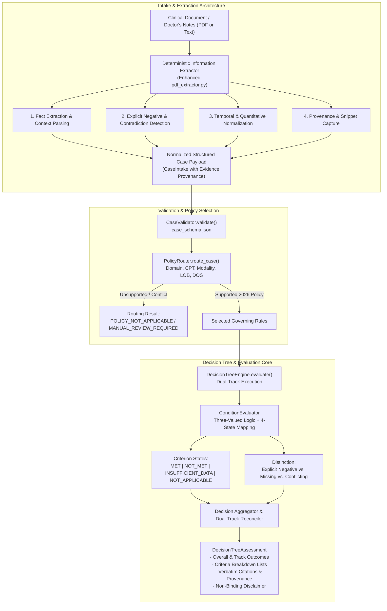

# MedRule — Step 2: Gap Analysis & Technical Architecture Specification

**Document Version:** 1.0  
**Phase:** Step 2 — Clinical Evidence Extraction, Policy Matching, and Evaluation Reliability  
**Target Repository:** `d:\PreAuth`  
**Date of Audit:** October 2026  

---

## 1. Executive Summary

This gap analysis reviews the existing MedRule prior-authorization evaluation implementation and establishes the technical specification for Step 2.

The goal of Step 2 is to improve clinical evidence extraction, policy matching, and evaluation reliability across varied clinical scenarios, doctor's notes, and modalities without introducing probabilistic LLMs, altering governing policy criteria, or violating governance controls.

### Core Governance Constraints
- **Zero LLM / Zero Probabilistic Clinical Logic:** All extraction and evaluation must be deterministic, auditable, and testable.
- **Strict Invariant: 0 Approved Rules:** All rules remain in `DRAFT` status; 7 rules remain strictly blocked as `NEEDS_HUMAN_REVIEW`.
- **Dual-Track Separation:** Clinical Necessity and Place of Service must remain isolated on independent tracks.
- **Absence Preservation (Closed-World Rejection):** Missing data is never treated as negative evidence or assumed satisfied.
- **Exclusion of CP.MP.107:** CP.MP.107 remains strictly quarantined from active decision logic.
- **Non-Binding Status:** All evaluation assessments must unconditionally declare `is_binding = False`.

---

## 2. Comprehensive Inspection of Existing Implementation

### 2.1 PDF and Text Extraction (`medrule_engine/integrations/pdf_extractor.py`)
- **Current Strengths:**
  - Extracts text from PDF bytes using PyMuPDF (`fitz`).
  - Matches basic demographics, member ID, CPT code, and date of service via regex.
  - Successfully handles basic happy-path notes for CT pancreatitis (`74177`) and Knee TKA (`27447`).
- **Critical Deficiencies / Gaps Identified:**
  1. **Fabrication of Clinical Facts:** In `_extract_clinical_evidence()`, if the word `"lumbar"` appears anywhere in the note, the code unconditionally assigns:
     ```python
     evidence["lumbar_radiculopathy_present"] = True
     evidence["conservative_therapy_duration_weeks"] = 6
     evidence["prior_conservative_care_modalities"] = ["Physical Therapy", "Oral NSAIDs", "Activity Modification"]
     ```
     Even if the physician note explicitly states `"acute low back pain for 2 days; no conservative care attempted; denies radicular symptoms"`, the extractor generates 6 weeks of conservative therapy and radiculopathy! This violates clinical safety.
  2. **No Explicit Negative Detection:** The extractor cannot distinguish between positive findings (`"has radiculopathy"`), explicit negative findings (`"denies radiculopathy"`, `"no focal weakness"`, `"no conservative therapy attempted"`), and missing facts.
  3. **No Contradiction / Conflict Detection:** If a note contains conflicting statements (e.g., in history: `"completed 8 weeks of PT"`; in assessment: `"patient non-compliant, has not attended PT"`), the extractor blindly takes the first positive match without flagging a contradiction.
  4. **Limited Procedure Scope:** Hardcoded keyword checks exist for only a handful of specific procedures, failing to normalize laterality (left, right, bilateral), anatomical levels (L4-L5, L5-S1), or contrast modalities.
  5. **Lack of Evidence Provenance:** The extractor does not record source text snippets or offsets showing where each extracted fact originated in the doctor's note.
  6. **Brittle Handling of Unreadable / Scanned PDFs:** If a PDF is a scanned bitmap without text, it raises an uncaught ValueError or fails without a structured error response explaining that manual document review or OCR preprocessing is required.

### 2.2 Case Validation and Structured Evidence Creation (`medrule_engine/case_validator.py`, `case_schema.json`)
- **Current Strengths:**
  - Robust Draft 7 JSON schema validation against `case_schema.json`.
  - Strong typing via `CaseIntake` dataclass.
  - Safe evidence lookup method `case.get_evidence(parameter)` returning `(is_present, value)`.
- **Gaps Identified:**
  - `clinical_evidence` dictionary accepts arbitrary values, but lacks standardized representation for:
    - `EXPLICIT_NEGATIVE` vs `MISSING`
    - `CONFLICTING` evidence structures
    - `AMBIGUOUS` evidence structures
    - Fact-level text citations / provenance

### 2.3 Procedure and Clinical-Domain Identification (`medrule_engine/policy_router.py`)
- **Current Strengths:**
  - Hard domain scope guards (e.g. rejecting diagnostic radiology CPTs 70000–79999 under IPM).
  - Validation of date of service ($\ge$ 2026-01-01) and Line of Business (`COMMERCIAL`, `MEDICARE_ADVANTAGE`, `MEDICAID`).
- **Gaps Identified:**
  - When an unmapped or unsupported CPT code is submitted, routing sometimes reports `POLICY_NOT_APPLICABLE` before properly checking if the domain itself is supported or if the procedure is experimental/uncovered.
  - Needs clearer separation between "Procedure unsupported by current 2026 guidelines" versus "General routing failure".

### 2.4 Rule Loading and Decision-Tree Evaluation (`medrule_engine/decision_tree.py`, `condition_evaluator.py`)
- **Current Strengths:**
  - Full three-valued Boolean logic (`TRUE`, `FALSE`, `UNKNOWN`) across `ALL_OF`, `ANY_OF`, and `NONE_OF`.
  - Strict governance blockage of the 7 `NEEDS_HUMAN_REVIEW` rules.
  - Complete dual-track separation between Clinical Necessity and Place of Service.
- **Gaps Identified:**
  - Evaluation results currently report criterion status as `TRUE`, `FALSE`, or `UNKNOWN`. The system needs to explicitly represent the standard four-state policy evaluation model:
    - `MET`: Sufficient evidence demonstrates criterion is satisfied.
    - `NOT_MET`: Sufficient documented evidence proves criterion is not satisfied.
    - `INSUFFICIENT_DATA`: Documentation lacks required parameters/evidence.
    - `NOT_APPLICABLE`: Criterion belongs to an unselected alternative or irrelevant branch.
  - Criterion-level summary reporting: The caller currently receives a list of execution traces, but lacks a clean breakdown of exactly which criteria were `MET`, `NOT_MET`, `INSUFFICIENT_DATA`, and `NOT_APPLICABLE`.

---

## 3. Step 2 Target Architecture & Improvement Plan



### 3.1 Four-State Policy Evaluation Outcome Model
Every policy criterion evaluated by `ConditionEvaluator` and recorded in `CriterionExecutionTrace` will explicitly provide a `criterion_state`:
1. `MET`:
   - Positive evidence is documented and satisfies the criterion threshold/operator.
2. `NOT_MET`:
   - Documented evidence explicitly fails the criterion threshold (e.g., conservative therapy was only 2 weeks when 6 weeks was required, or patient has confirmed absence of required symptom).
3. `INSUFFICIENT_DATA`:
   - Parameter is missing from input, provided as null, or documented as ambiguous/conflicting without resolution.
   - Missing data will **never** automatically become `NOT_MET`.
4. `NOT_APPLICABLE`:
   - Criterion is in an inactive alternative branch (e.g., in an `ANY_OF` where another branch is already satisfied, or a conditional sub-clause that does not apply).

### 3.2 Evidence Quality & Negation Handling
`CaseIntake` and `ConditionEvaluator` will support explicit evidence states:
- `EXPLICIT_POSITIVE`: Finding is documented as present (e.g., `True`, `"PRESENT"`, `"ELEVATED"`).
- `EXPLICIT_NEGATIVE`: Finding is explicitly documented as absent or denied (e.g., `False`, `"ABSENT"`, `"DENIED"`).
- `MISSING`: Finding is unrecorded, null, or omitted.
- `AMBIGUOUS`: Documentation contains uncertain or indeterminate findings (e.g., `"equivocal"`, `"possible"`).
- `CONFLICTING`: Documentation contains contradictory entries (e.g., one note says PT completed, another says never attended).

### 3.3 Enhanced Clinical Note Extractor
The extractor in `medrule_engine/integrations/pdf_extractor.py` will be overhauled to:
1. **Eliminate False Inferences:** Never assume radiculopathy, 6 weeks of conservative care, or normal ultrasound findings simply because a body part was mentioned.
2. **Contextual Negation Detection:** Detect negated phrases:
   - `"no radiculopathy"`, `"denies radicular pain"`, `"without radiating symptoms"` $\to$ `radiculopathy_present = False`.
   - `"no physical therapy"`, `"conservative therapy not attempted"` $\to$ `conservative_therapy_duration_weeks = 0`.
   - `"denies bowel or bladder incontinence"` $\to$ `suspected_cauda_equina_syndrome = False`.
3. **Quantitative & Temporal Parsing:**
   - Extract actual numbers of days, weeks, or months of conservative therapy and symptom duration (e.g., `"completed 4 weeks of physical therapy"` $\to$ `4`).
4. **Anatomy and Laterality Normalization:**
   - Detect anatomical regions (`LUMBAR_SPINE`, `KNEE`, `BRAIN`, `ABDOMEN_PELVIS`, `CERVICAL_SPINE`).
   - Detect laterality (`LEFT`, `RIGHT`, `BILATERAL`).
5. **Procedure Catalog Expansion:**
   - Lumbar MRI: `72148` (without contrast), `72149` (with contrast), `72158` (with/without).
   - Knee MRI: `73721` (without contrast), `73722` (with contrast), `73723` (with/without).
   - Brain MRI: `70551` (without contrast), `70552` (with contrast), `70553` (with/without).
   - CT Abdomen/Pelvis: `74176` (without contrast), `74177` (with contrast), `74178` (with/without).
   - Interventional Pain: `62322`/`62323` (lumbar epidural), `64483` (transforaminal epidural), `64490` (facet joint).
6. **Contradiction Detection:**
   - Identify conflicting statements within the document and tag the parameter with `{"status": "CONFLICTING", "evidence_snippets": [...]}`.
7. **Evidence Snippet Capture:**
   - For every extracted fact, capture the supporting sentence from the text and record it in an `evidence_provenance` dictionary.
8. **Graceful Handling of Unreadable Documents:**
   - If a PDF contains 0 characters of text (e.g., image-only scan or corrupted stream), return a structured status `UNREADABLE_OR_SCANNED_DOCUMENT` with instructions for OCR or clinical document upload, rather than crashing.

---

## 4. Test Matrix & Acceptance Criteria

We will establish a dedicated test suite `medrule_engine/tests/test_step2_clinical_extraction_and_evaluation.py` covering:

| Test Case Category | Specific Scenario Tested | Expected Engine Outcome |
| :--- | :--- | :--- |
| **Criterion State: MET** | Patient meets all criteria for Lumbar MRI (radiculopathy, 6+ weeks PT, licensed provider). | `overall_outcome = CRITERIA_MET`, criterion states = `MET`. |
| **Criterion State: NOT_MET** | Explicit negative evidence: note states patient completed only 2 weeks of PT (threshold is 6 weeks). | `overall_outcome = CRITERIA_NOT_MET`, PT criterion state = `NOT_MET` (not insufficient data). |
| **Criterion State: INSUFFICIENT_DATA** | Note mentions back pain but completely omits mention of prior conservative care. | `overall_outcome = INSUFFICIENT_INFORMATION`, PT criterion state = `INSUFFICIENT_DATA`. |
| **Criterion State: NOT_APPLICABLE** | In `ANY_OF` indication group, alternative indications not selected. | Selected branch `MET`, unselected branches `NOT_APPLICABLE`. |
| **Missing vs. Explicit Negative** | Test comparison: Note A says "denies radicular symptoms" (negative) vs Note B has no mention of radiculopathy (missing). | Note A evaluates to `NOT_MET`; Note B evaluates to `INSUFFICIENT_DATA`. |
| **Contradictory Documentation** | Note contains contradictory statements regarding prior treatment. | Extractor flags `CONFLICTING`; evaluator treats as `INSUFFICIENT_DATA` / `NEEDS_HUMAN_REVIEW`. |
| **Diverse Procedures** | Lumbar MRI (`72148`), Knee MRI (`73721`), Brain MRI (`70551`), CT Abdomen (`74177`), IPM Epidural (`62323`). | Correct domain, procedure, and policy selected for each. |
| **Unsupported Procedures** | Experimental spine surgery or unknown CPT code. | `POLICY_NOT_APPLICABLE`, no crash, explainable routing notes. |
| **Dual-Track POS Redirection** | Clinical criteria met, but hospital outpatient setting requested without clinical exception. | Clinical: `CRITERIA_MET`, POS: `CRITERIA_NOT_MET`, Overall: `CRITERIA_NOT_MET` with redirection summary. |
| **Unreadable / Scanned PDF** | Zero-text or blank PDF submitted to extractor. | Returns structured `UNREADABLE_OR_SCANNED_DOCUMENT` without unhandled exception. |
| **Governance Safeguards** | All 121 rules remain `DRAFT`; 7 rules remain strictly blocked. `is_binding = False`. | 100% preservation of all baseline safety invariants. |

---

## 5. Implementation Roadmap

1. **Step 2.1:** Implement `CriterionState` and evidence state tracking in `medrule_engine/condition_evaluator.py`.
2. **Step 2.2:** Update `medrule_engine/decision_tree.py` to aggregate criteria lists (`criteria_met`, `criteria_not_met`, `criteria_insufficient_data`, `criteria_not_applicable`) and enforce strict resolution rules.
3. **Step 2.3:** Enhance `medrule_engine/integrations/pdf_extractor.py` with non-fabricating, contextual, negated, temporal, and contradictory text extraction.
4. **Step 2.4:** Build and run the comprehensive synthetic evaluation test suite `test_step2_clinical_extraction_and_evaluation.py`.
5. **Step 2.5:** Run full regression suite and document results in `reports/step_02_validation_results.md`.
