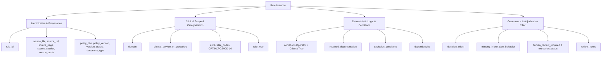
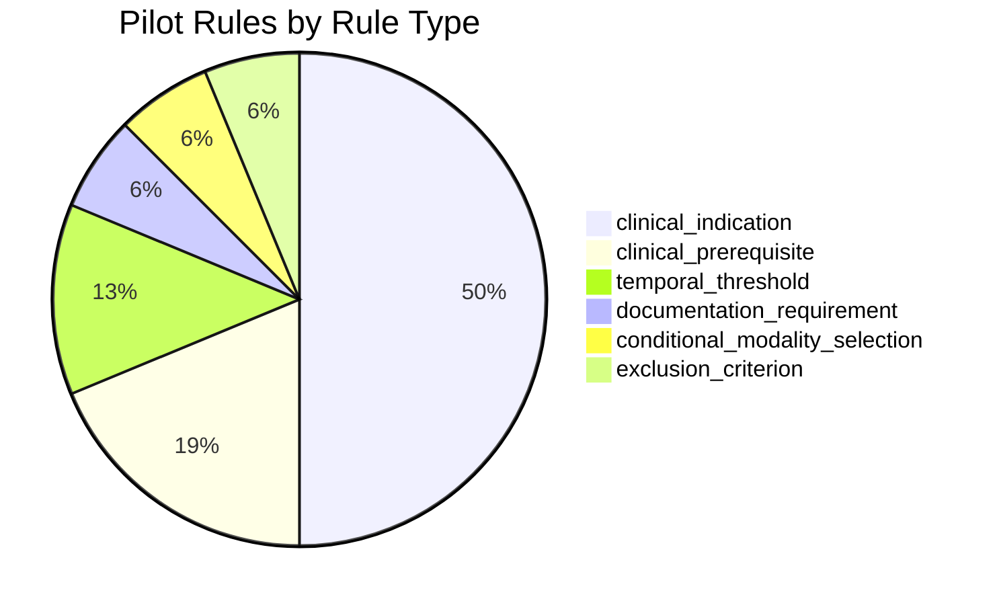
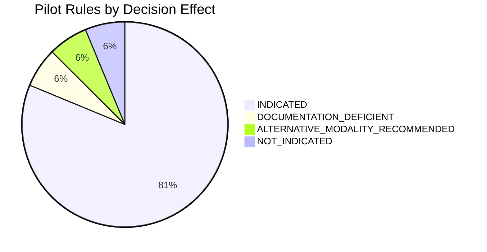
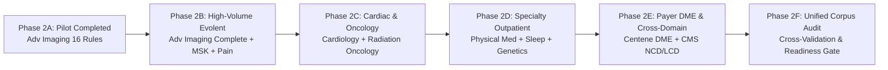
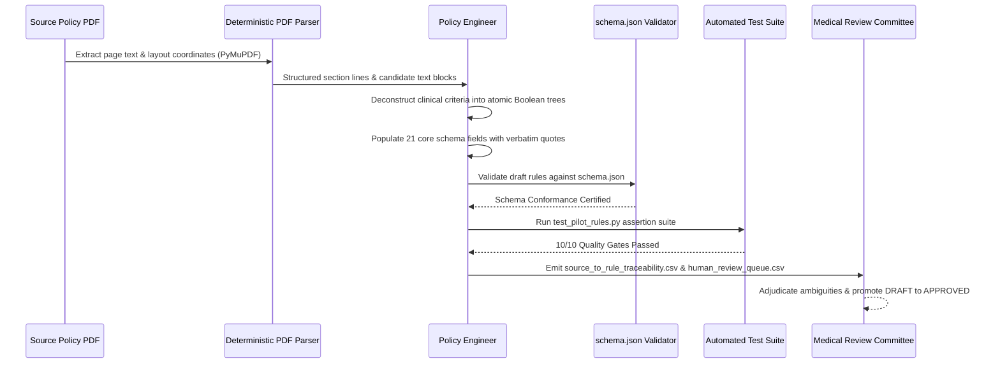

# MedRule Phase 2A — Advanced Imaging Pilot and Corpus Scaling Report

**Document Version**: 1.0.0  
**Phase**: Phase 2A (Rule Extraction Foundation & Advanced Imaging Pilot)  
**Governing Domain**: `advanced_imaging`  
**Governing Policy Document**: `2026 Evolent Clinical Guidelines - Advanced Imaging v2.pdf`  
**Location**: [`rulebook_collection/domains/advanced_imaging/rules/pilot_report.md`](file:///c:/Users/KumarShiva/Downloads/PreAuth/rulebook_collection/domains/advanced_imaging/rules/pilot_report.md)  
**Implementation Date**: 2026-10-18  

---

## 1. Executive Summary

The primary objective of **MedRule Phase 2A** is to establish an extensible, deterministic, machine-readable rule extraction foundation for the MedRule Prior Authorization Decision Support System and validate this architecture through a representative pilot in the **Advanced Imaging** domain.

In strict conformance with project constraints:
- **Zero LLMs or AI APIs**: Extraction, schema development, and validation were performed with deterministic local tools (Python 3.11, PyMuPDF, `jsonschema`). No LLM APIs, embeddings, fine-tuned models, or AI inference services were used.
- **Zero Invented Medical Logic**: Every extracted rule is grounded in verbatim text excerpts extracted directly from verified physical PDF pages.
- **Strict Clinical Governance**: All extracted rules are initially classified as `DRAFT` or `NEEDS_HUMAN_REVIEW`. No rule is approved automatically; authorization approval is strictly reserved for human clinical review.
- **100% Traceability**: Every criterion maps directly to its source PDF file, SHA-256 hash, physical page, printed page header, and exact section.

During Phase 2A, the team successfully:
1. Audited and verified the 2026 governing clinical guideline (`2026 Evolent Clinical Guidelines - Advanced Imaging v2.pdf`, 1,041 physical pages, SHA-256: `b607a1b4b2b7583f6abf4d92ce55272acbb4df39deb1f72eebba04b398abaa66`).
2. Engineered a reusable, draft-07 compliant JSON Schema ([`schema.json`](file:///c:/Users/KumarShiva/Downloads/PreAuth/rulebook_collection/domains/advanced_imaging/rules/schema.json)) supporting 21 core fields, controlled clinical vocabularies, and recursive Boolean condition trees.
3. Extracted 16 representative atomic rules covering documentation prerequisites, prior diagnostic workup, temporal thresholds, conservative care trials, explicit policy exceptions, modality redirections, and non-coverage exclusions across CG 2000 (Abdomen/Pelvis CT), CG 2012 (Brain MRI), and CG 2017 (Cervical Spine MRI).
4. Constructed end-to-end traceability ([`source_to_rule_traceability.csv`](file:///c:/Users/KumarShiva/Downloads/PreAuth/rulebook_collection/domains/advanced_imaging/rules/source_to_rule_traceability.csv)) and a clinical review queue ([`human_review_queue.csv`](file:///c:/Users/KumarShiva/Downloads/PreAuth/rulebook_collection/domains/advanced_imaging/rules/human_review_queue.csv)).
5. Created and executed an automated deterministic test suite ([`test_pilot_rules.py`](file:///c:/Users/KumarShiva/Downloads/PreAuth/rulebook_collection/domains/advanced_imaging/rules/tests/test_pilot_rules.py)) achieving a 100% pass rate across 10 independent quality gates.
6. Formulated a comprehensive, repeatable Corpus Scaling Procedure for expanding rule extraction across the remaining eight MedRule clinical domains (Subphases 2B through 2F).

---

## 2. Verified Source Documents

### 2.1 Primary Governing Document
- **Document Title**: 2026 Evolent Clinical Guidelines for Medical Necessity Review: Advanced Imaging Guidelines (v2)
- **Publisher**: Evolent Health / RadMD (National Imaging Associates)
- **Version / Edition**: `2026 v2`
- **Publication / Revision Date**: December 2025 (Effective January 1, 2026 – December 31, 2026)
- **Physical File Path**: [`rulebook_collection/domains/advanced_imaging/policy_pdfs/current_2026/2026 Evolent Clinical Guidelines - Advanced Imaging v2.pdf`](file:///c:/Users/KumarShiva/Downloads/PreAuth/rulebook_collection/domains/advanced_imaging/policy_pdfs/current_2026/2026%20Evolent%20Clinical%20Guidelines%20-%20Advanced%20Imaging%20v2.pdf)
- **SHA-256 Checksum**: `b607a1b4b2b7583f6abf4d92ce55272acbb4df39deb1f72eebba04b398abaa66`
- **File Size**: 13,644,257 bytes (~13.01 MB)
- **Physical Page Count**: Exactly 1,041 pages (verified via PyMuPDF 1.27.2)
- **Text Layer Quality**: Searchable, clean programmatic text layer with selectable text and standard vector formatting.

### 2.2 Table of Clinical Guidelines in Governing Document
The governing guideline encompasses 73 distinct Clinical Guidelines (CG 2000 through CG 2073) spanning all anatomical areas and diagnostic modalities:

| Guideline ID | Clinical Guideline Name | Primary Modalities | Page Range (Physical) |
|---|---|---|---|
| **CG 2000** | Abdomen and Pelvis CT | CT | pp. 6–34 |
| **CG 2001** | Abdomen MRI / MRA | MRI, MRA | pp. 35–64 |
| **CG 2002** | Pelvis MRI | MRI | pp. 65–88 |
| **CG 2003** | Chest CT | CT | pp. 89–118 |
| **CG 2004** | Chest MRI / MRA | MRI, MRA | pp. 119–135 |
| **CG 2005** | Thoracic Spine MRI | MRI | pp. 136–152 |
| **CG 2006** | Lumbar Spine MRI | MRI | pp. 153–180 |
| **CG 2007** | Lumbar Spine CT | CT | pp. 181–194 |
| **CG 2008** | Cervical Spine CT | CT | pp. 195–207 |
| **CG 2009** | Thoracic Spine CT | CT | pp. 208–218 |
| **CG 2010** | Head / Brain CT | CT | pp. 219–223 |
| **CG 2012** | Brain MRI (w/ or w/o IAC Views) | MRI | pp. 224–273 |
| **CG 2013** | Orbit, Sella, Face, Neck MRI | MRI | pp. 274–296 |
| **CG 2014** | Maxillofacial CT | CT | pp. 297–311 |
| **CG 2015** | Neck CT | CT | pp. 312–325 |
| **CG 2017** | Cervical Spine MRI | MRI | pp. 326–351 |
| **CG 2018–2073** | Extremity, Nuclear, PET, Vascular Guidelines | PET, SPECT, CT, MRI | pp. 352–1041 |

---

## 3. Rule Schema Architecture

The extraction schema is codified in [`schema.json`](file:///c:/Users/KumarShiva/Downloads/PreAuth/rulebook_collection/domains/advanced_imaging/rules/schema.json) under Draft-07 JSON Schema specifications.

### 3.1 21 Core Fields Rationale
The schema structure is deliberately non-relational and atomic to ensure self-contained serialization and simple downstream rule compilation:

### 3.2 Boolean Logic & Condition Trees
Prior authorization guidelines inherently contain compound Boolean logic (e.g. "Member has condition A AND (condition B OR condition C) AND NOT condition D"). 

The schema models this through recursive `conditions` objects:
- **`operator`**: Evaluates children using `ALL_OF` (Boolean AND), `ANY_OF` (Boolean OR), `NONE_OF` (Boolean NOT), or `SINGLE_CONDITION` (atomic leaf).
- **`criteria`**: An array of condition items containing `condition_id`, `description`, `parameter`, `comparator`, `value`, and `unit`.
- **`sub_conditions`**: Enables arbitrary nesting for multi-level clauses without loss of relational precision.
- **Controlled Comparators**: `EQUALS`, `NOT_EQUALS`, `GREATER_THAN`, `GREATER_THAN_OR_EQUAL`, `LESS_THAN`, `LESS_THAN_OR_EQUAL`, `BETWEEN`, `CONTAINS`, `NOT_CONTAINS`, `IS_PRESENT`, `IS_ABSENT`, `DOCUMENTED_FAILURE`, `CONTRAINDICATED`.

### 3.3 Uncertainty and Missing Data Handling
Medical charts frequently lack specific laboratory values or physical exam findings at initial intake. To prevent false negatives or arbitrary defaults:
- **`missing_information_behavior`**:
  - `PEND_FOR_DOCUMENTATION`: Halts automated adjudication and issues a targeted Request for Additional Information (RFI) to the provider.
  - `ESCALATE_TO_PEER_REVIEW`: Directs case to Medical Director peer-to-peer discussion.
  - `CANNOT_DETERMINE`: Flags system inability to evaluate without clinical interpretation.
  - `FAIL_CONDITION`: Treats absent evidence as a failed prerequisite.
  - `ASSUME_ABSENT`: Treats undocumented symptoms as absent.

---

## 4. Pilot Extraction Analysis

### 4.1 Summary of Extracted Pilot Rules

A total of 16 atomic rules were extracted from the 2026 governing guideline across three key sections:

| Guideline | Procedure Governed | Rules Extracted | Focus Areas |
|---|---|---|---|
| **CG 2000** | CT Abdomen & Pelvis | 12 rules (`001`–`012`) | Intake documentation, IBD workup, age redirection, acute appendicitis/diverticulitis, pancreatitis 72h threshold, hematuria risk stratification, AAA surveillance & rupture, cancer surveillance exclusions. |
| **CG 2012** | Brain MRI | 2 rules (`001`–`002`) | Acute sudden/thunderclap headache red flags, pediatric headache red flags. |
| **CG 2017** | Cervical Spine MRI | 2 rules (`001`–`002`) | Conservative treatment 6-week trial, suspected myelopathy conservative care bypass exception. |

### 4.2 Breakdown by Rule Type & Decision Effect

### 4.3 Key Clinical Patterns & Structural Challenges

1. **Advisory Normative Language vs Binding Prior-Auth Criteria**:
   - *Example*: In CG 2000 (Physical page 9), the policy notes: `"...MRI should be considered for age < 35 to reduce radiation exposure"`.
   - *Challenge*: Is this an enforceable denial of CT, or a clinical advisory suggestion?
   - *Resolution*: Extracted as `RULE-ADV-CG2000-003`, assigned `decision_effect: "ALTERNATIVE_MODALITY_RECOMMENDED"`, and flagged with `extraction_status: "NEEDS_HUMAN_REVIEW"`.

2. **Compound Disjunctive Lists with Embedded Risk Stratification**:
   - *Example*: Hematuria evaluation (Physical page 11) establishes a baseline prerequisite (Kidney stone NOT suspected AND Urinalysis negative for infection), followed by an OR branch (`Gross hematuria` OR `> 25 RBC/hpf` OR `3-25 RBC/hpf AND risk factor`).
   - *Resolution*: Decomposed into two distinct atomic rules: `RULE-ADV-CG2000-008` (high-risk gross / >25 RBC) and `RULE-ADV-CG2000-009` (intermediate risk 3–25 RBC with smoking/age/ultrasound risk factors).

3. **Temporal Prerequisites and Recency Constraints**:
   - *Example*: Cervical spine MRI conservative therapy requires: `"...minimum of six (6) weeks within the last six (6) months"`.
   - *Resolution*: Modeled in `RULE-ADV-CG2017-001` with two independent quantitative conditions: `conservative_care_duration_weeks >= 6` and `conservative_care_recency_months <= 6`.

4. **Explicit Policy Exceptions Bypassing Prerequisites**:
   - *Example*: While neck pain requires 6 weeks of conservative therapy, the policy explicitly states: `NOTE: Does NOT require conservative care` for suspected cervical myelopathy.
   - *Resolution*: Captured as dedicated exception rule `RULE-ADV-CG2017-002`, ensuring the decision engine will evaluate myelopathic red flags prior to testing conservative therapy duration.

---

## 5. Traceability and Review Artifacts

All 16 rules are mapped in [`source_to_rule_traceability.csv`](file:///c:/Users/KumarShiva/Downloads/PreAuth/rulebook_collection/domains/advanced_imaging/rules/source_to_rule_traceability.csv):

| Rule ID | Policy Section | Physical Page | Printed Page | Extraction Status |
|---|---|---|---|---|
| `RULE-ADV-CG2000-001` | STATEMENT / General Information | Physical p. 8 | Page 3 of 29 | `DRAFT` |
| `RULE-ADV-CG2000-002` | Inflammatory Bowel Disease (3–5) | Physical p. 9 | Page 4 of 29 | `DRAFT` |
| `RULE-ADV-CG2000-003` | Inflammatory Bowel Disease (3–5) | Physical p. 9 | Page 4 of 29 | `NEEDS_HUMAN_REVIEW` |
| `RULE-ADV-CG2000-004` | Diverticulitis or Acute Appendicitis (8,9) | Physical p. 9 | Page 4 of 29 | `DRAFT` |
| `RULE-ADV-CG2000-005` | Diverticulitis or Acute Appendicitis (8,9) | Physical p. 9 | Page 4 of 29 | `DRAFT` |
| `RULE-ADV-CG2000-006` | Pancreatitis (14) | Physical p. 10 | Page 5 of 29 | `DRAFT` |
| `RULE-ADV-CG2000-007` | Pancreatitis (14) | Physical p. 10 | Page 5 of 29 | `DRAFT` |
| `RULE-ADV-CG2000-008` | Evaluation of Hematuria (20) | Physical p. 11 | Page 6 of 29 | `DRAFT` |
| `RULE-ADV-CG2000-009` | Evaluation of Hematuria (20) | Physical p. 11 | Page 6 of 29 | `DRAFT` |
| `RULE-ADV-CG2000-010` | Abdominal Aortic Aneurysm (AAA) | Physical p. 13 | Page 8 of 29 | `DRAFT` |
| `RULE-ADV-CG2000-011` | Abdominal Aortic Aneurysm (AAA) | Physical p. 13 | Page 8 of 29 | `DRAFT` |
| `RULE-ADV-CG2000-012` | Surveillance / General Cancer Follow-up | Physical p. 19 | Page 14 of 29 | `DRAFT` |
| `RULE-ADV-CG2012-001` | INDICATIONS / Headache (1,2) | Physical p. 224 | Page 5 of 50 | `DRAFT` |
| `RULE-ADV-CG2012-002` | Pediatric Population (<18) Headache | Physical p. 225 | Page 6 of 50 | `DRAFT` |
| `RULE-ADV-CG2017-001` | Evaluation of Neck Pain (5,6) | Physical p. 330 | Page 4 of 26 | `DRAFT` |
| `RULE-ADV-CG2017-002` | Evaluation of Suspected Myelopathy | Physical p. 331 | Page 5 of 26 | `DRAFT` |

### 5.1 Human Review Queue Entries
Recorded in [`human_review_queue.csv`](file:///c:/Users/KumarShiva/Downloads/PreAuth/rulebook_collection/domains/advanced_imaging/rules/human_review_queue.csv):
1. **`RULE-ADV-CG2000-003` (`advisory_language_vs_binding_criteria`)**: Advisory term "MRI should be considered" in patient < 35 with IBD. Action: Medical Director committee must clarify if this is a hard prior-auth barrier or advisory recommendation.
2. **`RULE-ADV-CG2000-002` (`ambiguity_in_prior_imaging_modality`)**: Initial workup allows "x-ray and/or ultrasound". Action: Reconcile indication-specific guidelines that mandate an ultrasound specifically.
3. **`RULE-ADV-CG2017-001` (`conservative_therapy_documentation_breadth`)**: 6 consecutive weeks conservative care trial. Action: Health plan contract determination whether physical therapy is strictly required or pharmacotherapy alone qualifies.

---

## 6. Automated Validation Results

All 10 automated quality assertions were executed via [`test_pilot_rules.py`](file:///c:/Users/KumarShiva/Downloads/PreAuth/rulebook_collection/domains/advanced_imaging/rules/tests/test_pilot_rules.py) and certified in [`validation_report.md`](file:///c:/Users/KumarShiva/Downloads/PreAuth/rulebook_collection/domains/advanced_imaging/rules/validation_report.md):

| Check # | Quality Check Description | Assertion Target | Result |
|---|---|---|---|
| **Check 1** | Unique Rule IDs and Format | 16 rules, format `^RULE-[A-Z0-9]+-[A-Z0-9_]+-[0-9]{3,}$` | **PASS** |
| **Check 2** | JSON Schema Compliance | Validation against Draft-07 `schema.json` | **PASS** |
| **Check 3** | Physical PDF Existence | Verification of physical PDF on disk | **PASS** |
| **Check 4** | Page Bounds Validation | Verification $1 \le \text{page} \le 1,041$ | **PASS** |
| **Check 5** | Verbatim Quote Grounding | Exact substring match on cited physical page text layer | **PASS** |
| **Check 6** | Inventory Metadata Consistency | Verification against `master_pdf_inventory.csv` | **PASS** |
| **Check 7** | Human Review Governance | Zero rules marked `APPROVED` | **PASS** |
| **Check 8** | Non-Empty Condition Groups | Recursive check of all criteria arrays | **PASS** |
| **Check 9** | Nested Condition Tree Validity | Valid Boolean operators and relational comparators | **PASS** |
| **Check 10** | Cross-Artifact Row Count | Exact equality across JSON, traceability, and review queue | **PASS** |

---

## 7. Repeatable Corpus Scaling Procedure

To systematically scale rule extraction across the full Advanced Imaging guideline and the remaining eight MedRule clinical domains, the following standardized protocol must be executed in Subphases 2B through 2F.

### 7.1 Phased Rollout Schedule (Subphases 2B–2F)

| Phase | Clinical Domains Covered | Governing Documents | Estimated Rule Count |
|---|---|---|---|
| **Phase 2A** *(Current)* | `advanced_imaging` (Pilot) | 2026 Evolent Advanced Imaging v2 (CG 2000, 2012, 2017) | 16 (Actual) |
| **Phase 2B** | `advanced_imaging` (Full), `musculoskeletal_surgery`, `interventional_pain_management` | 2026 Advanced Imaging v2 (73 CGs), 2026 Spine Surgery, 2026 Joint Surgery, 2026 Pain Management | 450–600 |
| **Phase 2C** | `cardiology`, `radiation_oncology` | 2026 Cardiac Imaging & Surgery, 2026 Radiation Therapy / Proton Beam Guidelines | 300–400 |
| **Phase 2D** | `physical_medicine`, `sleep_health`, `genetic_testing` | 2026 PT/OT/ST & Chiro, 2026 Polysomnography/HSAT, 2026 Molecular & Genetic Testing | 350–450 |
| **Phase 2E** | `centene_dme_orthotics_prosthetics`, `cross_domain_references/cms` | CP.MP.107, CP.MP.114, CP.MP.125, Centene DME manual, CMS NCDs (220.1, 240.2, etc.) | 250–350 |
| **Phase 2F** | Unified Cross-Domain Harmonization | All 9 domains + CMS reference catalog | 1,350–1,800 Total |

### 7.2 Six-Step Rule Extraction Workflow

For every document in each subphase, follow this strict deterministic pipeline:

#### Step 1: Document Pre-Ingestion & Inventory Check
1. Verify document presence in `master_pdf_inventory.csv` and domain `policies_index.csv`.
2. Inspect physical page count and compute SHA-256 hash using PyMuPDF and `hashlib`.
3. Confirm `version_status` is `current_2026_verified` (or note historical/comparative role).

#### Step 2: Guideline Segmentation and Heading Parsing
1. Parse Table of Contents and bookmark trees to determine exact page bounds for each clinical guideline or policy chapter.
2. Segment document text page-by-page. For multi-column pages, extract blocks using `page.get_text("blocks")` to preserve reading order.

#### Step 3: Atomic Criteria Extraction & Modeling
1. Identify distinct rule archetypes:
   - *Intake Documentation*: Provider credentials, notes, lab dates.
   - *Prerequisites*: Prior imaging (X-ray, US), conservative care (PT, drugs), lab workup.
   - *Clinical Indications*: Symptoms, clinical findings, red flag combinations.
   - *Temporal Constraints*: Time windows (72 hours, 6 weeks, 6 months).
   - *Explicit Exclusions*: Non-covered conditions, asymptomatic surveillance limits.
   - *Exceptions*: Clinical scenarios that bypass standard prerequisites.
2. Ensure 1:1 atomicity: A single rule must represent a single evaluable clinical condition or decision branch. Never combine independent indications into a monolithic block.
3. Transcribe verbatim source quotes directly from the extracted page text without paraphrase.

#### Step 4: JSON Schema Validation & Normalization
1. Serialize the rule into JSON conforming to `schema.json`.
2. Assign a stable rule identifier following pattern: `RULE-<DOMAIN>-<GUIDELINE_ID>-<3_DIGIT_NUM>`.
3. Set `extraction_status` to `"DRAFT"` (or `"NEEDS_HUMAN_REVIEW"` if language is ambiguous).
4. Run `jsonschema.validate()`.

#### Step 5: Traceability and Review Queue Registration
1. Append rule record to domain `source_to_rule_traceability.csv`.
2. If the rule contains ambiguous language, discretionary words ("may consider", "should be evaluated"), or contract-specific dependencies, append to `human_review_queue.csv`.

#### Step 6: Automated Test Verification
1. Run automated test suite verifying:
   - Rule ID uniqueness.
   - Physical file existence.
   - Page number bounds ($1 \le \text{page} \le N$).
   - Verbatim quote presence on cited physical page text layer.
   - No rule marked `APPROVED`.
   - Condition tree structural integrity.

### 7.3 Cross-Domain Reference and Payer Overrides
- When clinical criteria depend on CMS National Coverage Determinations (NCDs) or Local Coverage Determinations (LCDs) (e.g. cardiac PET or lung cancer screening), cite the mirrored CMS documents in `rulebook_collection/cross_domain_references/cms/` in the `dependencies` array.
- For payer-specific variations (e.g. Centene Medicare Advantage vs Commercial vs Medicaid), model the base clinical criterion once, and attach plan-specific overrides via the `dependencies` and `review_notes` attributes.

---

## 8. Phase 2 Readiness Assessment & Conclusion

### 8.1 Phase 2A Completion Checklist
- [x] Audit outputs and master inventory verified (1,041-page governing PDF confirmed).
- [x] Reusable, draft-07 JSON Schema codified and documented.
- [x] 16 representative pilot rules extracted covering all required rule archetypes.
- [x] Zero rules marked `APPROVED` (15 `DRAFT`, 1 `NEEDS_HUMAN_REVIEW`).
- [x] 100% verbatim source grounding verified on cited physical pages.
- [x] Complete traceability mapping and human review queue artifacts published.
- [x] Automated test suite executed with 10/10 passed quality gates.
- [x] Detailed, step-by-step scaling procedure developed for Subphases 2B–2F.

### 8.2 Lessons Learned
1. **Physical Page vs Printed Page Divergence**: Header/footer printed pages (e.g., "Page 4 of 29") diverge from physical PDF indexing (e.g., Physical Page 9) due to introductory title sheets, disclaimers, and Table of Contents pages. Dual recording in `source_page` completely eliminates ambiguity.
2. **Special Typography and Bullets**: PDF text layers often encode bullets as `○`, `●`, or `■`, and quotes as curly quotes (`“`, `”`). Text comparison pipelines must use deterministic unicode and whitespace normalization.
3. **Condition Nesting**: Complex medical logic cannot be represented in a flat key-value list. Recursive `sub_conditions` are essential for representing nested AND/OR clinical trees accurately.

With all Phase 2A deliverables fully validated, tested, and documented, the foundation is certified and ready for scaling to Phase 2B.
