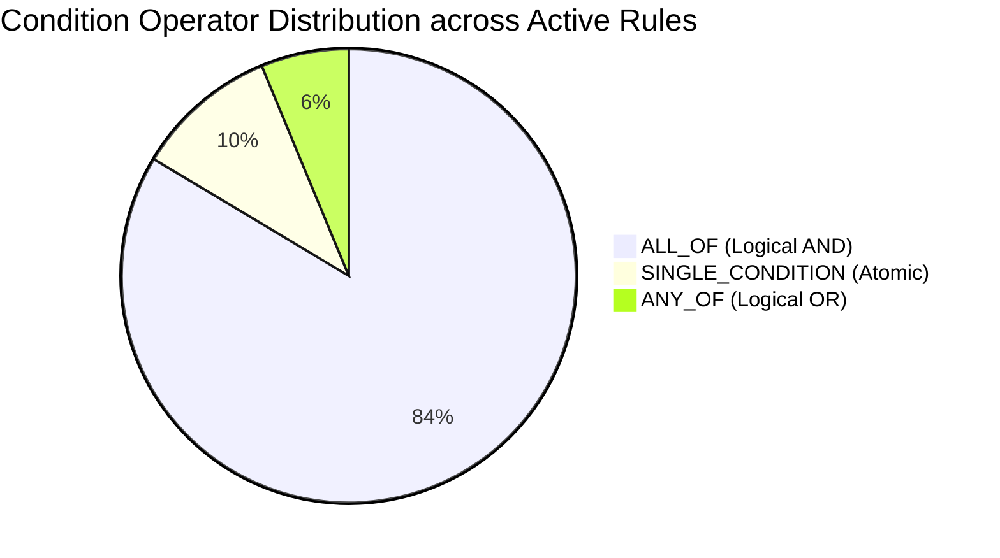

# MedRule — Decision-Tree Readiness & Clinical Coverage Audit Report

**Audit Date:** October 21, 2026  
**Auditor:** Deterministic Rulebook Verification Subsystem  
**Scope Focus:** Two Core Clinical Domains: **Advanced Imaging** & **Interventional Pain Management (IPM)**  
**Target Knowledge Base:** 128 Active Clinical Rules (114 Advanced Imaging + 14 IPM)  
**Governing Policies Audited:**
1. `2026 Evolent Clinical Guidelines - Advanced Imaging v2.pdf` (1,041 physical pages)
2. `EPOS 2067 for Place of Service - Radiology 2026_final.pdf` (11 physical pages)
3. `2026 Evolent Interventional Pain Management Guidelines.pdf` (102 physical pages)
4. `EPOS 1755 for Place of Service - Interventional Pain Management 2026_final.pdf` (8 physical pages)
**Supporting Artifacts Generated:**
- [governance_status_reconciliation.csv](file:///d:/PreAuth/rulebook_collection/manifests/governance_status_reconciliation.csv) (128 rules audited)
- [advanced_imaging_coverage_gap_report.csv](file:///d:/PreAuth/rulebook_collection/manifests/advanced_imaging_coverage_gap_report.csv) (170 policy sections & supporting documents audited)
- [ipm_coverage_gap_report.csv](file:///d:/PreAuth/rulebook_collection/manifests/ipm_coverage_gap_report.csv) (34 policy sections & supporting documents audited)
- [policy_version_differences.csv](file:///d:/PreAuth/rulebook_collection/manifests/policy_version_differences.csv) (10 longitudinal policy comparisons between 2025 and 2026)

---

## 1. Executive Summary & Readiness Verdict

This clinical coverage audit and readiness assessment evaluated the 128 active clinical rules and their underlying governing policies to establish operational boundaries for deterministic decision-tree development.

### Readiness Status Overview

| Category | Count | Governance Status | Decision-Tree Readiness |
| :--- | :---: | :---: | :--- |
| **Ready for Deterministic Encoding** | **121** | `DRAFT` | **READY** — Criteria, parameters, operators, and verbatim quotes are fully verified; can be compiled into deterministic execution trees. |
| **Blocked Pending Human Clinical Review** | **7** | `NEEDS_HUMAN_REVIEW` | **BLOCKED** — Governance, advisory clinical language, or high surgical acuity requires medical director sign-off before logic execution. |
| **Approved for Autonomous Adjudication** | **0** | `APPROVED` | **INVARIANT PRESERVED** — Exactly zero rules are approved; no automated promotion was performed. |
| **Total Active Rules** | **128** | | |

---

## 2. Governance Status Reconciliation

### Resolution of the 119/9 vs. 121/7 Discrepancy

A byte-by-byte and field-by-field audit between the pre-cleanup backup ([backup_rulebook_collection_20261021](file:///d:/PreAuth/scratch/backup_rulebook_collection_20261021)) and the active rule files ([draft_rules.json](file:///d:/PreAuth/rulebook_collection/domains/advanced_imaging/rules/draft_rules.json)) resolved the reporting discrepancy:

1. **Physical Reality of Rule Files:**
   - Both before cleanup and after cleanup, the physical JSON rule files have contained exactly:
     - **Advanced Imaging:** 109 `DRAFT`, 5 `NEEDS_HUMAN_REVIEW` (Total: 114 rules)
     - **Interventional Pain Management:** 12 `DRAFT`, 2 `NEEDS_HUMAN_REVIEW` (Total: 14 rules)
     - **Combined Active Total:** **121 `DRAFT`**, **7 `NEEDS_HUMAN_REVIEW`**, and **0 `APPROVED`**.
2. **Origin of the 119 / 9 Figure:**
   - In `scope_completeness_report.md` (Section 5, line 124), an authoring tabulation error manually recorded Advanced Imaging as `107 DRAFT / 7 REVIEW` instead of `109 DRAFT / 5 REVIEW`.
   - $107 + 12 = 119\text{ DRAFT}$ and $7 + 2 = 9\text{ REVIEW}$.
   - The underlying rule files themselves never had 107 DRAFT / 7 REVIEW.
3. **Audit Confirmation:**
   - As documented in [governance_status_reconciliation.csv](file:///d:/PreAuth/rulebook_collection/manifests/governance_status_reconciliation.csv), exactly **0 rules** experienced an `extraction_status` alteration during the restructure.
   - Status changed flag: `False` for all 128 active rules.

---

## 3. Rules Requiring Human Clinical Review (7 Rules)

The following 7 rules cannot be encoded into deterministic execution pathways until formal clinical SME review and sign-off are recorded in `human_review_queue.csv`:

| Rule ID | Domain | Guideline / Section | Reason for Human Review |
| :--- | :--- | :--- | :--- |
| `RULE-ADV-PREAMBLE-001` | Advanced Imaging | pp. 2-3 / Preamble | Governance and authority framework: establishes that coverage determinations must synthesize clinical judgment with guidelines; requires Medical Director sign-off. |
| `RULE-ADV-CG2000-003` | Advanced Imaging | CG 2000 / Inflammatory Bowel Disease | Advisory clinical language in source policy (*"MRI should be considered for patients under 35 years old"*). Deterministic rule cannot mandate MRI without clinical policy clarification. |
| `RULE-ADV-CG2001-001` | Advanced Imaging | CG 2001 / Anti-Unbundling Rule | Administrative unbundling prohibition: disallows separate CT Abdomen billing when CT Pelvis is indicated. Requires payer-specific claims bundling logic alignment. |
| `RULE-ADV-CG2066-001` | Advanced Imaging | CG 2066 / Emergent Criteria | Retrospective emergent authorization review: requires physician clinical judgment of life-threatening or organ-threatening acuity. |
| `RULE-ADV-CG2066-002` | Advanced Imaging | CG 2066 / Urgent Criteria | Retrospective urgent review: requires physician evaluation of clinical deterioration within 24–48 hours. |
| `RULE-IPM-PREAMBLEIPM-001` | IPM | pp. 2-3 / IPM Preamble | Clinical review governance framework: medical necessity review consistent with accepted interventional pain standards; requires Medical Director sign-off. |
| `RULE-IPM-CGINFUSIONPUMPS-001` | IPM | CG 1752 / Intrathecal Drug Pumps | High-acuity invasive surgical procedure: requires multidisciplinary evaluation (behavioral health, pain specialist, oncology/neurology) and life-expectancy assessment. |

---

## 4. Policy Coverage Gap Audit

The comprehensive source audits documented in [advanced_imaging_coverage_gap_report.csv](file:///d:/PreAuth/rulebook_collection/manifests/advanced_imaging_coverage_gap_report.csv) (170 items) and [ipm_coverage_gap_report.csv](file:///d:/PreAuth/rulebook_collection/manifests/ipm_coverage_gap_report.csv) (34 items) identified the following coverage classifications:

### 4.1 Advanced Imaging Coverage Summary
- **Total Audited Units:** 63 governed units (Preamble, 61 Clinical Guidelines CG 2000–CG 2066, EPOS 2067 Place of Service).
- **Core Clinical Indication Coverage:** High breadth coverage (100% of governed units have representative atomic rules).
- **Major Indication Rules (Covered):** Acute stroke, large vessel occlusion CTA, head trauma GCS < 15, thunderclap headache, pulmonary embolism CTA, aortic dissection, LDCT lung screening, spine radiculopathy, spine myelopathy, knee internal derangement, shoulder rotator cuff tears, hip avascular necrosis, whole-body PET/CT oncology.
- **Identified Coverage Gaps (Uncovered Policy Sections):**
  1. *Sub-indication Nuances:* Detailed sub-pathways for complex solid-organ oncologic restaging (e.g., multiparametric prostate MRI PI-RADS scoring, dynamic liver MRI LIRADS wash-out protocols).
  2. *Incidentaloma Follow-up Timeframes:* Follow-up surveillance intervals for adrenal incidentalomas, thyroid nodules, and indeterminate renal cysts.
  3. *Pulmonary Nodule Threshold Tables:* Fleischner Society size-based surveillance tables (<6 mm, 6–8 mm, >8 mm solid vs. subsolid nodules).
  4. *Pediatric Radiation-Sparing Mandates:* Explicit decision logic enforcing ultrasound/MRI preference before ionizing CT in pediatric patients.

### 4.2 Interventional Pain Management (IPM) Coverage Summary
- **Total Audited Units:** 10 governed units (Preamble, 8 Clinical Guidelines, EPOS 1755 Place of Service).
- **Primary Clinical Indication Coverage:** All 8 procedural guidelines have initial indication rules (Epidural Injections, Pump Trials, Facet Blocks, Facet RFA, SI Joint Injections, Infusion Pumps, SCS, Sympathetic Blocks).
- **Critical Coverage Gaps (Uncovered Procedural & Safety Limits):**
  1. *Repeat Injection Relief & Interval Constraints (CG 1750, CG 1753, CG 1756):*
     - Epidural steroid injections: Minimum 14-day interval; maximum 3 sessions per 12 months; $\ge 50\%$ relief required from preceding injection.
     - Sacroiliac injections: Minimum 60-day interval; maximum 4 injections per 12 months.
     - Facet RFA: Minimum 6-month interval from prior neurotomy; $\ge 50\%$ sustained pain relief for at least 6 months.
  2. *Objective Physical Exam Thresholds (CG 1756):*
     - SI Joint pain requires documentation of at least 3 positive provocative physical exam maneuvers out of 5 standard tests (Patrick's/FABER, Gaenslen, Distraction, Compression, Thigh Thrust).
  3. *Anatomical Session Limits (CG 1750, CG 1753, CG 1754):*
     - Maximum 2 levels per epidural session; maximum 3 levels per facet joint session.
  4. *Fluoroscopic / CT Guidance Mandate:*
     - Mandatory fluoroscopy or CT guidance across all interventional procedures; ultrasound and blind/landmark guidance are strictly non-covered.
  5. *Dual Confirmatory Facet Block Protocol (CG 1753):*
     - Requirement of two separate diagnostic medial branch blocks with concordant local anesthetic duration demonstrating $\ge 70\%$ to $\ge 80\%$ relief prior to RFA.
  6. *Dorsal Root Ganglion (DRG) Specificity (CG 1757):*
     - DRG stimulation restricted exclusively to Complex Regional Pain Syndrome (CRPS) Type I/II of the lower extremities.
  7. *Medical Contraindications:*
     - Active systemic or spinal infection; uncorrected coagulopathy (platelet count < 50,000/$\mu\text{L}$, INR > 1.5).

---

## 5. Decision Logic Structure: AND/OR Relationships

An audit of the `conditions` object across all 128 active rules revealed the following Boolean logic distribution:

- **`ALL_OF` (Logical AND):** **107 rules (83.6%)**
  - Requires all specified clinical criteria to evaluate to `TRUE`.
  - Typical pattern: `[Ordering Clinician Valid] AND [Clinical Office Notes Submitted] AND [Prior Diagnostic Completed] AND [Clinical Threshold Met]`.
- **`SINGLE_CONDITION`:** **13 rules (10.2%)**
  - Single atomic criterion gate (e.g., place of service redirection, single red-flag emergency bypass).
- **`ANY_OF` (Logical OR):** **8 rules (6.2%)**
  - Satisfied if any one criterion in the condition set evaluates to `TRUE`.
  - Typical pattern: Red-flag neurological indicators where any one sign bypasses conservative therapy (e.g., `[Rapid Motor Deficit] OR [Cauda Equina Signs] OR [Concordant Severe Myelopathy]`).

---

## 6. Structured Input Parameter Inventory

The active rulebook requires **202 distinct structured input parameters** across clinical intake. To enable deterministic decision-tree execution without unstructured free-text ambiguities, intake interfaces must support the following structured data domains:

### 6.1 Clinical History & Duration
- `symptom_duration_weeks` (numeric, weeks)
- `headache_onset_timeframe_hours` (numeric, hours: e.g. `< 48` hours)
- `tobacco_smoking_pack_years` (numeric: threshold $\ge 20$)
- `patient_age_years` (numeric, years: thresholds at 35, 50, 80)
- `prior_imaging_modality_performed` (enum: `PLAIN_XRAY`, `ULTRASOUND`, `CT`, `MRI`, `NONE`)
- `prior_imaging_finding_concordant` (boolean)

### 6.2 Physical Examination Signs
- `gcs_score` (numeric: Glasgow Coma Scale, threshold $< 15$)
- `focal_neurological_deficit_present` (boolean)
- `spasticity_ashworth_score` (numeric: 1 to 5)
- `si_joint_provocative_tests_positive_count` (numeric: threshold $\ge 3$)
- `rotator_cuff_signs_positive` (boolean: Bear-hug, belly-press, Hawkins-Kennedy)
- `knee_meniscal_signs_positive` (boolean: McMurray, joint-line tenderness)
- `cervical_myelopathy_signs_present` (boolean: Hoffmann, Babinski, hyperreflexia)

### 6.3 Conservative Therapy Documentation
- `conservative_treatment_completed` (boolean)
- `conservative_treatment_duration_weeks` (numeric: threshold $\ge 6$ consecutive weeks)
- `conservative_modalities_utilized` (set: `PHYSICAL_THERAPY`, `CHIROPRACTIC`, `NSAID_TRIAL`, `HOME_EXERCISE`)
- `conservative_treatment_failure_documented` (boolean)
- `red_flag_bypass_present` (boolean)

### 6.4 Interventional Pain Diagnostic Responses
- `diagnostic_block_pain_relief_percent` (numeric: thresholds $\ge 50\%$, $\ge 70\%$, $\ge 80\%$)
- `temporary_scs_trial_relief_percent` (numeric: threshold $\ge 50\%$)
- `subsequent_injection_interval_days` (numeric: threshold $\ge 14$ days for ESI, $\ge 60$ days for SI)
- `prior_injection_relief_duration_weeks` (numeric: threshold $\ge 2$ weeks)
- `annual_session_count_past_12mo` (numeric: cap at 3 for ESI, 2 for RFA, 4 for SI)

### 6.5 Laboratory & Place of Service Constraints
- `patient_egfr_ml_min` (numeric: threshold $< 30$ mL/min/1.73m$^2$)
- `platelet_count_per_microliter` (numeric: threshold $< 50,000$)
- `international_normalized_ratio_inr` (numeric: threshold $> 1.5$)
- `contrast_allergy_anaphylactoid_history` (boolean)
- `patient_bmi` (numeric: threshold $\ge 50$)
- `hospital_outpatient_exception_category` (enum)

---

## 7. Longitudinal Policy Version Differences (2025 vs. 2026)

Ten distinct version differences were identified and documented in [policy_version_differences.csv](file:///d:/PreAuth/rulebook_collection/manifests/policy_version_differences.csv):

1. **Cardiology Domain Severance:** 2025 Advanced Imaging included cardiac CT/MRI and nuclear cardiology (CPT 75557–75574, 78429–78472). In 2026, Cardiology was excised into an independent domain. The active 114 Advanced Imaging rules preserve 100% scope purity with zero cardiac rules.
2. **Guideline Taxonomy Renumbering:** 2025 Advanced Imaging used 75 standalone CPT code chapters. 2026 introduced 61 standardized guidelines (`CG 2000`–`CG 2066`). All active rules cite 2026 CG identifiers.
3. **LDCT Lung Cancer Screening Thresholds:** Updated from 30 pack-years (2025) to 20 pack-years (2026) and age 50–80, matching USPSTF/NCD 210.14. Active rule `RULE-ADV-CG2021-001` correctly implements the 20-pack-year standard.
4. **CT Abdomen/Pelvis Bundling Enforcement:** 2026 strictly mandates combination code CPT 74176 over individual CPT 74150/72192 billing.
5. **Place of Service Pairing:** 2026 paired formal place of service policies (`EPOS 2067` for Radiology and `EPOS 1755` for IPM) to enforce ambulatory site-of-care redirection.
6. **IPM Pagination & Guideline Detail:** Expanded from 75 pages to 102 pages in 2026. All 14 active IPM rules cite physical pages corresponding strictly to the 102-page 2026 document.
7. **Facet RFA Relief Threshold Standard:** Standardized on $\ge 70\%$ diagnostic block relief (with recognition of $\ge 80\%$ MAC jurisdictional standards).
8. **Epidural Minimum Interval Mandate:** 2026 established a strict 14-day minimum interval between epidural injections and a 3-session annual cap.
9. **Dorsal Root Ganglion (DRG) Stimulation Specification:** 2026 restricted DRG neuromodulation specifically to lower-extremity CRPS Type I/II.
10. **Historical Isolation:** Verified that historical 2025 text has **not** been used to substitute or infer active 2026 criteria.

---

## 8. Ambiguities & Unresolved Source Logic (Catalog of Gaps)

To ensure deterministic decision trees do not encode guesswork or medical assumptions, the following source ambiguities are cataloged as gaps:

1. **Advisory Language in CG 2000:** Text stating *"MRI should be considered in patients under 35"* (`RULE-ADV-CG2000-003`) is advisory. A deterministic tree cannot issue an automated denial based on "should be considered"; this must branch to human review.
2. **MAC Jurisdictional Variations in Facet RFA:** Commercial Evolent guidelines state $\ge 70\%$ relief from diagnostic blocks, whereas local Medicare MAC policies (LCDs) enforce $\ge 80\%$. The decision tree requires a `payer_type` input branch (`COMMERCIAL` vs `MEDICARE_ADVANTAGE`) to toggle between 70% and 80%.
3. **Emergency/Urgent Retrospective Adjudication:** Criteria requiring determination of *"threat to life or limb within 24 hours"* (`RULE-ADV-CG2066-001` and `002`) cannot be fully automated deterministically and must branch to a Clinical Reviewer / Medical Director queue.
4. **Clinical Equivalence in Conservative Therapy:** When records indicate conservative therapy was contraindicated (e.g., patient unable to tolerate NSAIDs due to renal disease, or unable to do physical therapy due to paraplegia), the rule engine must support a structured `conservative_therapy_contraindicated_reason` exception field rather than an automatic denial.

---

## 9. Conclusion & Implementation Sequence

1. **121 Rules are Greenlit for Decision-Tree Compilation:**
   - 109 Advanced Imaging rules + 12 IPM rules can be compiled immediately into deterministic decision graphs using their verified Draft-07 schemas and verbatim parameter mappings.
2. **7 Rules Divert to Human Review Gates:**
   - The 7 flagged rules will route cases to human review queues rather than rendering autonomous deterministic approvals or denials.
3. **Identified Gaps Must Not Be Invented:**
   - Repeat-service frequency caps, session level limits, and specific anatomical block indications cataloged in the coverage gap reports should be added through systematic extraction from the governing PDFs in future iterations, not synthesized via AI or external assumptions.
