# MedRule Phase 2E — Supporting Documents, Evidence Mapping and Policy Dependencies: Final Completion Report

**Project**: MedRule Deterministic Prior-Authorization Decision Support System  
**Phase**: Phase 2E — Supporting Documents, Evidence Mapping & Policy Dependencies  
**Date**: October 18, 2026  
**Status**: `PHASE_2E_COMPLETE`  
**Execution Mode**: Deterministic Source Grounding (Zero LLM APIs, Zero Pretrained Models, Zero Synthetic Rules, Zero Approved Rules)

---

## 1. Executive Summary & Corpus Verification

Phase 2E establishes the complete evidentiary intake architecture and policy dependency network for the MedRule knowledge base across all nine clinical domains. This phase systematically structures every supporting document, deconstructs intake checklists and clinical forms into discrete machine-readable fields, links supporting guidance to governing clinical policies and extracted decision rules, quarantines historical baseline documents, registers cross-domain external statutory authorities, and logs plan-specific commercial/Medicaid access dependencies.

### 1.1 Master Corpus Metrics
- **Total Master PDF Inventory Documents**: 85 physical PDF documents
  - **Governing Clinical Policies**: 21 documents (11 primary 2026 governing guidelines, 7 referenced Centene clinical policies, 3 historical comparison baselines)
  - **Checklists**: 16 documents
  - **Forms / Member Attestation Letters**: 7 documents
  - **Clinical Tip Sheets**: 18 documents
  - **Coding Grids / Fee Standards**: 3 documents
  - **Supplementary Clinical Policies**: 12 documents
  - **External Authority Reference Sources**: 8 documents (4 in Centene `referenced_sources/`, 4 in `cross_domain_references/cms/`)
- **Total Supporting / Reference Documents Cataloged in Phase 2E**: 74 entries (70 domain-level supporting documents + 4 central CMS references)
- **Cumulative Active Decision Rules**: Strictly 372 rules across all 9 domains
  - **Status Breakdown**: 322 `DRAFT`, 50 `NEEDS_HUMAN_REVIEW`, 0 `APPROVED`
  - **Non-Regression Guarantee**: 100% preserved and unmodified from Phase 2D.1
- **Total Policy and Rule Mappings Created**: 79 verified mappings
- **Discrete Evidence and Intake Fields Deconstructed**: 121 standardized fields
  - **Clinical Evidence Fields**: 76 fields (62.8%)
  - **Administrative Intake Fields**: 45 fields (37.2%)
- **Cross-Domain Policy Dependencies Registered**: 15 verified dependencies
- **Automated Unit Tests**: 121 tests executed across the workspace — **100% Pass Rate (0 failures, 0 errors)**

---

## 2. Functional Role Taxonomy & Authority Governance

A core clinical safety requirement in deterministic prior authorization is ensuring that non-governing aids (intake checklists, administrative forms, and provider tip sheets) are never improperly elevated to autonomous governing coverage policies. To enforce this boundary, Phase 2E classifies every document with both its physical `document_type` and an authoritative `functional_role`:

| Functional Role | Permitted Use in Decision Engine | Regulatory & Evidentiary Scope |
|-----------------|----------------------------------|--------------------------------|
| `INTAKE_OR_DOCUMENTATION_AID` | Structures data capture; prompts provider for required clinical records; collects signatures. | Intake checklists, clinical history questionnaires, member transfer attestation forms. Non-governing. |
| `SUPPLEMENTARY_PROCEDURAL_GUIDANCE` | Establishes clinical exception criteria, site of service redirects, modality trade-offs. | Place of Service policies (EPOS 2067, 1755, 1773), claim edit rules, clinical tip sheets. Subordinate to governing guidelines. |
| `CODING_OR_BILLING_REFERENCE` | Defines prior authorization CPT/HCPCS code clusters, bundling edits, and laboratory crosswalks. | Cardiovascular service grids, radiation oncology coding standards, genetic test matrices. |
| `SEPARATELY_GOVERNED_POLICY` | Provides autonomous clinical necessity criteria for specific procedures or modalities. | Referenced Centene clinical policies (CP.MP.48, 99, 171, 184, 185, 203, 243); Physical Medicine policies. |
| `EXTERNAL_AUTHORITY` | Establishes statutory billing requirements, hospital discharge rules, supplier quality standards. | CMS Medicare Claims Manual Ch 20, CMS State Operations Manual App A, CMS Quality Standards, RESNA Position Papers. |
| `HISTORICAL_DOCUMENT_COMPARISON` | Longitudinal audit tracking and baseline comparison only. | Superseded 2024/2025 guidelines and obsolete intake forms. Strictly barred from active automated evaluation. |
| `PLAN_SPECIFIC_DEPENDENCY` | Plan-specific benefit carve-outs and state fee schedules. | Proprietary Medicaid fee schedules, employer group benefit carve-out lists. Triggers mandatory human review. |

---

## 3. Domain-by-Domain Analysis

### 3.1 Advanced Imaging
- **Governing Guidelines**: 2026 Evolent Advanced Imaging Guidelines (DOC-ADV-001)
- **Supporting Documents Cataloged**: 10 documents
  - `DOC-ADV-002`: Evolent Place of Service Policy EPOS 2067 (`SUPPLEMENTARY_PROCEDURAL_GUIDANCE`)
  - `DOC-ADV-003`: 2025 Evolent Advanced Imaging Guidelines (`HISTORICAL_DOCUMENT_COMPARISON` — Quarantined)
  - `DOC-ADV-004`: Advanced Imaging Prior Authorization Checklist (`INTAKE_OR_DOCUMENTATION_AID`)
  - `DOC-ADV-005`: Low-Dose CT Lung Cancer Screening Prior Authorization Checklist (`INTAKE_OR_DOCUMENTATION_AID`)
  - `DOC-ADV-006`: Conservative Treatment History Form: Imaging (Rev. July 2025) (`INTAKE_OR_DOCUMENTATION_AID`)
  - `DOC-ADV-007`: Conservative Treatment History Form: Imaging (Rev. 01/11/2024) (`HISTORICAL_DOCUMENT_COMPARISON` — Quarantined)
  - `DOC-ADV-008`: Evolent Tip Sheet Advanced Imaging (Rev. July 2025) (`SUPPLEMENTARY_PROCEDURAL_GUIDANCE`)
  - `DOC-ADV-009`: Evolent Tip Sheet Brain MRI and CT (`SUPPLEMENTARY_PROCEDURAL_GUIDANCE`)
  - `DOC-ADV-010`: Evolent Tip Sheet Advanced Imaging 2.16.24 (`HISTORICAL_DOCUMENT_COMPARISON` — Quarantined)
  - `DOC-ADV-011`: Evolent Tip Sheet Pediatric Imaging 2.16.24 (`HISTORICAL_DOCUMENT_COMPARISON` — Quarantined)
- **Traceability Mappings**: 11 mappings (MAP-ADV-001 through MAP-ADV-011) linked to `RULE-ADV-EPOS2067-001`, `RULE-ADV-CG2066-001`, `RULE-ADV-PREAMBLE-001`, and `RULE-ADV-CG2000-001`.
- **Field Mappings**: 20 discrete fields deconstructed across DOC-ADV-004, DOC-ADV-005, and DOC-ADV-006 (e.g. 20+ pack-year smoking history, asymptomatic status, 6-week physical therapy trial dates, clinician attestation signature).
- **Unmapped / Quarantined**: 4 historical documents in `HISTORICAL_QUARANTINE` + 1 plan-specific dependency (`DOC-ADV-MISSING-001`: State Medicaid CPT Crosswalks).

### 3.2 Cardiology
- **Governing Guidelines**: 2026 Evolent Diagnostic Cardiology (DOC-CARD-001), 2026 Interventional Cardiology (DOC-CARD-002)
- **Supporting Documents Cataloged**: 9 documents
  - `DOC-CARD-003`: Cardiovascular Service Group Grid (`CODING_OR_BILLING_REFERENCE`)
  - `DOC-CARD-004`: Cardiac Claim Edit: Stress Echo & Doppler Add-On OP38801 (`SUPPLEMENTARY_PROCEDURAL_GUIDANCE`)
  - `DOC-CARD-005`: Evolent Generic Cardiac Prior Authorization Checklist (`INTAKE_OR_DOCUMENTATION_AID`)
  - `DOC-CARD-006` to `DOC-CARD-011`: 6 Clinical Tip Sheets covering Cath, MPI vs Stress Echo, MPI, Stress Echo, TTE, and Solution Overview (`SUPPLEMENTARY_PROCEDURAL_GUIDANCE`).
- **Traceability Mappings**: 11 mappings (MAP-CARD-001 through MAP-CARD-011) linked to `RULE-CARD-PREAMBLEDIAG-001`, `RULE-CARD-OP38801-001`, `RULE-CARD-CG7251-001` (TTE), `RULE-CARD-CG7252-001` (Stress Echo), `RULE-CARD-CG7253-001` (MPI), and `RULE-CARD-CG7254-001` (Cath).
- **Field Mappings**: 18 discrete fields deconstructed from DOC-CARD-005 (e.g. Baseline 12-lead ECG interpretability, LVEF %, prior stress test result, CCS angina class, ability to treadmill walk, GDMT antianginal therapy trial).
- **Unmapped / Plan-Specific**: 1 plan-specific dependency (`DOC-CARD-MISSING-001`: Payer Cardiac Stress Testing Tiering Crosswalk Grids).

### 3.3 Musculoskeletal Surgery
- **Governing Guidelines**: 2026 Evolent Musculoskeletal Surgery Guidelines (DOC-MSK-001)
- **Supporting Documents Cataloged**: 10 documents
  - `DOC-MSK-002`: Evolent Place of Service Policy EPOS 1773 (`SUPPLEMENTARY_PROCEDURAL_GUIDANCE`)
  - `DOC-MSK-003`: Musculoskeletal Surgery Checklist: Hip, Knee, and Shoulder (`INTAKE_OR_DOCUMENTATION_AID`)
  - `DOC-MSK-004`: Musculoskeletal Surgery Checklist: Spine Surgery (`INTAKE_OR_DOCUMENTATION_AID`)
  - `DOC-MSK-005`: Conservative Treatment History Form: Back / Neck (Rev. July 2025) (`INTAKE_OR_DOCUMENTATION_AID`)
  - `DOC-MSK-006`: Conservative Treatment History Form: Major Joints (Rev. July 2025) (`INTAKE_OR_DOCUMENTATION_AID`)
  - `DOC-MSK-007` to `DOC-MSK-011`: 5 Clinical Tip Sheets for Hip/Knee (Commercial/Medicare), Knee Arthroscopy, Shoulder Arthroplasty, Shoulder Arthroscopy (`SUPPLEMENTARY_PROCEDURAL_GUIDANCE`).
- **Traceability Mappings**: 10 mappings (MAP-MSK-001 through MAP-MSK-010) linked to `RULE-MSK-EPOS1773-001`, `RULE-MSK-CGKNEEARTHROPLASTY-001`, `RULE-MSK-CGCERVICALLUMBAR-002`, and `RULE-MSK-PREAMBLEMSK-001`.
- **Field Mappings**: 16 discrete fields deconstructed across DOC-MSK-003, 004, 005, 006 (e.g. Weight-bearing Kellgren-Lawrence Grade 3-4 radiographs, neural concordance physical exam, cauda equina red-flag exclusion, >= 6 weeks physical therapy, intra-articular injection dates & relief).
- **Unmapped / Plan-Specific**: 1 regulatory dependency (`DOC-MSK-MISSING-001`: CMS Inpatient Only Carve-Out List).

### 3.4 Interventional Pain Management
- **Governing Guidelines**: 2026 Evolent Interventional Pain Management Guidelines (DOC-IPM-001)
- **Supporting Documents Cataloged**: 6 documents
  - `DOC-IPM-002`: Evolent Place of Service Policy EPOS 1755 (`SUPPLEMENTARY_PROCEDURAL_GUIDANCE`)
  - `DOC-IPM-003`: 2025 Interventional Pain Management Guidelines (`HISTORICAL_DOCUMENT_COMPARISON` — Quarantined)
  - `DOC-IPM-004`: Interventional Pain Management Prior Authorization Checklist (`INTAKE_OR_DOCUMENTATION_AID`)
  - `DOC-IPM-005`: Conservative Treatment History Form: IPM (Rev. July 2025) (`INTAKE_OR_DOCUMENTATION_AID`)
  - `DOC-IPM-006`: Conservative Treatment History Form: IPM (Rev. 01/11/2024) (`HISTORICAL_DOCUMENT_COMPARISON` — Quarantined)
  - `DOC-IPM-007`: IPM Prior Authorization Tip Sheet (`SUPPLEMENTARY_PROCEDURAL_GUIDANCE`)
- **Traceability Mappings**: 7 mappings (MAP-IPM-001 through MAP-IPM-007) linked to `RULE-IPM-EPOS1755-001`, `RULE-IPM-CGEPIDURALINJECTIONS-001`, `RULE-IPM-CGFACETBLOCKS-001`, and `RULE-IPM-PREAMBLEIPM-001`.
- **Field Mappings**: 14 discrete fields deconstructed across DOC-IPM-004 and DOC-IPM-005 (e.g. Radicular vs axial pain distribution, fluoroscopic guidance affirmation, prior injection relief % [>=50%], duration of relief [>=2 months], annual injection frequency cap [max 4/year]).
- **Unmapped / Quarantined**: 2 historical documents in `HISTORICAL_QUARANTINE` + 1 plan-specific dependency (`DOC-IPM-MISSING-001`: State Medicaid Injection Frequency Limitations).

### 3.5 Radiation Oncology
- **Governing Guidelines**: Evolent Clinical Guideline 7000 (DOC-RAD-001), Clinical Guideline 7001 Proton/Neutron (DOC-RAD-002)
- **Supporting Documents Cataloged**: 7 documents
  - `DOC-RAD-003`: 2026 Evolent Radiation Oncology Coding Standards (`CODING_OR_BILLING_REFERENCE`)
  - `DOC-RAD-004` to `DOC-RAD-009`: 6 Disease-Specific Checklists (Breast, Prostate, Non-Small Cell Lung, CNS Primary, Colorectal, Head & Neck) (`INTAKE_OR_DOCUMENTATION_AID`).
- **Traceability Mappings**: 7 mappings (MAP-RAD-001 through MAP-RAD-007) linked to `RULE-RAD-RADCODINGIMRTPLANNING-001`, `RULE-RAD-ECG7000BREAST-001`, `RULE-RAD-ECG7000PROSTATE-001`, `RULE-RAD-ECG7000LUNG-001`, `RULE-RAD-ECG7000CNSSRS-001`, `RULE-RAD-ECG7000GICOLORECTAL-001`, and `RULE-RAD-ECG7000HEADNECK-001`.
- **Field Mappings**: 15 discrete fields deconstructed across checklists (e.g. AJCC/TNM pathologic stage, ECOG performance status, curative vs palliative intent, prescribed Gy dose & fraction count, prior overlapping radiation field audit, comparative 3D vs IMRT/Proton dosimetric plan).
- **Unmapped / Plan-Specific**: 1 plan-specific dependency (`DOC-RAD-MISSING-001`: Payer Proton Beam Coverage Threshold Agreements).

### 3.6 Physical Medicine
- **Governing Guidelines**: 2026 Evolent Physical Medicine Guidelines (DOC-PHY-001)
- **Supporting Documents Cataloged**: 11 documents
  - `DOC-PHY-002` to `DOC-PHY-009`: 8 Supplementary Policies covering Active Procedures, Passive Modalities, Measurable Improvement, Habilitative PT/OT, Speech Therapy, DME Provisioning, Investigational Services, and Record Keeping (`SEPARATELY_GOVERNED_POLICY` / `SUPPLEMENTARY_PROCEDURAL_GUIDANCE`).
  - `DOC-PHY-010`: Physical Medicine Tip Sheet and Document Checklist (Rev. 4/2026) (`INTAKE_OR_DOCUMENTATION_AID`)
  - `DOC-PHY-011`: Maintenance Therapy and Episodic Care Tip Sheet (`SUPPLEMENTARY_PROCEDURAL_GUIDANCE`)
  - `DOC-PHY-012`: Overlapping Authorization Member Attestation Letter (`INTAKE_OR_DOCUMENTATION_AID`)
- **Traceability Mappings**: 11 mappings (MAP-PHY-001 through MAP-PHY-011) linked to `RULE-PHY-PREAMBLEPHY-001`, `RULE-PHY-POLICYMEASURABLEIMPROV-001`, `RULE-PHY-POLICYHABILITATIVEPTOT-001`, `RULE-PHY-POLICYHABREHABSPEECH-001`, `RULE-PHY-POLICYPASSIVETREATMENT-001`, and `RULE-PHY-ECG1501CHIROINFANT-001`.
- **Field Mappings**: 13 discrete fields deconstructed across DOC-PHY-010 and DOC-PHY-012 (e.g. Prior level of function [PLOF], objective ROM/MMT measurements, measurable progress documented every 2 weeks, standardized norm-referenced pediatric delay scores, member attestation terminating outside care).
- **Unmapped / Plan-Specific**: 1 plan-specific dependency (`DOC-PHY-MISSING-001`: Health Plan Summary Plan Description [SPD] Annual Therapy Benefit Caps).

### 3.7 Sleep Health
- **Governing Guidelines**: 2026 Evolent Sleep Studies Guidelines (DOC-SLP-001)
- **Supporting Documents Cataloged**: 2 documents
  - `DOC-SLP-002`: Sleep Assessment Record Checklist: Attended or Unattended (`INTAKE_OR_DOCUMENTATION_AID`)
  - `DOC-SLP-003`: Sleep Assessment Record Checklist: Plans Without Home Sleep Testing Benefit (`INTAKE_OR_DOCUMENTATION_AID`)
- **Traceability Mappings**: 4 mappings (MAP-SLP-001 through MAP-SLP-004) linked to `RULE-SLP-CG2050-001` (Adult OSA), `RULE-SLP-CG2051-001` (Pediatric PSG), and `RULE-SLP-CG2050-004` (PAP Titration).
- **Field Mappings**: 12 discrete fields deconstructed across checklists (e.g. Epworth Sleepiness Scale [ESS] >= 10, witnessed apneas, COPD/hypoventilation comorbidity, NYHA III-IV heart failure, prior failed/inconclusive HSAT, cognitive/motor inability to self-administer home test).
- **Unmapped / Plan-Specific**: 1 plan-specific dependency (`DOC-SLP-MISSING-001`: Commercial Employer Group Home Sleep Test Exemption Lists).

### 3.8 Genetic Testing
- **Governing Guidelines**: 2026 Evolent Genetic Testing Guidelines (DOC-GEN-001)
- **Supporting Documents Cataloged**: 3 documents
  - `DOC-GEN-002`: Generic Genetic Tests and Laboratory Matrix (`CODING_OR_BILLING_REFERENCE`)
  - `DOC-GEN-003`: Generic Genetic and Molecular Testing Program Checklist (`INTAKE_OR_DOCUMENTATION_AID`)
  - `DOC-GEN-004`: Oncology: Molecular Analysis of Solid Tumors and Hematologic Malignancies Checklist (`INTAKE_OR_DOCUMENTATION_AID`)
- **Traceability Mappings**: 6 mappings (MAP-GEN-001 through MAP-GEN-006) linked to `RULE-GEN-PREAMBLEGEN-001`, `RULE-GEN-CGGENHBOCBRCA-001`, `RULE-GEN-CGGENEXOMEWES-001`, `RULE-GEN-CGBREASTPROGNOSTIC-002`, and `RULE-GEN-CGGENLYNCHSYNDROME-001`.
- **Field Mappings**: 11 discrete fields deconstructed across checklists (e.g. Performing CLIA laboratory NPI, 3-generation family pedigree, pre-test genetic counseling documentation, clinical actionability statement altering management, tumor cellularity >= 20-30% for NGS).
- **Unmapped / Plan-Specific**: 1 plan-specific dependency (`DOC-GEN-MISSING-001`: Payer Non-Covered Genetic Panel Exclusion Lists).

### 3.9 Centene DME, Orthotics and Prosthetics
- **Governing Guidelines**: Centene CP.MP.107 (Rev. 08/26, effective 08/01/2026) (DOC-CEN-001)
- **Supporting Documents Cataloged**: 12 documents
  - `DOC-CEN-002`: CP.MP.107 (Rev. 11/24) (`HISTORICAL_DOCUMENT_COMPARISON` — Quarantined)
  - `DOC-CEN-003` to `DOC-CEN-009`: 7 Referenced Centene Clinical Policies covering NMES (CP.MP.48), Wheelchair Seating (CP.MP.99), Implantable Pain Pumps (CP.MP.173), Home Ventilators (CP.MP.184), Skin Substitutes (CP.MP.185), Phrenic Nerve Stimulation (CP.MP.203), and Implantable Loop Recorder (CP.MP.243) (`SEPARATELY_GOVERNED_POLICY`).
  - `DOC-CEN-010` to `DOC-CEN-013`: 4 External Reference Documents covering CMS Claims Manual Ch 20, CMS State Operations Manual App A, RESNA Seat Elevation Position Paper, and CMS DMEPOS Quality Standards (`EXTERNAL_AUTHORITY`).
- **Traceability Mappings**: 12 mappings (MAP-CEN-001 through MAP-CEN-012) linked to `RULE-DME-107-001`, `RULE-DME-048-001`, `RULE-DME-099-001`, `RULE-DME-173-001`, `RULE-DME-184-001`, `RULE-DME-185-001`, `RULE-DME-203-001`, and `RULE-DME-243-001`.
- **Field Mappings**: 12 discrete fields deconstructed across CP.MP.107 and referenced policies (e.g. Signed Written Order Prior to Delivery [WOPD], NSC-accredited supplier NPI, Face-to-face clinical exam within 6 months, home accessibility assessment, PT/OT specialty seating evaluation, preliminary intrathecal opioid trial [>= 50% relief], ABG PaCO2 >= 45 mmHg, chronic wound dimensions failing >= 4 weeks standard care).
- **Unmapped / Quarantined**: 1 historical baseline in `HISTORICAL_QUARANTINE` (DOC-CEN-002) + 1 plan-specific dependency (`DOC-CEN-MISSING-001`: Centene State Medicaid Specific DMEPOS Fee Schedules & Quantity Limits).

---

## 4. Cross-Domain Policy Dependency Matrix

The cross-domain register (`rulebook_collection/manifests/policy_dependency_mapping.csv`) captures 15 explicit interactions across external statutory bodies, inter-domain policy crossovers, and plan-specific contracts:

```mermaid
flowchart TD
    subgraph External_Authorities ["External Statutory & Clinical Authorities"]
        CMS20["CMS Claims Manual Ch 20 (DOC-CEN-010 / DOC-XCMS-001)"]
        CMS_SOM["CMS Hospital SOM App A (DOC-CEN-011 / DOC-XCMS-002)"]
        RESNA["RESNA Seat Elevation Paper (DOC-CEN-012 / DOC-XCMS-003)"]
        CMS_QS["CMS DMEPOS Quality Standards (DOC-CEN-013 / DOC-XCMS-004)"]
        CMS_IPO["CMS Inpatient Only Schedule (DOC-MSK-MISSING-001)"]
    end

    subgraph Governing_Domains ["Governing Clinical Domains"]
        DME["Centene DMEPOS (CP.MP.107)"]
        PHY["Physical Medicine (DOC-PHY-001)"]
        MSK["MSK Surgery (DOC-MSK-001)"]
        RAD["Radiation Oncology (DOC-RAD-001)"]
        ADV["Advanced Imaging (DOC-ADV-001)"]
        IPM["Interventional Pain (DOC-IPM-001)"]
        CARD["Cardiology (DOC-CARD-001)"]
        SLP["Sleep Health (DOC-SLP-001)"]
        GEN["Genetic Testing (DOC-GEN-001)"]
    end

    subgraph Plan_Specific_Portals ["Plan-Specific Access Required"]
        PLAN_DME["State Medicaid Fee Schedules (DOC-CEN-MISSING-001)"]
        PLAN_SPD["Commercial Benefit Caps (DOC-PHY-MISSING-001)"]
        PLAN_CARD["Stress Testing Grids (DOC-CARD-MISSING-001)"]
        PLAN_RAD["Proton Beam Agreements (DOC-RAD-MISSING-001)"]
        PLAN_IPM["State Injection Caps (DOC-IPM-MISSING-001)"]
        PLAN_ADV["Medicaid CPT Crosswalks (DOC-ADV-MISSING-001)"]
        PLAN_SLP["Employer HSAT Exemptions (DOC-SLP-MISSING-001)"]
        PLAN_GEN["Non-Covered Panels (DOC-GEN-MISSING-001)"]
    end

    CMS20 -->|Statutory Billing & CMN| DME
    CMS_SOM -->|Inpatient Delivery Prohibition| DME
    RESNA -->|Seating Necessity Evidence| DME
    CMS_QS -->|Supplier Accreditation| DME
    DME -->|DME Orthotics Coordination| PHY
    ADV -->|POS Exception Harmonization| RAD
    CMS_IPO -->|ASC Setting Restriction| MSK

    PLAN_DME -.->|Dollar Thresholds| DME
    PLAN_SPD -.->|Visit Maximums| PHY
    PLAN_CARD -.->|Treadmill Tiering| CARD
    PLAN_RAD -.->|Proton HMO Thresholds| RAD
    PLAN_IPM -.->|Annual Session Limits| IPM
    PLAN_ADV -.->|Prior Auth Exceptions| ADV
    PLAN_SLP -.->|Direct PSG Exemptions| SLP
    PLAN_GEN -.->|Panel Exclusions| GEN
```

---

## 5. Automated Verification & Test Audit

All deliverables were verified using an automated unit test suite (`rulebook_collection/manifests/tests/test_phase_2e_mappings.py`) alongside all existing domain test suites.

### Test Execution Summary:
- **Total Test Suites Executed**: 10 distinct test suites
- **Total Unit Tests Executed**: 121 tests
- **Passed**: 121 tests (100%)
- **Failures / Errors**: 0

### Automated Verification Gates Passed:
1. **Physical File & Hash Consistency**: Every supporting document path resolves to disk, its SHA-256 matches disk, and its page count matches PyMuPDF.
2. **Schema & Taxonomy Compliance**: All functional roles, relationship types, data types, and clinical vs administrative categories strictly adhere to the allowed Phase 2E taxonomies.
3. **Traceability Closure**: Every linked active decision rule ID in `policy_rule_mapping.csv` resolves to a valid rule in `draft_rules.json`.
4. **Historical Quarantine Gate**: Zero historical documents are linked to active decision rules; all are isolated with `HISTORICAL_COMPARISON_ONLY` / `HISTORICAL_QUARANTINE`.
5. **Non-Regression Gate**: Cumulative rule count remains strictly 372 (322 `DRAFT`, 50 `NEEDS_HUMAN_REVIEW`, 0 `APPROVED`).

---

## 6. Official Phase 2E Completion Declaration

**Phase 2E has successfully fulfilled all technical, evidentiary, and clinical governance requirements.**

- **Corpus State**: 85 master inventory files cataloged; 74 supporting/reference documents inventoried.
- **Traceability State**: 79 policy/rule mappings established; 121 discrete intake/evidence fields structured.
- **Rulebase Integrity**: 372 active rules preserved; zero synthetic rules; zero approved rules.
- **Dependencies Logged**: 15 cross-domain and plan-specific constraints registered.
- **Readiness**: The MedRule knowledge base is fully prepared for Phase 2F / Phase 3 intake engine design and deterministic case evaluation.

**OFFICIAL STATUS**: `PHASE_2E_COMPLETE`
