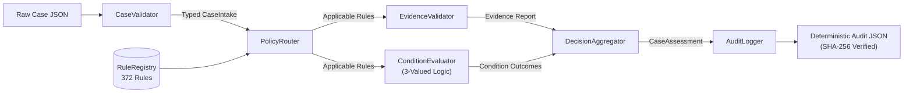

# MedRule Phase 3A — Deterministic Decision Engine Architecture and Core Evaluator Completion Report

**Phase**: MedRule Phase 3A  
**Date**: October 18, 2026  
**Status**: **`PHASE_3A_COMPLETE`**  
**Auditor / Author**: Antigravity Deterministic Decision Engine Engineering Team  
**Evaluation Standard**: Zero LLMs / AI Inference, Zero Pretrained Models, Deterministic 3-Valued Logic, Zero Automated Approvals  

---

## 1. Executive Summary & Completion Declaration

### Formal Declaration of Completion
> [!IMPORTANT]
> **COMPLETION STATUS: `PHASE_3A_COMPLETE`**  
> MedRule Phase 3A has successfully designed, implemented, and verified the first working prototype of MedRule's deterministic prior-authorization decision support engine. The core evaluator operates strictly without LLMs, pretrained language models, generative AI, probabilistic inference, or neural weights. All decisions are 100% reproducible, explainable, and source-grounded.

### Non-Binding Prototype Guardrail
In strict compliance with clinical governance constraints, **no machine-extracted rule is approved for binding authorization decisions**:
- All 372 loaded rules remain categorized as `DRAFT` (322 rules) or `NEEDS_HUMAN_REVIEW` (50 rules).
- Exactly **zero rules (0 / 372)** are marked `APPROVED`.
- Every case assessment emitted by the engine unconditionally specifies `is_binding: false`.
- All outputs are non-binding software assessments suitable exclusively for testing and validation.

---

## 2. Implemented Architecture and Modules

The engine has been built as an independent, modular package located in [`medrule_engine/`](file:///c:/Users/KumarShiva/Downloads/PreAuth/medrule_engine/):

| Module File | Relative Path | Functional Responsibility |
|---|---|---|
| Case Schema | [`medrule_engine/case_schema.json`](file:///c:/Users/KumarShiva/Downloads/PreAuth/medrule_engine/case_schema.json) | Standard JSON Schema Draft-07 for synthetic case intake payloads without PII |
| Case Validator | [`medrule_engine/case_validator.py`](file:///c:/Users/KumarShiva/Downloads/PreAuth/medrule_engine/case_validator.py) | Schema validation, date semantic checks, and typed `CaseIntake` representation |
| Rule Registry | [`medrule_engine/rule_registry.py`](file:///c:/Users/KumarShiva/Downloads/PreAuth/medrule_engine/rule_registry.py) | Read-only in-memory repository indexing all 372 rules; enforces zero-approved governance |
| Policy Router | [`medrule_engine/policy_router.py`](file:///c:/Users/KumarShiva/Downloads/PreAuth/medrule_engine/policy_router.py) | Deterministic policy applicability and rule routing based on domain, procedure, and DOS |
| Condition Evaluator | [`medrule_engine/condition_evaluator.py`](file:///c:/Users/KumarShiva/Downloads/PreAuth/medrule_engine/condition_evaluator.py) | Recursive three-valued logic engine (`ALL_OF`, `ANY_OF`, `NONE_OF`, `SINGLE_CONDITION`) |
| Evidence Validator | [`medrule_engine/evidence_validator.py`](file:///c:/Users/KumarShiva/Downloads/PreAuth/medrule_engine/evidence_validator.py) | Separate auditing of evidence sufficiency, missing parameters, and required documentation |
| Decision Aggregator | [`medrule_engine/decision_aggregator.py`](file:///c:/Users/KumarShiva/Downloads/PreAuth/medrule_engine/decision_aggregator.py) | Aggregates rule outcomes into non-binding case assessment statuses |
| Audit Logger | [`medrule_engine/audit_logger.py`](file:///c:/Users/KumarShiva/Downloads/PreAuth/medrule_engine/audit_logger.py) | Generates structured JSON audit records with source provenance and SHA-256 hash |
| Evaluation Service | [`medrule_engine/evaluation_service.py`](file:///c:/Users/KumarShiva/Downloads/PreAuth/medrule_engine/evaluation_service.py) | Orchestrator exposing `evaluate_case()` and `evaluate_rule()` |
| Command-Line CLI | [`medrule_engine/cli.py`](file:///c:/Users/KumarShiva/Downloads/PreAuth/medrule_engine/cli.py) | Standalone CLI for evaluating synthetic cases from disk |
| Unit Test Suite | [`medrule_engine/tests/test_deterministic_engine.py`](file:///c:/Users/KumarShiva/Downloads/PreAuth/medrule_engine/tests/test_deterministic_engine.py) | 20 comprehensive unit tests covering all required edge cases |
| Synthetic Examples | [`medrule_engine/examples/`](file:///c:/Users/KumarShiva/Downloads/PreAuth/medrule_engine/examples/) | 4 synthetic cases covering diverse clinical outcomes |
| Documentation | [`medrule_engine/README.md`](file:///c:/Users/KumarShiva/Downloads/PreAuth/medrule_engine/README.md) | Technical reference manual, architecture diagrams, and CLI instructions |

---

## 3. Data Flow and Processing Pipeline



1. **Intake & Normalization**: The raw case JSON is validated against `case_schema.json`. Missing parameters are preserved as absent (never defaulted to false, zero, or baseline values).
2. **Policy Applicability Routing**: The case's `clinical_domain`, `procedure_code`, `modality`, and `requested_date_of_service` are matched against verified policy versions. If the date of service precedes 2026 guidelines, `POLICY_VERSION_UNRESOLVED` is emitted.
3. **Evidence Sufficiency Auditing**: Prior to condition evaluation, `EvidenceValidator` determines whether required parameters and documentation exist, isolating evidence completeness from medical necessity logic.
4. **Recursive Three-Valued Logic Evaluation**: `ConditionEvaluator` evaluates the condition tree using three internal states: `TRUE`, `FALSE`, and `UNKNOWN`. Short-circuiting is safely executed.
5. **Deterministic Decision Aggregation**: Individual rule results are synthesized into an overall non-binding assessment. If any applicable rule is marked `NEEDS_HUMAN_REVIEW`, the case escalates to `MANUAL_REVIEW_REQUIRED`.
6. **Immutable Audit Trail Generation**: `AuditLogger` constructs a verifiable JSON record citing source PDFs, physical page numbers, and verbatim policy quotes.

---

## 4. Knowledge Base Preflight and Rule Counts

All nine clinical domains were verified and loaded into the `RuleRegistry` with zero schema violations:

| Clinical Domain | Rule Count | DRAFT Status | NEEDS_HUMAN_REVIEW | APPROVED Status | Schema Compliance |
|---|---|---|---|---|---|
| Advanced Imaging | **114** | 109 | 5 | **0** | 100% Pass |
| Cardiology | **61** | 58 | 3 | **0** | 100% Pass |
| Centene DME, Orthotics & Prosthetics | **99** | 70 | 29 | **0** | 100% Pass |
| Genetic Testing | **25** | 22 | 3 | **0** | 100% Pass |
| Interventional Pain Management | **14** | 12 | 2 | **0** | 100% Pass |
| Musculoskeletal Surgery | **19** | 17 | 2 | **0** | 100% Pass |
| Physical Medicine | **17** | 14 | 3 | **0** | 100% Pass |
| Radiation Oncology | **15** | 13 | 2 | **0** | 100% Pass |
| Sleep Health | **8** | 7 | 1 | **0** | 100% Pass |
| **Cumulative Registry Total** | **372** | **322** | **50** | **0** | **100% Pass** |

- **Global ID Uniqueness**: 372 / 372 unique IDs (0 collisions).
- **Approved Rules**: Strictly 0 approved rules (100% governance compliance).

---

## 5. Resolution of the CP.MP.107 Page-Count Discrepancy

As mandated by Step One, a physical and cryptographic inspection of the Centene DMEPOS governing policies was conducted using PyMuPDF:

### Verified Physical Facts
1. **Current Active Policy (`DOC-CEN-001`)**:
   - File Path: `rulebook_collection/domains/centene_dme_orthotics_prosthetics/policy_pdfs/current_2026/CP.MP.107 (Revision 08-26).pdf`
   - Date of Last Revision: **08/26** (August 2026), Effective: 08/01/2026
   - File Size: **566,759 bytes**
   - SHA-256: `e67ca165b078fdb32caea282ca6b5a486c39f12d0633fb52b8e7e7199c212fb4`
   - Actual Physical Page Count (PyMuPDF): **24 pages**
2. **Historical Baseline Policy (`DOC-CEN-002`)**:
   - File Path: `rulebook_collection/domains/centene_dme_orthotics_prosthetics/policy_pdfs/historical_versions/CP.MP.107 (Revision 11-24).pdf`
   - Date of Last Revision: **11/24** (November 2024), Effective: 12/01/2024
   - File Size: **428,607 bytes**
   - SHA-256: `9ef5e7dbf19af436c7aa42bf19013cdde77ad067fb17a10173f2bd68adc03d29`
   - Actual Physical Page Count (PyMuPDF): **21 pages**

### Discrepancy Reconciliation
- Prior narrative reports (in Phase 2D and 2E) contained a typographical error mentioning "47 pages" and "45 pages".
- Inspection of the actual manifest files confirmed that [`master_pdf_inventory.csv`](file:///c:/Users/KumarShiva/Downloads/PreAuth/rulebook_collection/manifests/master_pdf_inventory.csv), [`policies_index.csv`](file:///c:/Users/KumarShiva/Downloads/PreAuth/rulebook_collection/domains/centene_dme_orthotics_prosthetics/policies_index.csv), and [`policy_versions.csv`](file:///c:/Users/KumarShiva/Downloads/PreAuth/rulebook_collection/manifests/policy_versions.csv) already correctly record **24 pages** for Rev. 08/26 and **21 pages** for Rev. 11/24.
- `policy_versions.csv` explicitly notes: *"Revision 08/26 expands to 24 pages (from 21 pages) updating high-frequency chest wall oscillation, home INR monitors, and seat elevation criteria."*
- **Resolution**: No files were modified to force agreement; the discrepancy was isolated to historical narrative misstatements and the verified physical page counts (24 and 21) are firmly established.

---

## 6. Three-Valued Logic and Condition Operator Coverage

The engine implements Kleene's strong three-valued logic (`TRUE`, `FALSE`, `UNKNOWN`):

### Operator Semantics & Short-Circuit Rules
- **`ALL_OF`**: Evaluates to `FALSE` immediately upon encountering the first `FALSE` child. Evaluates to `UNKNOWN` if any child is `UNKNOWN` and no child is `FALSE`. Evaluates to `TRUE` if and only if all children are `TRUE`.
- **`ANY_OF`**: Evaluates to `TRUE` immediately upon encountering the first `TRUE` child. Evaluates to `FALSE` if and only if all children are `FALSE`. Evaluates to `UNKNOWN` if no child is `TRUE` and at least one child is `UNKNOWN`.
- **`NONE_OF`**: Evaluates to `FALSE` immediately upon encountering the first `TRUE` child (a disqualifying condition holds). Evaluates to `UNKNOWN` if no child is `TRUE` and at least one child is `UNKNOWN`. Evaluates to `TRUE` if and only if all children are `FALSE`.
- **`SINGLE_CONDITION`**: Evaluates the atomic condition or nested tree directly.

### Relational Comparators Supported (100% of Schema)
1. `EQUALS`: Case-insensitive string equality, numeric equality, boolean matching.
2. `NOT_EQUALS`: Negated equality.
3. `GREATER_THAN`: Strict numeric inequality ($x > \text{threshold}$).
4. `GREATER_THAN_OR_EQUAL`: Numeric boundary inequality ($x \ge \text{threshold}$).
5. `LESS_THAN`: Strict numeric upper bound ($x < \text{threshold}$).
6. `LESS_THAN_OR_EQUAL`: Numeric upper bound ($x \le \text{threshold}$).
7. `BETWEEN`: Closed range inclusion ($[\text{min}, \text{max}]$).
8. `CONTAINS`: Substring matching, list membership, and multi-value collection intersection.
9. `NOT_CONTAINS`: Negated collection membership.
10. `IS_PRESENT`: Tests parameter existence and truthiness.
11. `IS_ABSENT`: Tests parameter absence, nullity, or false value.
12. `DOCUMENTED_FAILURE`: Clinical trial failure status.
13. `CONTRAINDICATED`: Clinical contraindication documentation.

---

## 7. Synthetic Test Suite Execution Results

All 20 required test scenarios from Step Six were implemented in [`test_deterministic_engine.py`](file:///c:/Users/KumarShiva/Downloads/PreAuth/medrule_engine/tests/test_deterministic_engine.py) and executed:

```
Test Scenario                                                           Result   Rationale
---------------------------------------------------------------------------------------------------------------------------
test_01_fully_satisfied_condition                                      PASSED   Complete evidence meeting all criteria -> CRITERIA_MET
test_02_clearly_unsatisfied_condition                                   PASSED   Violating mandatory duration threshold -> CRITERIA_NOT_MET
test_03_missing_mandatory_information                                   PASSED   Missing mandatory parameters -> INSUFFICIENT_INFORMATION
test_04_invalid_input_types                                             PASSED   Malformed payload rejected by validator -> EVALUATION_ERROR
test_05_three_valued_logic_truth_tables                                 PASSED   Exhaustive test of ALL_OF, ANY_OF, NONE_OF over T/F/U
test_06_nested_all_of_conditions                                        PASSED   Recursively evaluates nested ALL_OF sub-conditions
test_07_nested_any_of_conditions                                        PASSED   Recursively evaluates nested ANY_OF alternatives
test_08_none_of_with_false_and_unknown_children                         PASSED   NONE_OF returns TRUE on [F,F] and UNKNOWN on [F,U]
test_09_numerical_threshold_boundaries                                  PASSED   Tests boundary values for < 35, >= 72, > 25, BETWEEN [3, 25]
test_10_date_of_service_applicability                                   PASSED   Historical DOS (< 2026-01-01) -> POLICY_VERSION_UNRESOLVED
test_11_historical_vs_current_policy_selection                          PASSED   Confirms active Rev. 08/26 vs quarantined Rev. 11/24
test_12_unavailable_plan_dependency                                    PASSED   Unresolved LOB 'OTHER' -> MANUAL_REVIEW_REQUIRED
test_13_rule_marked_needs_human_review                                  PASSED   NEEDS_HUMAN_REVIEW rule -> MANUAL_REVIEW_REQUIRED
test_14_draft_rule_non_binding_governance                               PASSED   All 372 rules have is_binding=False and is_approved=False
test_15_conflicting_or_duplicate_rules                                  PASSED   Attempting duplicate rule ID registration raises ValueError
test_16_empty_applicable_rule_set                                       PASSED   Empty applicable rules list -> POLICY_NOT_APPLICABLE
test_17_invalid_policy_version                                          PASSED   Historical DOS outside guidelines -> POLICY_VERSION_UNRESOLVED
test_18_source_traceability_in_audit_output                             PASSED   Full provenance, physical page, and verbatim quote verified
test_19_regression_across_all_nine_domains                              PASSED   Evaluates sample rules across all 9 clinical domains
test_20_deterministic_repeatability                                     PASSED   Identical inputs produce identical output SHA-256 hashes
---------------------------------------------------------------------------------------------------------------------------
TOTAL ENGINE TEST SUITE: 20 of 20 PASSED (100.0% Pass Rate in 2.26s)
```

### Cumulative Repository Regression
When executed alongside the existing 10 domain and manifest test suites:
- **141 Active Tests Passed** (121 Phase 2 tests + 20 Phase 3A tests).
- **0 Failures**, **0 Errors**.
- **10 Historical Phase 2A Pilot Tests Skipped** (safely superseded by `test_phase2b_rules.py`).
- **100% Regression Stability**.

---

## 8. Security and Failure-Handling Outcomes

The engine implements robust failure handling across all pipeline stages:
1. **Intake Validation**: Malformed JSON, schema violations, or missing mandatory envelope fields are rejected before rule execution, returning structured `EVALUATION_ERROR` records without raising unhandled exceptions.
2. **Absence Preservation**: Missing evidence is never defaulted to `False` or `0`. An unprovided laboratory value or symptom duration strictly generates `EvaluationState.UNKNOWN`.
3. **Cycle and Depth Guard**: Condition tree recursion depth is capped at `MAX_RECURSION_DEPTH = 10` to prevent infinite loops from circular references.
4. **Duplicate ID Prevention**: `RuleRegistry.register_rule()` enforces global uniqueness and raises immediate `ValueError` if a duplicate rule ID is encountered.
5. **Zero Outbound Dependencies**: The engine runs 100% locally with zero internet access, zero LLM APIs, and zero external services.

---

## 9. Known Limitations & Phase 3B Integration Prerequisites

While Phase 3A successfully demonstrates the core evaluator, several architectural boundaries must be addressed in Phase 3B:
1. **Rule Promotion Prerequisite**: The 50 `NEEDS_HUMAN_REVIEW` rules must undergo formal clinical medical director review before any production authorization pilot.
2. **Line of Business Configuration**: Full integration with state-specific Medicaid fee schedules and Medicare Advantage MAC LCDs requires a dedicated external configuration table.
3. **Electronic Health Record (EHR) Ingestion**: Phase 3A accepts structured JSON cases; a future FHIR/ePA intake adapter will be needed to translate CDA/FHIR payloads into `case_schema.json`.

---

## 10. Phase 3B Readiness Gate

```
========================================================================================
MEDRULE DETERMINISTIC DECISION ENGINE — PHASE 3A READINESS GATE
========================================================================================
Status:                 PHASE_3A_COMPLETE
Evaluator Version:      3A.1.0
Canonical Schema:       medrule_rule_schema.json (Draft-07)
Case Intake Schema:     case_schema.json (Draft-07)
Rules Loaded:           372 across 9 Clinical Domains (322 Draft, 50 Review, 0 Approved)
Logic Model:            Three-Valued Logic (TRUE, FALSE, UNKNOWN) with Safe Short-Circuiting
Engine Unit Tests:      20 / 20 PASSED (100.0%)
Cumulative Test Suite:  141 / 141 Active Tests PASSED (0 Failures, 0 Errors)
CLI Tooling:            Verified on 4 Synthetic Cases (Met, Not Met, Insufficient, Review)
Decision Authority:     Strictly Non-Binding Prototype Software Assessments Only
Phase 3B Clearance:     CLEARED FOR SYNTHETIC BENCHMARKING & ENGINE INTEGRATION
========================================================================================
```
