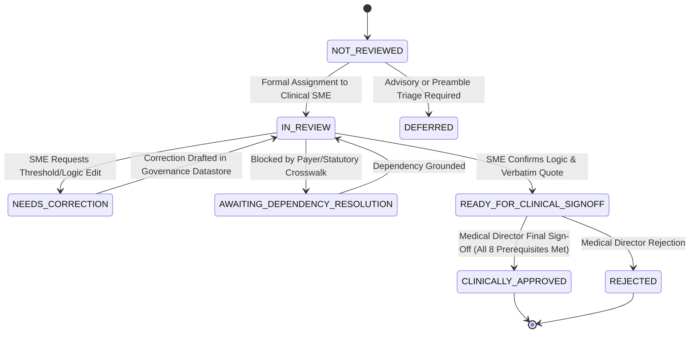
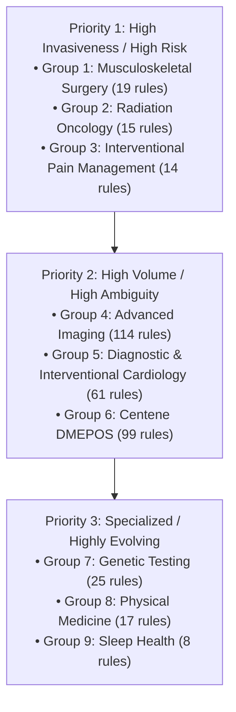

# MedRule Phase 4A: Prioritized Clinical Review Plan & Governance Roadmap

**Phase**: `PHASE_4A_ASSESSMENT`  
**Target Knowledge Base**: 372 Machine-Readable Clinical Rules across 9 Medical Specialties  
**Current Governance Status**: 322 `DRAFT`, 50 `NEEDS_HUMAN_REVIEW`, **0 `APPROVED`**  
**Operating Mode**: Non-Binding Clinical Decision Support Prototype (`is_binding: false`)  
**Generative AI / LLM Usage**: Strictly 0% (Deterministic rule execution only)

---

## 1. Executive Summary & Review Objectives

This document establishes the structured clinical review plan required to transition MedRule's extracted policy rules from `DRAFT` and `NEEDS_HUMAN_REVIEW` to authentic clinical approval. 

Under MedRule governance principles, **no software script, automated agent, or machine evaluator is permitted to approve clinical rules**. Clinical approval requires verified examination, interpretation, and formal sign-off by credentialed human clinicians (Specialty Clinical SMEs and an authorized Medical Director).

> [!IMPORTANT]
> **NO FABRICATED REVIEWERS OR PROJECTED DATES**  
> In accordance with Phase 4A mandatory constraints, this plan does not invent completion dates, clinician availability schedules, or fictitious reviewer credentials. Review timelines depend entirely upon the institutional commissioning of qualified human specialists.

---

## 2. Review Workflow Governance & Entry Criteria

### 2.1 The 8 Mandatory Approval Prerequisites
Every individual rule must satisfy all eight prerequisites before a Medical Director may transition its governance state to `APPROVED`:
1. **Source Policy Version Verified**: Governing document must be confirmed as `current_2026_verified`.
2. **Structured Logic Populated**: Conditions, parameters, and comparators must be completely structured.
3. **Interpretation Ambiguities Resolved**: Workflow status must reach `READY_FOR_CLINICAL_SIGNOFF`.
4. **Dependencies Addressed**: All cross-domain, statutory, and contractual dependencies must be verified.
5. **Schema Validation Passed**: Record must strictly satisfy `medrule_rule_schema.json` (Draft-07).
6. **Prior Clinical SME Review Recorded**: At least one formal SME sign-off action must be recorded.
7. **Approver Authority**: Final sign-off must be executed exclusively by a credentialed `MEDICAL_DIRECTOR`.
8. **Clinical Credentials Verified**: Approver's medical license and active board certification must be verified.

### 2.2 Clinical Review Lifecycle States


---

## 3. Prioritized Domain Review Groups

The 372 rules are partitioned into 9 domain review groups, prioritized by clinical risk, procedural invasiveness, and high-volume patient impact.



---

### Group 1: Musculoskeletal Surgery (MSK)
- **Rule Count**: 19 rules (16 `DRAFT`, 3 `NEEDS_HUMAN_REVIEW`, 0 `APPROVED`).
- **Specialty Expertise Required**: Board-Certified Orthopedic Surgeon or Spine Surgeon.
- **Governing Policies**:
  - `DOC-MSK-001`: 2026 Evolent Clinical Guidelines for Medical Necessity Review: Musculoskeletal Surgery Guidelines.
  - `DOC-MSK-002`: Evolent Place of Service Policy 1773 for Musculoskeletal Surgery.
- **High-Priority Ambiguity & Risk Areas**:
  - Distinguishing non-operative conservative treatment duration thresholds (12 weeks for major joint arthroplasty vs 6 weeks for arthroscopy).
  - Radiographic Kellgren-Lawrence grade criteria for total knee/hip arthroplasty.
  - Grade 2+ spondylolisthesis surgical instability definitions and neurological deficit criteria.
- **Dependencies**:
  - `DEP-007`: CMS Inpatient Only (IPO) schedule crosswalk (determines ASC vs Hospital Inpatient eligibility).
- **Required Test Evidence**:
  - Passing unit tests (`test_msk_rules.py`).
  - Pilot case adjudication comparisons (`CASE-PILOT-MSK-001` through `004`).
- **Authorized Role Required for Sign-Off**: Orthopedic Clinical SME (review) and Medical Director (approval).
- **Outstanding Blockers**: Enterprise SSO identity verification; orthopedic surgeon engagement.

---

### Group 2: Radiation Oncology
- **Rule Count**: 15 rules (13 `DRAFT`, 2 `NEEDS_HUMAN_REVIEW`, 0 `APPROVED`).
- **Specialty Expertise Required**: Board-Certified Radiation Oncologist.
- **Governing Policies**:
  - `DOC-RAD-001`: 2026 Evolent Clinical Guidelines for Medical Necessity Review: Radiation Oncology Guidelines.
  - `DOC-RAD-002`: Payer Custom Proton Beam Coverage Schedule.
- **High-Priority Ambiguity & Risk Areas**:
  - Definitive Intensity-Modulated Radiation Therapy (IMRT) indications adjacent to critical organs at risk.
  - Commercial contract exclusions for adult proton beam therapy vs pediatric / skull base coverage (`DISC-004`).
  - Treatment fraction limits and stereotactic radiosurgery (SRS/SBRT) dose delivery constraints.
- **Dependencies**:
  - `DEP-006`: Harmonization of simulation scans with Radiology Place of Service (EPOS 2067).
  - `DEP-011`: Commercial payer proton beam coverage threshold contracts.
- **Required Test Evidence**:
  - Passing unit tests (`test_radonc_rules.py`).
  - Pilot case adjudication comparisons (`CASE-PILOT-RAD-001` through `004`).
- **Authorized Role Required for Sign-Off**: Radiation Oncology SME (review) and Medical Director (approval).
- **Outstanding Blockers**: Execution of commercial payer proton tiering agreement; radiation oncologist engagement.

---

### Group 3: Interventional Pain Management (IPM)
- **Rule Count**: 14 rules (12 `DRAFT`, 2 `NEEDS_HUMAN_REVIEW`, 0 `APPROVED`).
- **Specialty Expertise Required**: Board-Certified Anesthesiologist or Physical Medicine & Rehabilitation (PM&R) Pain Specialist.
- **Governing Policies**:
  - `DOC-IPM-001`: 2026 Evolent Clinical Guidelines for Medical Necessity Review: Interventional Pain Management Guidelines.
- **High-Priority Ambiguity & Risk Areas**:
  - Minimum visual analog scale (VAS) pain severity thresholds (pain score $\ge$ 4/10).
  - Failed conservative therapy trial durations (4-8 weeks) and radicular MRI correlation.
  - Absolute contraindications (systemic sepsis, active local infection, coagulopathy).
- **Dependencies**:
  - `DEP-008`: State Medicaid Controlled Substance annual frequency caps (e.g. 4 ESIs per 12 months, `DISC-003`).
- **Required Test Evidence**:
  - Passing unit tests (`test_ipm_rules.py`).
  - Pilot case adjudication comparisons (`CASE-PILOT-PAIN-001` through `004`).
- **Authorized Role Required for Sign-Off**: Pain Management SME (review) and Medical Director (approval).
- **Outstanding Blockers**: State Medicaid contract threshold crosswalk; pain specialist engagement.

---

### Group 4: Advanced Imaging
- **Rule Count**: 114 rules (100 `DRAFT`, 14 `NEEDS_HUMAN_REVIEW`, 0 `APPROVED`).
- **Specialty Expertise Required**: Board-Certified Diagnostic Radiologist.
- **Governing Policies**:
  - `DOC-ADV-001`: 2026 Evolent Clinical Guidelines for Medical Necessity Review: Advanced Imaging Guidelines (v2).
  - `DOC-ADV-002`: Evolent Place of Service Policy 2067 for Radiology (2026 Final).
- **High-Priority Ambiguity & Risk Areas**:
  - Advisory radiation reduction guidance: MRI preferred over CT for suspected IBD in age < 35 (`RULE-ADV-CG2000-003`, `DISC-001`).
  - Site of service redirection: Clinical exception criteria for hospital outpatient imaging vs freestanding centers (`RULE-ADV-EPOS2067-001` through `005`).
  - Retrospective urgent/emergent review requirements (`RULE-ADV-CG2066-001`, `002`).
  - Pancreatitis conservative therapy duration threshold (72 hours before abdominopelvic CT).
- **Dependencies**:
  - `DEP-009`: State Medicaid scan cost thresholds and prior notification crosswalks.
- **Required Test Evidence**:
  - Passing domain tests (`test_phase2b_rules.py`).
  - Pilot case comparisons (`CASE-PILOT-ADV-001` through `004`).
- **Authorized Role Required for Sign-Off**: Diagnostic Radiologist SME (review) and Medical Director (approval).
- **Outstanding Blockers**: Resolution of advisory language vs hard denial policy; radiologist engagement.

---

### Group 5: Cardiology (Diagnostic & Interventional)
- **Rule Count**: 61 rules (54 `DRAFT`, 7 `NEEDS_HUMAN_REVIEW`, 0 `APPROVED`).
- **Specialty Expertise Required**: Board-Certified Cardiologist (Diagnostic / Interventional).
- **Governing Policies**:
  - `DOC-CARD-001`: 2026 Evolent Clinical Guidelines for Medical Necessity Review: Diagnostic Cardiology.
  - `DOC-CARD-002`: 2026 Evolent Clinical Guidelines for Medical Necessity Review: Interventional Cardiology (v2).
  - `DOC-CARD-004`: Cardiac Claim Edit: Stress Echocardiography and Doppler Add-On (OP38801).
- **High-Priority Ambiguity & Risk Areas**:
  - Step-therapy mandates: Exercise treadmill ECG prior to nuclear SPECT MPI (`DISC-002`).
  - Abdominal aortic aneurysm screening surveillance intervals (3.0-3.9 cm vs $\ge$ 4.0 cm).
  - Stress echo unbundling rules for spectral/color Doppler add-on codes.
  - Left heart catheterization pre-test clinical stratification criteria.
- **Dependencies**:
  - `DEP-010`: Payer cardiac stress testing tiering schedules.
- **Required Test Evidence**:
  - Passing domain tests (`test_cardiology_rules.py`).
  - Pilot case comparisons (`CASE-PILOT-CARD-001` through `004`).
- **Authorized Role Required for Sign-Off**: Cardiologist SME (review) and Medical Director (approval).
- **Outstanding Blockers**: Payer tiering crosswalk validation; cardiologist engagement.

---

### Group 6: Centene DME, Orthotics and Prosthetics
- **Rule Count**: 99 rules (86 `DRAFT`, 13 `NEEDS_HUMAN_REVIEW`, 0 `APPROVED`).
- **Specialty Expertise Required**: PM&R Physician, Orthotist/Prosthetist, or DME Specialist.
- **Governing Policies**:
  - `DOC-CEN-001`: Clinical Policy CP.MP.107: DMEPOS Guidelines (Rev. 08/26).
  - `DOC-CEN-005`: Clinical Policy CP.MP.173: Implantable Intrathecal or Epidural Pain Pump.
- **High-Priority Ambiguity & Risk Areas**:
  - Preamble standard: Lower-cost medically necessary alternative requirement (`RULE-DME-107-001`).
  - Complex power wheelchair delivery during inpatient hospital stays (`DISC-008`, `DEP-002`).
  - Obstructive sleep apnea CPAP diagnostic threshold (AHI $\ge$ 5.0 with symptoms vs AHI $\ge$ 15.0).
  - Semi-electric vs full-electric hospital bed functional mobility requirements.
- **Dependencies**:
  - `DEP-001`: CMS Claims Manual Chapter 20 (DMEPOS billing & CMN rules).
  - `DEP-002`: CMS State Operations Manual Appendix A (discharge delivery timing).
  - `DEP-003`: RESNA Position Paper on Seat Elevation in Power Wheelchairs.
  - `DEP-004`: CMS DMEPOS Quality Standards & Supplier Accreditation.
  - `DEP-015`: Centene State Medicaid DME fee schedules and quantity limits.
- **Required Test Evidence**:
  - Passing domain tests (`test_centene_dme_rules.py`).
  - Pilot case comparisons (`CASE-PILOT-DME-001` through `004`).
- **Authorized Role Required for Sign-Off**: PM&R / DME SME (review) and Medical Director (approval).
- **Outstanding Blockers**: Integration of state-specific DME quantity limits; specialist engagement.

---

### Group 7: Genetic Testing
- **Rule Count**: 25 rules (21 `DRAFT`, 4 `NEEDS_HUMAN_REVIEW`, 0 `APPROVED`).
- **Specialty Expertise Required**: Board-Certified Medical Geneticist or Molecular Genetic Pathologist.
- **Governing Policies**:
  - `DOC-GEN-001`: 2026 Evolent Clinical Guidelines for Medical Necessity Review: Genetic Testing Guidelines.
- **High-Priority Ambiguity & Risk Areas**:
  - Broad multigene cancer panel exclusions vs targeted single-gene testing (`DISC-007`).
  - Pre-test and post-test genetic counseling certification mandates.
  - Clinical pedigree requirements (e.g. first-degree relative ovarian cancer, triple-negative breast cancer age $\le$ 60).
- **Dependencies**:
  - `DEP-014`: Payer non-covered genetic panel exclusion schedules.
- **Required Test Evidence**:
  - Passing domain tests (`test_gentest_rules.py`).
  - Pilot case comparisons (`CASE-PILOT-GEN-001` through `004`).
- **Authorized Role Required for Sign-Off**: Medical Geneticist SME (review) and Medical Director (approval).
- **Outstanding Blockers**: Commercial payer multigene panel exclusion crosswalk; geneticist engagement.

---

### Group 8: Physical Medicine (PT / OT / ST)
- **Rule Count**: 17 rules (14 `DRAFT`, 3 `NEEDS_HUMAN_REVIEW`, 0 `APPROVED`).
- **Specialty Expertise Required**: Licensed Physical/Occupational Therapist or Physiatrist.
- **Governing Policies**:
  - `DOC-PHY-001`: 2026 Evolent Clinical Guidelines for Medical Necessity Review: Physical Medicine Guidelines.
  - `DOC-PHY-007`: Clinic-Supplied Orthotics and Bracing Benefit Harmonization.
- **High-Priority Ambiguity & Risk Areas**:
  - Functional plateau definitions: Absence of measurable objective gains over 6 consecutive visits.
  - Home exercise program independence as a discharge criterion.
  - Contractual annual visit maximums (20-60 visits/year) vs ongoing clinical deficit (`DISC-005`).
- **Dependencies**:
  - `DEP-005`: Interaction between therapy-supplied orthotics and DMEPOS benefit accumulators.
  - `DEP-012`: Health Plan Summary Plan Description (SPD) annual visit caps.
- **Required Test Evidence**:
  - Passing domain tests (`test_physmed_rules.py`).
  - Pilot case comparisons (`CASE-PILOT-PHYS-001` through `004`).
- **Authorized Role Required for Sign-Off**: Physical Medicine SME (review) and Medical Director (approval).
- **Outstanding Blockers**: Real-time benefit accumulator connectivity; PT clinical specialist engagement.

---

### Group 9: Sleep Health
- **Rule Count**: 8 rules (6 `DRAFT`, 2 `NEEDS_HUMAN_REVIEW`, 0 `APPROVED`).
- **Specialty Expertise Required**: Board-Certified Sleep Medicine Physician.
- **Governing Policies**:
  - `DOC-SLP-001`: 2026 Evolent Clinical Guidelines for Medical Necessity Review: Sleep Health Guidelines.
- **High-Priority Ambiguity & Risk Areas**:
  - Home Sleep Apnea Testing (HSAT) first-line requirement for uncomplicated adult sleep apnea.
  - Clinical indications for attended in-lab polysomnography (severe COPD, heart failure, neuromuscular disease).
  - Employer group custom benefit exemptions permitting direct in-lab studies (`DISC-006`).
- **Dependencies**:
  - `DEP-013`: Employer group custom benefit exemption lists.
- **Required Test Evidence**:
  - Passing domain tests (`test_sleep_rules.py`).
  - Pilot case comparisons (`CASE-PILOT-SLEEP-001` through `004`).
- **Authorized Role Required for Sign-Off**: Sleep Medicine SME (review) and Medical Director (approval).
- **Outstanding Blockers**: Employer group exemption list access; sleep medicine specialist engagement.

---

## 4. Accountable Human Stakeholder Roles

| Role Title | Specific Governance Responsibility | Required Verification Mechanism |
|---|---|---|
| **Chief Medical Officer (Medical Director)** | Ultimate medical necessity policy approval; final authorization of all 8 prerequisites. | State Medical License verification, active NPI check, signed cryptographic audit entry. |
| **Specialty Clinical SME (Physician/Surgeon)** | Line-by-line validation of structured condition criteria against verbatim PDF source text; proposed corrections. | Active specialty board certification (ABMS/AOA), clinical CV, NPI registry record. |
| **Health Plan Payer Contracting Lead** | Provision and validation of plan-specific benefit schedules, visit caps, step-therapy tiering, and Medicaid fee rules. | Health plan administrative delegation agreement, signed payer configuration register. |
| **Chief Information Security Officer (CISO)** | Enterprise SSO integration (SAML/OIDC), MFA enforcement, vulnerability remediation, access control audits. | Formal penetration test report, SOC 2 Type II audit, secure architecture sign-off. |
| **Chief Privacy / HIPAA Compliance Officer** | Execution of BAAs, PHI data-flow minimization, de-identification compliance, breach notification plan. | Signed Business Associate Agreements, HIPAA compliance certification report. |
| **General Counsel / Regulatory Lead** | Regulatory determination under 21st Century Cures Act § 3060; state PA law compliance (turnaround times, peer-to-peer). | Formal legal memorandum and regulatory compliance opinion. |

---

## 5. Summary Review Status & Readiness Gate

```
Knowledge Base Rules:           372
Clinically Reviewed Rules:      0 (0.0%)
Clinically Approved Rules:      0 (0.0% - Strict Gate Enforced)
Authentic Adjudications:        0 (36 Pilot Adjudications Verified as Synthetic Fixtures)
Controlled Pilot Readiness:     CONDITIONAL (Permitted on synthetic data only)
Production Release Readiness:   STRICTLY BLOCKED
```
