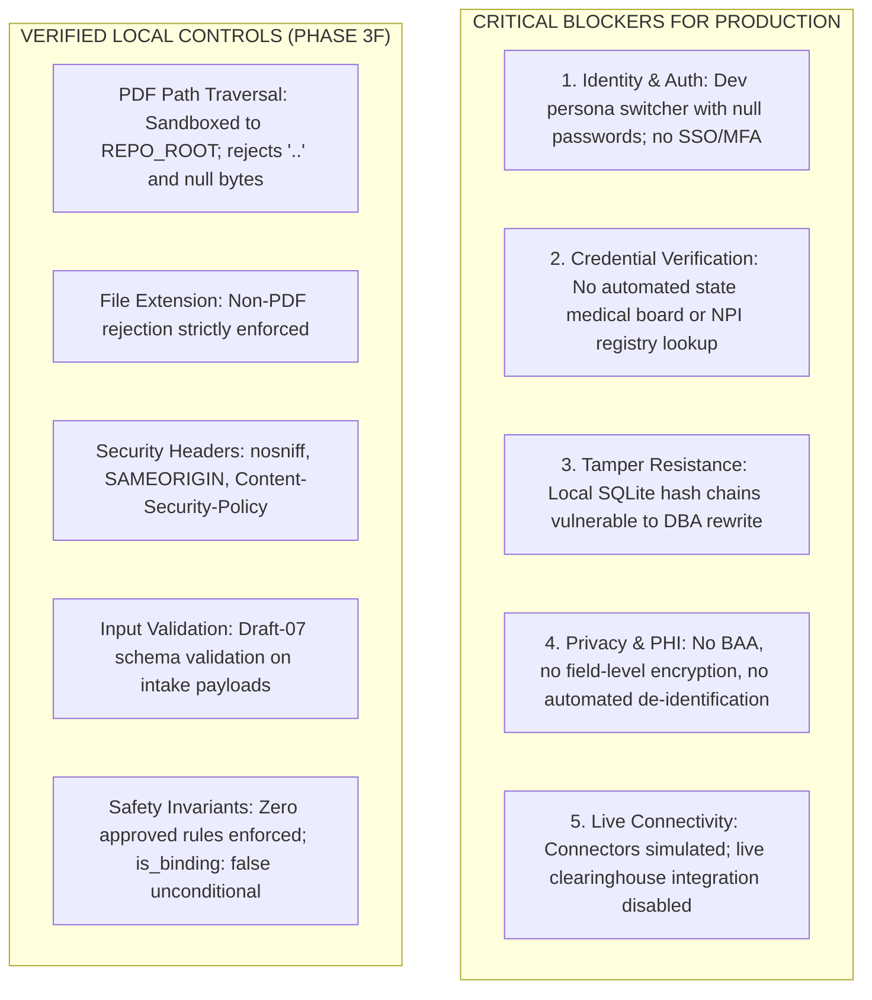

# MedRule Phase 4A: Comprehensive Security, Privacy & Infrastructure Gap Assessment

**Assessment Phase**: `PHASE_4A_ASSESSMENT`  
**Target Release**: MedRule Release Candidate 1.0 (`v1.0.0-rc1`)  
**Assessment Date**: 2026-10-18  
**Scope**: Technical Application Security, Identity & Access Management (IAM), Privacy (HIPAA), Data Governance, and Infrastructure Architecture  
**Evaluator Status**: Independent Security & Governance Audit  

---

## 1. Executive Summary

This security and privacy gap assessment provides a rigorous technical analysis of MedRule Release Candidate 1.0. While Phase 3F achieved robust local hardening—including strict PDF path traversal protection, MIME-type enforcement, HTTP security headers, and JSON Schema Draft-07 validation—**critical architectural gaps currently prevent the system from operating in a live clinical or production healthcare environment**.

The current prototype is safe for local developer evaluation and controlled demonstration using synthetic data. However, production deployment and binding clinical adjudication are **strictly blocked** until enterprise authentication, clinical credential verification, immutable audit storage, HIPAA PHI governance, and secure clearinghouse integrations are implemented.

---

## 2. High-Level Risk & Gap Summary

---

## 3. Detailed Gap Assessment Across 16 Control Domains

### 3.1 Authentication & Identity Verification
- **Current Prototype State**:
  - Reviewer identities are seeded in `review_users` table (`USR-SME-01`, `USR-MEDDIR-01`, etc.) with `password_hash: null`.
  - The UI navigation bar provides an interactive dropdown persona switcher allowing instant role switching without re-authenticating.
  - Development badge `DEV ONLY` is displayed in the UI.
- **Architectural Gaps**:
  - Zero password or credential challenge on persona switching.
  - Absence of Enterprise Single Sign-On (SSO) via SAML 2.0 or OAuth 2.0 / OpenID Connect (OIDC).
  - No Multi-Factor Authentication (MFA) enforcement for high-privilege Medical Director approval workflows.
- **Production Requirement**:
  - Connect to enterprise Identity Provider (IdP) (e.g. Okta, Azure AD / Microsoft Entra ID, PingFederate).
  - Enforce FIDO2 / WebAuthn hardware tokens or TOTP MFA for Medical Director sign-offs.
  - Permanently strip the developer persona switcher from production build configurations.
- **Readiness Impact**: **BLOCKS PRODUCTION**; **BLOCKS CONTROLLED CLINICAL PILOT** (Real clinicians cannot use shared dev personas).

---

### 3.2 Role-Based Authorization & Least Privilege
- **Current Prototype State**:
  - Role hierarchy defined in `medrule_engine/governance/models.py` (`VIEWER`, `CLINICAL_SME_REVIEWER`, `MEDICAL_DIRECTOR`, `ADMINISTRATOR`).
  - Action permission matrix restricts `APPROVE_RULE` exclusively to `MEDICAL_DIRECTOR`.
  - CLI commands enforce caller role permissions.
- **Architectural Gaps**:
  - The Web API endpoints (`/api/rules/<rule_id>/review`, `/api/rules/<rule_id>/correct`) rely on client-supplied `reviewer_id` in JSON request body without cryptographic session verification or JWT signature checking.
  - Any HTTP client can forge a Medical Director request by sending `reviewer_id: "USR-MEDDIR-01"`.
- **Production Requirement**:
  - Cryptographically signed session tokens (JWTs) with tamper-proof claims containing user identity and role from authenticated enterprise IdP.
  - Role-based route decorators verifying token signatures and organizational tenant boundaries on every API request.
- **Readiness Impact**: **BLOCKS PRODUCTION**; **BLOCKS CONTROLLED CLINICAL PILOT**.

---

### 3.3 Clinical Credential Verification
- **Current Prototype State**:
  - Static strings in `review_users.credentials` (e.g. `"MD, Board Certified Diagnostic Radiology"`).
- **Architectural Gaps**:
  - No verification against the National Plan and Provider Enumeration System (NPPES) NPI Registry API.
  - No automated check of state medical board licensure status, sanctions, or disciplinary actions via Federation of State Medical Boards (FSMB).
  - No verification of active American Board of Medical Specialties (ABMS) or American Osteopathic Association (AOA) specialty board certifications.
- **Production Requirement**:
  - Automated integration with NPPES and FSMB/ABMS credentialing APIs during clinician onboarding.
  - Periodic (e.g. monthly) automated credential re-validation and immediate revocation of approval authority upon license lapse or suspension.
- **Readiness Impact**: **BLOCKS PRODUCTION**.

---

### 3.4 Session & CSRF Protections
- **Current Prototype State**:
  - Standard Flask cookie-based session with secret key loaded from environment or default fallback.
  - Session cookie flags not explicitly locked to `Secure`, `HttpOnly`, and `SameSite=Strict`.
  - No Cross-Site Request Forgery (CSRF) tokens configured on HTML intake forms or review action submissions.
- **Architectural Gaps**:
  - HTML intake form (`/intake`) and rule review form (`/rules/<id>`) vulnerable to CSRF attacks if invoked from authenticated browser sessions.
  - Insecure cookies could be transmitted over plaintext HTTP.
- **Production Requirement**:
  - Implement `Flask-WTF` CSRF protection on all HTML form POST actions and custom header validation on JSON APIs.
  - Enforce `SESSION_COOKIE_SECURE = True`, `SESSION_COOKIE_HTTPONLY = True`, and `SESSION_COOKIE_SAMESITE = 'Strict'`.
- **Readiness Impact**: **BLOCKS PRODUCTION**; **BLOCKS CONTROLLED CLINICAL PILOT**.

---

### 3.5 PDF Path Isolation & Sandboxing
- **Current Prototype State**:
  - Hardened `@app.route("/pdf/<path:pdf_path>")` endpoint.
  - Rejects traversal sequences (`..`, `%2e`, null bytes `\x00`).
  - Resolves canonical absolute paths via `Path.resolve()` and strictly verifies containment within `REPO_ROOT`.
  - Rejects non-PDF file extensions with HTTP 400.
- **Architectural Gaps**:
  - Policy PDFs reside on local filesystem inside application repository directory.
  - File serving executed directly by Flask built-in server rather than a hardened reverse proxy or cloud object store.
- **Production Requirement**:
  - Move source policy PDFs to dedicated private object storage (e.g. AWS S3 / Azure Blob) with short-lived presigned URLs.
  - Decouple static asset delivery from the application execution server.
- **Readiness Impact**: Satisfactory for local evaluation; **NON-BLOCKING FOR PILOT**; **RECOMMENDED FOR PRODUCTION**.

---

### 3.6 Sensitive-Data Minimization & PHI Handling
- **Current Prototype State**:
  - The system operates strictly on synthetic, fictional test cases (e.g. `"MEM-SYNTH-88219"`).
  - Zero real patient records or protected health information (PHI) exist in the repository.
- **Architectural Gaps**:
  - If live intake payloads are submitted, patient identifiers (`patient.id`, `patient.first_name`, `patient.last_name`, `patient.dob`, `patient.gender`) are stored unencrypted in SQLite `case_intake_records.payload_json`.
  - No automated de-identification or pseudonymization pipeline (HIPAA Safe Harbor 18-identifier stripping).
  - No data retention or automatic purging policy for expired intake cases.
- **Production Requirement**:
  - Implement field-level encryption (AES-256-GCM) for sensitive demographic fields in the database.
  - Implement a clinical data minimization layer stripping unnecessary direct identifiers before routing to the condition evaluator.
  - Execute formal HIPAA Business Associate Agreements (BAAs) with all hosting and cloud providers.
- **Readiness Impact**: **BLOCKS PRODUCTION** (Cannot ingest real patient data without HIPAA compliance controls).

---

### 3.7 Secrets Management
- **Current Prototype State**:
  - Secret keys and configuration options configured in code or local variables with default fallbacks.
  - No dedicated secret vault or KMS integration.
- **Architectural Gaps**:
  - Risk of hardcoded secrets or default development keys being deployed to staging/production environments.
- **Production Requirement**:
  - Integrate with enterprise secrets management (e.g. HashiCorp Vault, AWS Secrets Manager, Azure Key Vault).
  - Enforce zero default secrets in codebase; require application abort on missing KMS keys at startup.
- **Readiness Impact**: **BLOCKS PRODUCTION**.

---

### 3.8 Database Access & Backup
- **Current Prototype State**:
  - Single-file SQLite database (`medrule_engine/governance/data/governance.db`).
  - ACID transactions, PRAGMA foreign keys, and WAL mode supported.
- **Architectural Gaps**:
  - SQLite is a single-node, embedded database unsuitable for high-concurrency multi-instance horizontal scaling.
  - Database file stored on local filesystem without transparent data encryption at rest (TDE / SQLCipher).
  - No automated point-in-time recovery (PITR) or geo-replicated backups.
- **Production Requirement**:
  - Migrate persistence layer to an enterprise relational database (e.g. PostgreSQL with connection pooling via PgBouncer).
  - Enable Transparent Data Encryption at rest (AES-256) and automated daily snapshots with cross-region replication.
- **Readiness Impact**: **BLOCKS PRODUCTION**.

---

### 3.9 Audit-Event Integrity & Tamper Detection
- **Current Prototype State**:
  - `audit_events` table implements SHA-256 cryptographic state chaining (`previous_event_hash`, `new_state_hash`, `event_signature`).
  - Repeat evaluations and transitions verify hash consistency.
- **Architectural Gaps**:
  - **Crucial Distinction**: The application implements an append-only workflow, but **local SQLite is NOT tamper-resistant storage**.
  - A privileged user (operating system root, local developer, or database administrator) with direct disk access can alter rows in `audit_events` and recompute the SHA-256 hash chain arbitrarily without detection.
- **Production Requirement**:
  - Stream all audit events synchronously to Write-Once-Read-Many (WORM) immutable cloud storage (e.g. AWS S3 Object Lock in Compliance Mode) or an append-only cryptographic ledger (e.g. QLDB / CloudTrail Lake).
  - Asymmetric digital signatures: Each review event signed by the reviewer's private key (PKI / smart card), with public certificates verified against an enterprise Certificate Authority (CA).
- **Readiness Impact**: **BLOCKS PRODUCTION**; **BLOCKS BINDING ADJUDICATION**.

---

### 3.10 Application Configuration & Environment Isolation
- **Current Prototype State**:
  - Configuration split between Python module constants, CLI flags, and default paths.
- **Architectural Gaps**:
  - No formalized separation between `development`, `testing`, `pilot`, and `production` configuration profiles (12-Factor App config).
  - Risk of test routes or dev persona switcher running in production.
- **Production Requirement**:
  - Enforce strict environment variables (`MEDRULE_ENV=production`) that categorically disable mock routes, development badges, and unauthenticated endpoints.
- **Readiness Impact**: **BLOCKS PRODUCTION**.

---

### 3.11 Dependency Vulnerabilities & Supply Chain
- **Current Prototype State**:
  - Standard dependencies specified in `requirements.txt` (Flask, jsonschema, PyMuPDF / fitz, pytest).
- **Architectural Gaps**:
  - No automated Software Bill of Materials (SBOM) generation.
  - No automated vulnerability scanning in continuous integration (e.g. `pip-audit`, Snyk, Trivy).
- **Production Requirement**:
  - Integrate automated dependency vulnerability scanning and lockfile pinning (`requirements.lock`).
  - Container image signing and vulnerability scanning before deployment.
- **Readiness Impact**: **NON-BLOCKING FOR LOCAL DEMO**; **BLOCKS PRODUCTION**.

---

### 3.12 Error Handling & Information Disclosure
- **Current Prototype State**:
  - Flask web app includes debug mode toggle (`--debug`).
  - Custom API error responses return JSON with error summaries.
- **Architectural Gaps**:
  - In development debug mode, Flask exposes the interactive debugger (Werkzeug pin) which allows arbitrary remote code execution.
  - Certain unhandled exceptions may reveal internal filesystem paths in HTTP 500 error traces.
- **Production Requirement**:
  - Ensure `DEBUG = False` is hardcoded for production builds.
  - Implement centralized exception handling returning generic correlation IDs (`"Incident ID: ERR-10294"`) while logging full stack traces exclusively to private logs.
- **Readiness Impact**: **BLOCKS PRODUCTION**.

---

### 3.13 Access Logging & HIPAA Retention (6 Years)
- **Current Prototype State**:
  - Python standard `logging` configured for console and file output.
  - `connector_audit_events` and `audit_events` tables persist in local database.
- **Architectural Gaps**:
  - No centralized Security Information and Event Management (SIEM) integration (e.g. Splunk, Datadog, AWS CloudWatch).
  - No enforcement of HIPAA administrative safeguard mandate: 6-year retention lifecycle for prior-authorization audit logs (45 CFR § 164.316(b)(2)(i)).
- **Production Requirement**:
  - Configure automated syslog/fluentbit export to secure SIEM with 6-year non-erasable retention policy.
- **Readiness Impact**: **BLOCKS PRODUCTION**.

---

### 3.14 Incident Handling & Rollback Procedures
- **Current Prototype State**:
  - No formal incident response documentation or automated rollback runbooks.
- **Architectural Gaps**:
  - Lack of a documented protocol to immediately revoke an erroneous rule or freeze the decision engine in the event of an aberrant clinical assessment.
  - Absence of a automated "fail-to-human" kill switch that diverts all incoming prior authorizations to 100% human review during system anomalies.
- **Production Requirement**:
  - Author and rehearse a Clinical Decision Support Incident Response Plan (CDS-IRP).
  - Implement an administrative global kill-switch halting automated rule evaluation.
- **Readiness Impact**: **BLOCKS CONTROLLED PILOT**; **BLOCKS PRODUCTION**.

---

### 3.15 External Connector Permissions & Integration Security
- **Current Prototype State**:
  - Connectors operate strictly in simulated mock mode (`MockEligibilityConnector`, `MockBenefitConnector`, `MockAuthorizationRequirementsConnector`).
  - `AuthorizationSubmissionAdapter` permanently raises `SubmissionDisabledError`.
- **Architectural Gaps**:
  - No production clearinghouse client certificates (mTLS), OAuth 2.0 client credentials, or API secret rotation.
- **Production Requirement**:
  - Mutual TLS (TLS 1.3 with client certificates) for all outbound clearinghouse connections.
  - Strict least-privilege API scopes for eligibility verification vs claim submission.
- **Readiness Impact**: Non-blocking while simulated; **BLOCKS LIVE PRODUCTION CONNECTIVITY**.

---

### 3.16 Network Egress Restrictions
- **Current Prototype State**:
  - Local process does not initiate outbound network traffic during test and evaluation runs.
- **Architectural Gaps**:
  - No network firewall or egress filter enforced at the OS / container level preventing unauthorized outbound HTTP/DNS requests.
- **Production Requirement**:
  - Enforce egress network security groups allowing outbound traffic exclusively to whitelisted payer clearinghouse IP ranges and KMS endpoints.
- **Readiness Impact**: **BLOCKS PRODUCTION**.

---

## 4. Remediation Priority Matrix

| Risk Level | Control Domain | Key Remediation Task | Phase Required |
|---|---|---|---|
| **CRITICAL** | Identity & Auth | Replace UI persona switcher with Enterprise SSO (SAML 2.0 / OIDC) and MFA | Pre-Pilot / Prod |
| **CRITICAL** | Credentialing | Automated NPPES NPI and FSMB state medical license validation | Pre-Prod |
| **CRITICAL** | Tamper Resistance | WORM cloud storage / cryptographic ledger for audit events | Pre-Prod |
| **CRITICAL** | Privacy & Data | BAA execution, field-level encryption (AES-256), PHI minimization | Pre-Prod |
| **HIGH** | Web Security | CSRF token protection on all forms, HTTPS enforcement, secure cookie flags | Pre-Pilot |
| **HIGH** | Database | Migration from SQLite to PostgreSQL with TDE and automated PITR backups | Pre-Prod |
| **HIGH** | Incident Handling | Documented CDS Incident Response Plan and global "fail-to-human" kill switch | Pre-Pilot |
| **MEDIUM** | Logging | SIEM export and HIPAA 6-year audit retention policy | Pre-Prod |
| **MEDIUM** | Supply Chain | Automated SBOM generation and pip vulnerability scanning in CI/CD | Pre-Prod |
