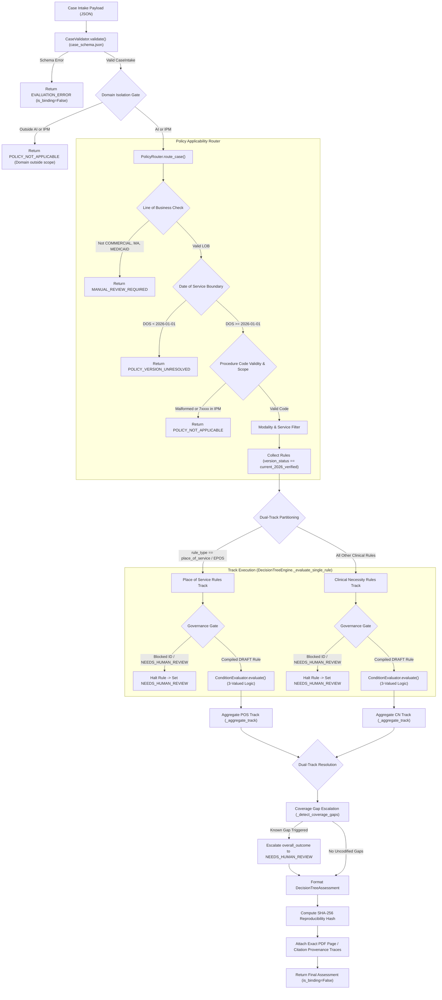

# MedRule Policy Selection & Execution Flow

**Document ID:** MEDRULE-DOC-SELECTION-FLOW-001  
**Audit Date:** 2026-10-21  
**Scope:** Advanced Imaging & Interventional Pain Management (IPM)  
**Classification:** Technical Architecture & Provenance Traceability Specification  

---

## 1. Overview & End-to-End Execution Flow

This document details the exact sequence of operations by which the MedRule decision-support engine consumes clinical prior authorization case intake payloads, verifies policy applicability, isolates domains, filters candidate rules, separates dual tracks (Clinical Necessity vs. Place of Service), and executes deterministic three-valued logic trees.



---

## 2. Step-by-Step Runtime Execution Details

### 2.1 Case Intake and Schema Validation
- **Source Code Reference:** [`medrule_engine/case_validator.py:81-145`](file:///d:/PreAuth/medrule_engine/case_validator.py#L81-L145) (`CaseValidator.validate()`)
- **Schema Specification:** [`medrule_engine/case_schema.json`](file:///d:/PreAuth/medrule_engine/case_schema.json)
- **Mechanism:** Validates synthetic case dictionary against Draft-7 JSON Schema. Requires `case_id`, `clinical_domain`, `procedure_code`, `procedure_name`, `requested_date_of_service`, `line_of_business`, `payer_id`, and `clinical_evidence`.
- **Date Format Checking:** Enforces ISO 8601 (`YYYY-MM-DD`). Rejects invalid date formats.
- **Null / Missing Preservation:** Missing evidence parameters are preserved as absent rather than defaulted to `False` or `0`.
- **Output:** Strongly-typed immutable [`CaseIntake`](file:///d:/PreAuth/medrule_engine/case_validator.py#L19-L44) object.

### 2.2 Domain Detection and Isolation Gate
- **Source Code Reference:** [`medrule_engine/decision_tree.py:186-204`](file:///d:/PreAuth/medrule_engine/decision_tree.py#L186-L204)
- **Mechanism:** Inspects `case.clinical_domain`. The active domains are strictly restricted to:
  ```python
  active_domains = {"advanced_imaging", "interventional_pain_management"}
  ```
- **Behavior:** If `case.clinical_domain` is not in `active_domains` (and `policy_context.allow_archived_domains` is not set), evaluation halts immediately with `POLICY_NOT_APPLICABLE` and summary: *"Clinical domain is not in active MedRule scope (Advanced Imaging & IPM only)."*

### 2.3 Policy Applicability and Version Verification
- **Source Code Reference:** [`medrule_engine/policy_router.py:36-231`](file:///d:/PreAuth/medrule_engine/policy_router.py#L36-L231) (`PolicyRouter.route_case()`)
- **Dimensions Evaluated:**
  1. **Line of Business (LOB):**
     - Allowed values: `{"COMMERCIAL", "MEDICARE_ADVANTAGE", "MEDICAID"}`.
     - If empty, unrecognized, or `OTHER`, returns `MANUAL_REVIEW_REQUIRED` with note: *"MedRule does not assume commercial applicability without verification. Requires clinical manual review."*
  2. **Date of Service (DOS):**
     - Compares `requested_date_of_service` to the 2026 policy effective threshold (`2026-01-01`).
     - If `dos < 2026-01-01` without `allow_historical_evaluation`, returns `POLICY_VERSION_UNRESOLVED` (*"Precedes the effective date of the 2026 governing guidelines... Historical policy retrieval required"*).
  3. **Cross-Domain Scope Guard:**
     - Diagnostic radiology codes (`70000`-`79999`) submitted under `interventional_pain_management` are rejected as `POLICY_NOT_APPLICABLE`.
  4. **Modality Filtering:**
     - Matches `case.modality` (e.g. `MRI`, `CT`, `CTA`, `MRA`) against `rule.clinical_service_or_procedure`.
     - Excludes opposing modality rules (e.g. CT rule excluded for MRI request) while retaining domain-wide general prerequisites and Place of Service rules.
  5. **Policy Version Status Invariant:**
     - Enforces `rule.version_status == "current_2026_verified"`. Excludes quarantined or historical rules.

### 2.4 Rule Registry Loading & Storage
- **Source Code Reference:** [`medrule_engine/rule_registry.py:80-150`](file:///d:/PreAuth/medrule_engine/rule_registry.py#L80-L150) (`RuleRegistry.load_all_domains()`)
- **Mechanism:** Ingests `draft_rules.json` from `rulebook_collection/domains/{domain}/rules/`.
- **Validation:** Validates every rule record against [`medrule_rule_schema.json`](file:///d:/PreAuth/rulebook_collection/schemas/medrule_rule_schema.json).
- **Index:** Indexes rules by unique `rule_id` and by `domain`. Total active inventory loaded: exactly 128 rules (114 AI + 14 IPM).

### 2.5 Dual-Track Partitioning: Clinical Necessity vs Place of Service
- **Source Code Reference:** [`medrule_engine/decision_tree.py:236-255`](file:///d:/PreAuth/medrule_engine/decision_tree.py#L236-L255)
- **Partitioning Rule:**
  ```python
  is_pos = (
      r_rec.rule_type == "place_of_service" or
      "EPOS 2067" in r_rec.policy_title or
      "EPOS 1755" in r_rec.policy_title or
      "EPOS" in r_rec.rule_id
  )
  ```
- **Track Separation:**
  - `pos_rules`: Evaluated on `DecisionTrack.PLACE_OF_SERVICE`. Governed by EPOS 2067 (Radiology) and EPOS 1755 (IPM).
  - `clin_rules`: Evaluated on `DecisionTrack.CLINICAL_NECESSITY`. Governed by 2026 Evolent Clinical Guidelines.

### 2.6 Strict Governance Gate for Blocked Rules
- **Source Code Reference:** [`medrule_engine/decision_tree.py:368-394`](file:///d:/PreAuth/medrule_engine/decision_tree.py#L368-L394)
- **Blocked IDs:** `GOVERNANCE_BLOCKED_RULE_IDS = {"RULE-ADV-PREAMBLE-001", "RULE-ADV-CG2000-003", "RULE-ADV-CG2001-001", "RULE-ADV-CG2066-001", "RULE-ADV-CG2066-002", "RULE-IPM-PREAMBLEIPM-001", "RULE-IPM-CGINFUSIONPUMPS-001"}`
- **Execution Guard:**
  ```python
  is_blocked = (
      rid in GOVERNANCE_BLOCKED_RULE_IDS or
      rule.extraction_status == "NEEDS_HUMAN_REVIEW" or
      rule.human_review_required is True
  )
  ```
- **Halting Behavior:** If a rule is blocked, condition evaluation is bypassed entirely. The rule returns `outcome = NEEDS_HUMAN_REVIEW`, `is_blocked_by_governance = True`, and the track escalates to `NEEDS_HUMAN_REVIEW`.

### 2.7 Condition Tree Evaluation (Three-Valued Logic)
- **Source Code Reference:** [`medrule_engine/condition_evaluator.py:63-241`](file:///d:/PreAuth/medrule_engine/condition_evaluator.py#L63-L241) (`ConditionEvaluator`)
- **Logic:** Kleene 3-valued Boolean logic (`TRUE`, `FALSE`, `UNKNOWN`).
- **Short-Circuiting:**
  - `ALL_OF`: Short-circuits to `FALSE` if any mandatory child is `FALSE`. Evaluates to `UNKNOWN` if no child is `FALSE` and at least one is `UNKNOWN`.
  - `ANY_OF`: Short-circuits to `TRUE` if any alternative is `TRUE`. Evaluates to `FALSE` only when all alternatives are `FALSE`. Evaluates to `UNKNOWN` if no alternative is `TRUE` and at least one is `UNKNOWN`.
  - Missing parameters return `EvaluationState.UNKNOWN` with `evidence_missing = True`.

### 2.8 Coverage Gap Escalation Engine
- **Source Code Reference:** [`medrule_engine/decision_tree.py:574-635`](file:///d:/PreAuth/medrule_engine/decision_tree.py#L574-L635) (`_detect_coverage_gaps()`)
- **Uncodified Ambiguities Handled:**
  - IPM CG 1750: Epidural injection requested for spinal stenosis without radiculopathy (canal diameter and walking distance thresholds uncodified).
  - IPM CG 1757: DRG stimulation requested for non-lower-extremity CRPS.
  - IPM CG 1750 Repeat Interval: Repeat injection requested with interval < 14 calendar days from prior session.
  - IPM Annual Session Limit: Cumulative sessions exceeding policy limits.
  - AI CG 2007: Advisory IBD surveillance criteria.
- **Action:** Halts autonomous clearance and escalates `overall_outcome` to `NEEDS_HUMAN_REVIEW`.

### 2.9 Final Outcome Aggregation & Provenance Trace
- **Source Code Reference:** [`medrule_engine/decision_tree.py:212-348`](file:///d:/PreAuth/medrule_engine/decision_tree.py#L212-L348)
- **Track Resolution Matrix:**
  | Clinical Necessity Track | Place of Service Track | Overall Decision Outcome | Summary Action |
  | :--- | :--- | :--- | :--- |
  | `CRITERIA_MET` | `CRITERIA_MET` | `CRITERIA_MET` | Full criteria satisfied for procedure and site of care. |
  | `CRITERIA_MET` | `CRITERIA_NOT_MET` | `CRITERIA_NOT_MET` | Clinical necessity preserved as MET; overall rejected with mandatory redirection to ambulatory/freestanding facility (POS 11/24). |
  | `CRITERIA_MET` | `INSUFFICIENT_INFORMATION` | `INSUFFICIENT_INFORMATION` | Clinical necessity satisfied; pended for facility clinical records. |
  | `CRITERIA_NOT_MET` | Any | `CRITERIA_NOT_MET` | Clinical necessity criteria not satisfied. |
  | `INSUFFICIENT_INFORMATION`| Any | `INSUFFICIENT_INFORMATION`| Case pended for missing clinical records. |
  | `NEEDS_HUMAN_REVIEW` | Any | `NEEDS_HUMAN_REVIEW` | Escalated to medical director review queue. |
- **Provenance & Hashing:**
  - Builds [`CriterionExecutionTrace`](file:///d:/PreAuth/medrule_engine/decision_tree.py#L65-L81) containing `condition_id`, `parameter`, `comparator`, `expected_value`, `actual_value`, `status`, `source_file`, `physical_page`, `source_section`, and `source_quote`.
  - Calculates SHA-256 reproducibility hash via [`_compute_reproducibility_hash()`](file:///d:/PreAuth/medrule_engine/decision_tree.py#L637-L665).
  - Enforces `is_binding = False` unconditionally.

---

## 3. Specific Audit Question Responses

### 1. Which field determines the clinical domain?
The top-level field `case_dict["clinical_domain"]` (validated into `CaseIntake.clinical_domain`) determines the domain. It is strictly constrained by `case_schema.json` to controlled enum values, and the engine isolates active evaluation to `advanced_imaging` and `interventional_pain_management`.

### 2. How is the requested procedure or service matched to a rule?
Matching is executed by `PolicyRouter.route_case()` through a multi-stage deterministic filter:
1. `case.clinical_domain` selects all rules within that domain.
2. `rule.version_status == "current_2026_verified"` filters out non-active versions.
3. `case.modality` and `case.procedure_code` match against `rule.clinical_service_or_procedure`.
4. Domain-wide general rules (preambles, general guidelines, Place of Service rules) are preserved for all cases in that domain.

### 3. How are CPT/HCPCS codes, modality, procedure, and indication used?
- `procedure_code`: Validated for alphanumeric format. Cross-domain scope guard checks whether numerical code falls in diagnostic radiology (`70000`-`79999`) and rejects them if submitted under IPM.
- `modality`: Categorizes CT vs. MRI vs. CTA vs. MRA vs. PET. Rules specific to opposing modalities are excluded.
- `procedure_name`: Used for text matching in coverage gap detection (e.g. detecting "epidural" or "drg" requests).
- `clinical_evidence`: Contains specific indication parameters evaluated against rule condition trees.

### 4. How does the system select the governing policy and version?
The system maps domain rules loaded from `draft_rules.json` to their embedded metadata:
- Advanced Imaging rules link to `2026 Evolent Clinical Guidelines - Advanced Imaging v2.pdf` (`POL-ADV-2026-V2`).
- Radiology site of care rules link to `EPOS 2067 for Place of Service - Radiology 2026_final.pdf` (`POL-ADV-EPOS2067-2026`).
- IPM clinical rules link to `2026 Evolent Interventional Pain Management Guidelines.pdf` (`POL-IPM-2026`).
- IPM site of care rules link to `EPOS 1755 for Place of Service - Interventional Pain Management 2026_final.pdf` (`POL-IPM-EPOS1755-2026`).

### 5. How does the system verify member, payer, product, jurisdiction, and date of service applicability?
- `requested_date_of_service`: Parsed as ISO date; checked against effective date boundary (`2026-01-01`). Preceding dates yield `POLICY_VERSION_UNRESOLVED`.
- `line_of_business`: Validated against `{COMMERCIAL, MEDICARE_ADVANTAGE, MEDICAID}`. Other/empty yields `MANUAL_REVIEW_REQUIRED`.
- `payer_id` / `plan_id` / `jurisdiction`: Ingested and stored in `CaseIntake`. If uncodified plan dependencies exist in `policy_context`, router returns `MANUAL_REVIEW_REQUIRED`. Universal multi-payer customization is not currently codified; the active rules represent the baseline Evolent national clinical policy.

### 6. How are Clinical Necessity and Place of Service evaluated independently?
Rules are partitioned into two separate lists in `decision_tree.py:236-255`. Each track evaluates its own rules independently. A failure in Place of Service (e.g. requesting hospital outpatient without medical exception) preserves Clinical Necessity as `CRITERIA_MET` while directing redirection of the site of care.

### 7. What happens when a policy is missing, expired, ambiguous, conflicting, or not applicable?
- Outside active domain: Returns `POLICY_NOT_APPLICABLE`.
- DOS precedes effective date: Returns `POLICY_VERSION_UNRESOLVED`.
- Missing mandatory clinical evidence: Returns `INSUFFICIENT_INFORMATION` (Pended).
- Ambiguous advisory language / blocked rules: Escalates to `NEEDS_HUMAN_REVIEW`.
- Unrecognized Line of Business: Returns `MANUAL_REVIEW_REQUIRED`.
- Incompatible procedure code: Returns `POLICY_NOT_APPLICABLE`.

### 8. Can any fallback silently select a different or historical policy?
**NO.** There are zero silent fallbacks in the engine.
- Historical policies (`POL-ADV-2025-HIST`, `POL-IPM-2025-HIST`) reside in historical folders and have `version_status = "historical_superseded"`.
- `policy_router.py:181` strictly excludes any rule where `version_status != "current_2026_verified"`.
- If a case has a 2025 DOS, it returns `POLICY_VERSION_UNRESOLVED` rather than silently picking an older policy.

### 9. Are any rules or clinical criteria hardcoded in Python?
**NO.** All 128 clinical condition trees, thresholds, comparators, and documentation requirements are stored in external JSON rulebooks and loaded into memory by `RuleRegistry`. Python code implements the execution engine (`ConditionEvaluator`, `DecisionTreeEngine`), not clinical criteria. The only logic codified in Python is the coverage gap detector (`_detect_coverage_gaps`), which strictly blocks autonomous approvals and escalates to human review when uncodified criteria are detected.

### 10. Does the decision-tree engine consume the expected rules and conditions at runtime?
**YES.** Verified across all 14 tests in `medrule_engine/tests/test_decision_tree.py` and 20 tests in `test_deterministic_engine.py`. Condition trees are dynamically walked node-by-node, comparing patient evidence against expected policy values.
